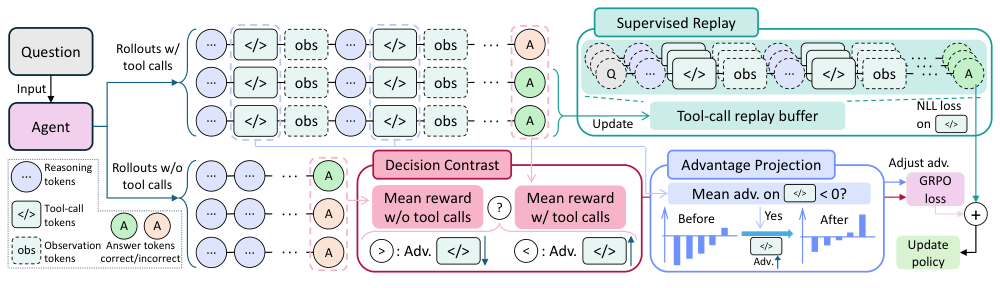
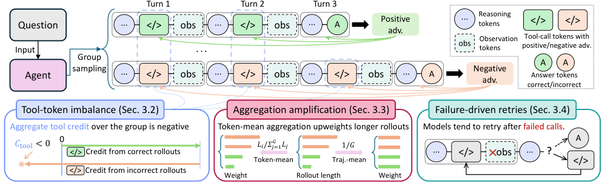
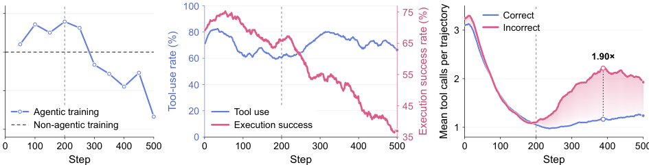
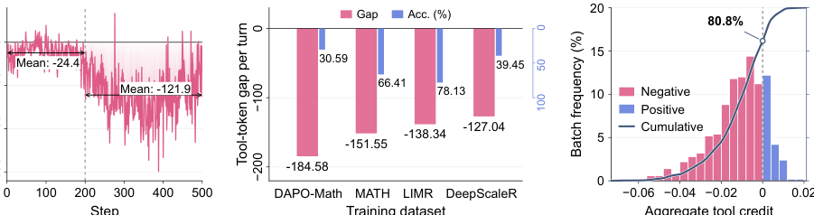
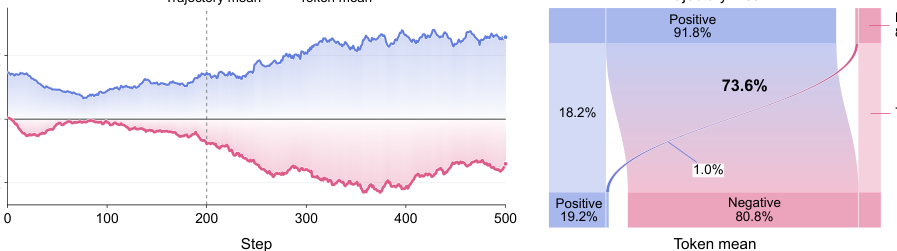
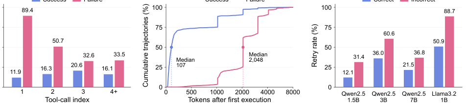
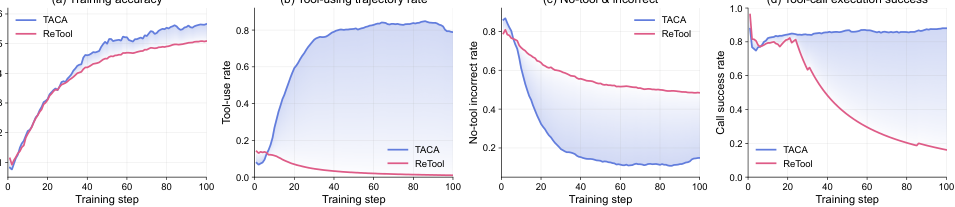
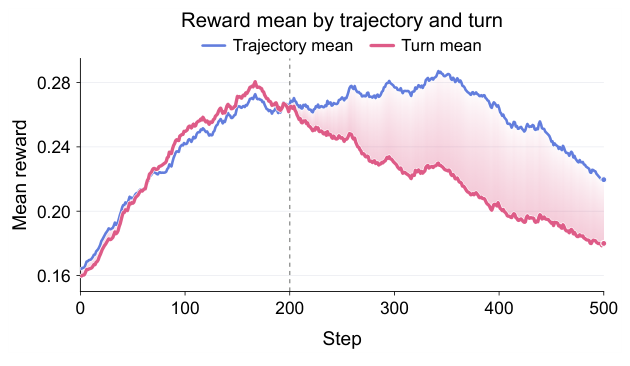
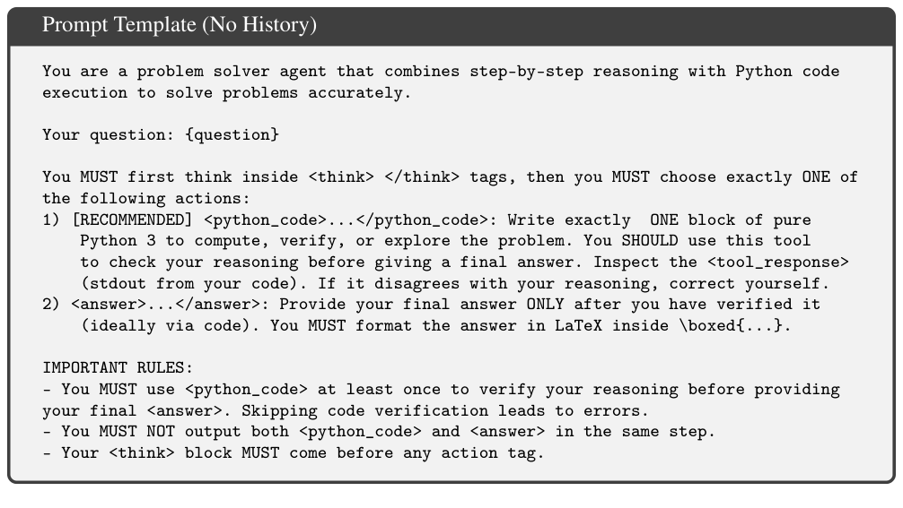
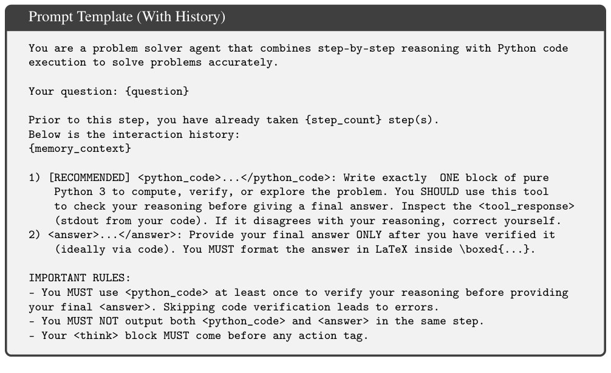

## 基础摘要


论文研究带可验证奖励的智能体强化学习在多轮工具交互中出现的性能与工具调用能力退化问题。作者指出，现有训练存在三个相互耦合的缺陷：错误轨迹每轮包含更多工具 token，导致工具信用整体为负；按 token 均值聚合又让较长错误轨迹获得更大更新权重；模型失败后倾向重试工具，进一步把负信用扩散到恢复步骤。为此提出转移感知信用分配 TACA，同时监督工具调用的发起与生成，并针对从推理到工具使用的转移做校正。其核心是把工具调用的发起与生成纳入同一信用分配框架，并用优势投影、决策对比和监督回放分别修正组内偏差、判断调用收益、复用成功调用经验。

## 论文结构图

<!--RAW-->
<figure class="paper-figure">
  
  <figcaption>图 6：TACA 总体结构。左侧对每个问题采样两条路径：含工具调用的 rollout（上）与不含工具调用的直接作答 rollout（下）；中间“决策对比”比较两种响应模式的平均奖励，以带符号的优势修正工具调用起始 token 与答案起始 token；“优势投影”检查工具调用 token 的平均优势是否为负，若为负则施加最小均匀偏移，使组内工具信用均值非负；右侧“监督回放”把最终答案正确轨迹中的工具调用上下文—响应对存入回放缓冲区，并以工具调用 token 的负对数似然进行辅助监督。三者与 GRPO 策略损失共同更新策略。</figcaption>
</figure>
<!--/RAW-->

## 中文完整翻译

### 当信用反过来对抗工具：智能体强化学习中的转移感知信用分配

**作者**：Xiangyu Lu¹、Zhanke Zhou¹、Jiazhe Ning¹,²、Chentao Cao¹、Jiangchao Yao³、Bo Han¹†

¹ 香港浸会大学计算机科学系 TMLR 组；² 北京大学；³ 上海交通大学协同媒体网络创新中心

† 通讯作者：Bo Han（bhanml@comp.hkbu.edu.hk）

第 40 届神经信息处理系统大会（NeurIPS 2026）  
arXiv:2611.11330v1 [cs.LG] · 2026 年 11 月 8 日

---

### 摘要

带可验证奖励的智能体强化学习通过多轮工具交互训练语言模型，但模型的推理性能与工具调用能力可能在训练过程中下降。作者将这种退化追溯到三个相互耦合的机制：（1）**工具 token 失衡**：当错误轨迹每轮包含的工具 token 多于正确轨迹时，工具调用的总体信用会变为负值；（2）**聚合放大**：token 均值聚合使较长的错误轨迹在策略更新中获得更大权重，从而进一步强化负信号；（3）**失败驱动重试**：模型在执行出错后倾向于再次调用工具，使轨迹被拉长，并把潜在的负信用扩展到恢复尝试上。为抵消这种抑制，作者提出**转移感知信用分配（Transition-Aware Credit Assignment，TACA）**，通过同时监督“是否发起调用”和“如何生成调用”，专门处理从推理到工具使用的转移。具体而言，TACA 使用**优势投影（Advantage Projection）**，通过最小的均匀平移，使每个提示组内工具调用 token 的平均优势非负；使用**决策对比（Decision Contrast）**，比较同一提示下工具辅助作答与直接作答的奖励，以指导工具使用决策；并通过**监督回放（Supervised Replay）**，利用此前采样到的正确轨迹中的调用，强化工具调用生成。跨模型、跨任务的实验表明，TACA 提升了性能，并在训练过程中维持更可靠的工具交互；在六个推理基准上，相较 MT-GRPO，Qwen2.5-1.5B 的平均准确率提高 4.61 个百分点，Qwen2.5-3B 提高 3.61 个百分点。代码见 https://github.com/tmlr-group/TACA。

---

### 1 引言

带可验证奖励的强化学习（RLVR）以最终答案正确性作为终端奖励，已经提升了语言模型的推理能力 [2, 39, 34, 10, 37, 56, 54, 14, 49, 47]。智能体 RLVR 将这一范式扩展到多轮工具交互场景：模型利用工具返回的观测来指导后续推理 [51, 18, 44, 5, 29, 58, 33, 36]。多轮组相对策略优化（Multi-turn Group Relative Policy Optimization，MT-GRPO）[34, 6, 26] 是智能体 RLVR 中广泛使用的方法，它把每条轨迹的终端奖励分配给该轨迹中每一个由模型生成的轮次。因此，在同一条轨迹内，调用工具的 token 与依据工具输出进行推理的 token 共享同一个优势值。

尽管取得了上述进展，智能体强化学习系统仍被反复报告存在训练不稳定性 [51, 44, 42, 4, 50, 9, 55, 3]。具体表现为：推理准确率可能在训练早期提升，随后跌到非智能体基线以下。在这一下降过程中，工具使用率可能大体保持稳定，但成功执行的调用比例却在缩小。模型在当轮就能观察到一次调用是否成功，但 MT-GRPO 却依据可能在若干轮之后才出现的最终答案，给这次调用分配信用。在这种信用分配方式下，同一次成功调用如果在最终正确的轨迹中就会被强化，而在最终错误的轨迹中却会被抑制。这引出了一个自然的问题：正向与负向的工具调用信用在不同轨迹之间究竟如何合并？这种合并能否解释为何工具执行与推理性能会随训练持续而退化？

因此，作者分析了 MT-GRPO 中正负优势如何在构成工具调用的 token 上合并（图 1）。研究表明：当错误轨迹每个生成轮次包含的工具调用 token 多于正确轨迹时，即使正确轨迹占多数，这种**工具 token 失衡**仍会使工具调用的总体信用为负。此外，**聚合放大**会增强这一负信号：token 均值聚合使较长的错误轨迹在策略更新中获得比等轨迹加权更大的权重。最后，工具调用失败后，模型倾向于在下一轮重试；这些**失败驱动重试**更频繁地出现在错误轨迹中，而每增加一个工具调用轮次，负信用就会进一步扩展到恢复尝试上，并使该轨迹在策略更新中占据更大权重。

基于这些发现，作者提出 **TACA**，在 MT-GRPO 的基础上，为“从推理到工具使用”的转移增加有针对性的监督。TACA 同时训练两个环节：是否寻求外部反馈的决策，以及决定模型下一步能看到什么内容的调用生成。具体而言，优势投影在不破坏同一提示组内依赖奖励的优势差异的前提下，抵消工具调用 token 上的负平均优势；决策对比通过比较同一提示下使用工具与直接作答轨迹的奖励，指导工具使用决策；监督回放则在多次策略更新之间，复用此前采样到的工具调用作为监督目标。三者结合，使推理到工具交互的转移能够利用超出单条轨迹最终结果之外的信息进行训练。

作者在四个 Qwen 与 Llama 模型上，跨数学推理、代码生成和决策任务评估 TACA。TACA 在 Qwen2.5-1.5B 与 3B 的基线比较中取得最高平均准确率，并在 Qwen2.5-7B 与 Llama-3.2-1B 上优于轮级 GRPO。以 Qwen2.5-1.5B 为例，TACO 单元测试得分从 41.98 提升到 53.70，WebShop 成功率从 56.8% 提升到 67.2%。这些增益伴随着训练期间更可靠的工具有效执行；消融实验支持优势调整与回放监督各自发挥互补作用。

本文的主要贡献如下：

- 作者识别出**负的聚合工具信用**是多轮 GRPO 中训练退化的一个机制。分析将其出现与工具 token 失衡联系起来，并说明长度加权会放大其影响、失败驱动重试会扩展负监督（第 3 节）。
- 作者提出 **TACA**，一种转移感知目标：通过修正负的聚合工具信用、利用奖励对比指导工具使用决策、并通过回放监督维持工具使用能力，联合优化工具使用决策与工具调用生成（第 4 节）。
- 作者证明 TACA 在多个模型家族和任务上稳定优于现有 RL 方法，任务涵盖数学推理、代码生成和决策；随着训练推进，TACA 还能维持推理性能与工具执行可靠性（第 5 节）。

---

### 2 预备知识

**多轮 rollout 与优势。** 在多轮交互中，每个由模型生成的轮次可以包含推理、工具调用或答案；工具返回的观测会进入上下文，供后续轮次使用。对于每个提示 $x$，固定的 rollout 策略 $\pi_{\theta_{\mathrm{old}}}$ 采样 $G$ 条轨迹 $\{\tau_i\}_{i=1}^{G}$，其中轨迹 $\tau_i$ 包含 $S_i$ 个生成轮次，并获得一个有界的标量终端奖励 $R_i$。

组相对策略优化（GRPO）[34] 通过在每个提示的样本组内对奖励做标准化来计算优势。本文研究采用轮级奖励标准化的多轮 GRPO（MT-GRPO）[26, 6, 59, 30, 17, 43]：在标准化之前，每条轨迹的奖励 $R_i$ 会先复制到它的 $S_i$ 个轮次上。令 $M=\sum_i S_i$ 为总轮次数，则奖励均值与方差为

$$
\mu_{\mathrm{turn}}=\frac{1}{M}\sum_i S_iR_i,\qquad
\sigma_{\mathrm{turn}}^2=\frac{1}{M}\sum_i S_i\left(R_i-\mu_{\mathrm{turn}}\right)^2. \tag{1}
$$

随后，$\tau_i$ 中每个生成 token 都获得相同的优势

$$
A_i^{\mathrm{turn}}=\frac{R_i-\mu_{\mathrm{turn}}}{\sigma_{\mathrm{turn}}}.
$$

**Token 均值策略目标。** 令 $\ell_{i,h}$ 表示轨迹 $i$ 的第 $h$ 个轮次中被目标函数计分的生成 token 数，令 $N=\sum_i\sum_{h=1}^{S_i}\ell_{i,h}$ 为总 token 数。观测只提供上下文，不参与目标函数。本文采用 token 均值聚合 [54, 23, 18, 51, 48]。当前策略 $\pi_\theta$ 最大化在这 $N$ 个 token 上平均的目标：

$$
J_{\mathrm{MT\text{-}GRPO}}(\pi_\theta)\triangleq
\frac{1}{N}\sum_{i=1}^{G}\sum_{h=1}^{S_i}\sum_{t=1}^{\ell_{i,h}}
\left[\phi\left(\rho_{i,h,t},A_i^{\mathrm{turn}}\right)
-\beta D_{\mathrm{KL}}\left[\pi_\theta\,\|\,\pi_{\mathrm{ref}}\right]_{i,h,t}\right]. \tag{2}
$$

其中，$\rho_{i,h,t}$ 是当前策略相对于 rollout 策略的 token 级重要性采样比。裁剪代理目标为 $\phi(\rho,a)=\min\{\rho a,\operatorname{clip}(\rho,1-\varepsilon,1+\varepsilon)a\}$，其中 $a$ 为优势，$\varepsilon$ 为裁剪阈值。KL 惩罚的权重为 $\beta$，参考策略 $\pi_{\mathrm{ref}}$ 固定不变。

---

### 3 理解多轮 GRPO 中的训练退化

作者分析终端奖励监督、奖励标准化和目标聚合如何决定工具交互上的信用。首先推导标量信用与轨迹加权之间的关系，然后考察重试行为如何贡献于这些效应。详细推导见附录 F。

#### 3.1 训练退化与工具交互

多轮智能体 RL 中的训练不稳定性已在近期多个系统中被记录 [51, 18, 44, 42, 4, 50, 9, 55, 3, 11]。作者在一个广泛采用的工具集成推理设置中复现了这种退化：在 DAPO-Math 上使用 MT-GRPO 训练 Qwen2.5-3B-Instruct。经过初期提升后，验证准确率开始下降，并跌到非智能体参考基线以下（图 2a）。与此同时，工具执行成功率下降，而工具使用率大体保持稳定（图 2b）；错误轨迹平均包含的工具调用多于正确轨迹（图 2c）。这些观察表明，训练退化与工具交互质量之间存在紧密联系。

> **图 1：训练退化的耦合机制。** 终端监督可能产生负的聚合工具信用。Token 均值聚合会通过提高较长错误 rollout 的权重，进一步放大这一信号；而重试会拉长这些 rollout，并把负信用扩展到恢复尝试上。

#### 3.2 终端奖励监督与负工具信用

MT-GRPO 将每条轨迹的终端奖励优势分配给其所有被计分 token。轮级标准化满足 $\sum_i S_iA_i^{\mathrm{turn}}=0$，从而在所有生成轮次之间平衡正负优势。但这种平衡可能在工具 token 上被打破：当错误轨迹每个轮次包含的工具 token 多于正确轨迹时，负系数会在聚合工具信用中占主导。

考虑一个同时包含正确轨迹（$R_i=1$）与错误轨迹（$R_i=0$）的提示组。令 $m_i$ 统计轨迹 $i$ 中构成工具调用的模型生成 token 数。令 $\bar m_{\mathrm{turn}}^{+}$ 与 $\bar m_{\mathrm{turn}}^{-}$ 分别表示正确轨迹与错误轨迹每个生成轮次平均包含的工具 token 数。

**命题 3.1（负工具信用条件）。** 在完全同策略设置下，奖励代理目标给轨迹 $i$ 中每个工具 token 的对数概率梯度分配系数 $A_i^{\mathrm{turn}}/N$。将这些系数求和可得

$$
C_{\mathrm{tool}}:=\frac{1}{N}\sum_i m_iA_i^{\mathrm{turn}}
=\frac{M\sigma_{\mathrm{turn}}}{N}
\left(\bar m_{\mathrm{turn}}^{+}-\bar m_{\mathrm{turn}}^{-}\right), \tag{3}
$$

其中 $M$ 表示生成轮次总数，$N$ 表示策略目标中包含的 token 总数。因此，$C_{\mathrm{tool}}<0$ 当且仅当错误轨迹每个生成轮次包含的工具 token 多于正确轨迹。

命题 3.1 表明，即使正确轨迹占多数，负工具信用仍可能出现。在一个混合结果的组内，每轮工具 token 数之差决定聚合信用的符号，而奖励构成也会影响其幅度。图 3a、3b 刻画了训练过程中以及不同准确率数据集上的这种失衡。在这类组内，终端奖励监督会把同一个负优势分配给错误轨迹中的每一次调用，包括那些在后续推理出错之前已经成功执行的调用。因此，工具调用信用被绑定到了可能发生在轨迹其他位置的失败上。在命题 3.1 的条件下，这些负贡献的总和会超过工具 token 上的正信用。

Token 均值聚合会按各提示组生成 token 总数对其信用加权；图 3c 使用每个提示组内计算得到的优势，测量由此产生的批次信用。

> **图 2：MT-GRPO 的训练动态。**（a）验证准确率先达到峰值，随后跌到非智能体参考线以下。（b）工具使用率大体稳定，但工具执行成功率下降。（c）错误轨迹的平均工具调用数上升，而正确轨迹相对稳定。

> **图 3：工具 token 上的负信用。**（a）每轮工具 token 差距 $\bar m_{\mathrm{turn}}^{+}-\bar m_{\mathrm{turn}}^{-}$ 在退化过程中变得越来越负。（b）在第 300 步，这一差距在不同准确率的训练数据集上均为负。（c）在大多数批次中，聚合工具信用 $C_{\mathrm{tool}}$ 为负。

#### 3.3 长度比例重加权

除了工具 token 失衡之外，聚合工具信用还取决于轨迹权重。作者分析 token 均值聚合相对于等轨迹加权所引入的偏移。

**工具信用聚合。** 令 $B$ 索引一个训练批次中的轨迹。对每个 $i\in B$，令 $L_i=\sum_{h=1}^{S_i}\ell_{i,h}>0$ 统计模型生成 token 数，$m_i$ 统计其中工具调用 token 数。若轮级优势 $A_i^{\mathrm{turn}}$ 在其提示组内计算，则该轨迹对每个生成 token 贡献工具信用 $(m_i/L_i)A_i^{\mathrm{turn}}$。Token 均值聚合按轨迹长度对这一贡献加权，而轨迹均值聚合对轨迹等权：

$$
C_{\mathrm{tool}}^{\mathrm{token}}
=\sum_{i\in B}\frac{L_i}{\sum_{j\in B}L_j}\frac{m_i}{L_i}A_i^{\mathrm{turn}},
\qquad
C_{\mathrm{tool}}^{\mathrm{traj}}
=\frac{1}{|B|}\sum_{i\in B}\frac{m_i}{L_i}A_i^{\mathrm{turn}}. \tag{4}
$$

**聚合诱导的信用偏移。** 两者之差分离出长度加权的影响：

$$
C_{\mathrm{tool}}^{\mathrm{token}}-C_{\mathrm{tool}}^{\mathrm{traj}}
=\frac{\operatorname{Cov}_{B}\left(L_i,\frac{m_i}{L_i}A_i^{\mathrm{turn}}\right)}
{\mathbb{E}_{B}[L_i]}, \tag{5}
$$

其中经验均值与协方差给每条轨迹分配权重 $1/|B|$。协方差决定信用偏移的方向：当较长轨迹每个生成 token 倾向于携带较低工具信用时，token 均值聚合会把聚合信用向下推。这种偏移会放大负信用，并且当其幅度超过 $C_{\mathrm{tool}}^{\mathrm{traj}}$ 时，会把正信用反转为负信用。

图 4a 展示了长度加权导致的向下信用偏移；图 4b 找出了工具信用由正变负的批次。在这些批次中，负的工具 token 系数在奖励代理目标中超过正系数，使更新方向转向惩罚已采样的工具调用。因此，长度加权会加剧第 3.2 节分析的抑制效应：它增强了负监督对工具交互的相对影响，包括对最终错误轨迹中成功执行的调用。

> **图 4：长度加权与聚合工具信用。**（a）相对于轨迹均值聚合，token 均值聚合把信用向下推。（b）长度加权使工具信用在 73.6% 的批次中由正变负。这使平衡转向惩罚已采样的工具调用。

#### 3.4 失败驱动重试

**以失败为条件的续写。** 造成这些信用失衡的轨迹，受到模型对执行错误之反应方式的塑造。一次重试会在终端奖励分配之前增加一个工具动作及其伴随推理。因此，执行结果会影响哪些后续动作进入训练样本，以及生成会持续多久。失败执行后更高的下一轮工具调用率（图 5a），以及首次执行失败后更长的续写（图 5b），支持了轨迹构成对中间结果的这种依赖。

**恢复尝试的终端监督。** 每一次决定重试，都会扩大共享整条完成轨迹终端奖励优势的动作集合。在一个混合结果的提示组中，最终错误的轨迹会把负优势同时分配给失败的调用和后续恢复尝试，包括那些执行成功的重试。图 5c 显示，在所有模型中，错误轨迹的重试率都更高，从而把恢复行为与决定信用的终端结果联系起来。因此，恢复行为会塑造后续监督：在一条不成功的轨迹中，每一次额外的恢复尝试都会增加接收相同负优势的工具动作。

> **图 5：重试行为与续写长度。**（a）失败执行之后，下一轮再次调用工具的概率高于成功执行之后。（b）首次执行失败与更长的后续生成相关。（c）在 MATH 上，四个模型的错误轨迹重试率均高于正确轨迹。

---

### 4 转移感知信用分配

受第 3 节启发，作者提出**转移感知信用分配（TACA）**，在 MT-GRPO 上增加 token 级优势修正与工具调用生成的辅助监督（图 6）。具体而言，TACA 抵消工具调用 token 上的负平均优势（优势投影），通过比较同一提示下使用工具与直接作答轨迹的奖励来指导工具使用决策（决策对比），并利用此前采样调用的辅助似然目标强化工具调用生成（监督回放）。

> **图 6：TACA 总览。** TACA 利用同一提示内使用工具与直接作答 rollout 的奖励统计，调整工具调用 token 与决策 token 的优势。这些调整以及来自正确轨迹的回放监督，共同指导工具使用决策与工具调用生成。

#### 4.1 优势投影

针对第 3 节识别出的负聚合信用，作者对工具相关 token 施加均匀的优势修正。对每个提示 $x$，令 $Z$ 表示其采样轨迹中构成工具调用的模型生成 token 集合，令 $A_i$ 表示轨迹 $i$ 的 GRPO 优势。作者计算这些 token 上的平均优势及相应修正：

$$
\bar A_{x,Z}=\frac{1}{|Z|}\sum_{(i,h,t)\in Z}A_i,
\qquad
b_{x,Z}=\max\{-\bar A_{x,Z},0\}, \tag{6}
$$

其中 $(i,h,t)$ 索引轨迹、轮次和 token 位置，$|Z|$ 是集合中工具调用 token 的数量。优势投影仅在 $Z$ 中的位置把 $A_i$ 替换为 $A_i+b_{x,Z}$。该修正把 $Z$ 上的聚合优势从 $|Z|\bar A_{x,Z}$ 变为 $|Z|\max\{\bar A_{x,Z},0\}$。因此，负聚合信用被中和，而正聚合信用保持不变。所得向量是原始工具调用优势向量到“均值非负”半空间上的欧氏投影。在同一组内，均匀偏移保留了轨迹 $i$ 与 $j$ 的工具 token 之间的优势差 $A_i-A_j$。因此，优势投影在强制聚合工具信用非负的同时，保留了这些依赖奖励的差异。

#### 4.2 决策对比

作者用一个奖励比较来补充工具信用修正，以指导“使用工具”还是“直接作答”的选择。对每个提示 $x$，令 $T_x$ 包含至少调用一次工具的采样轨迹，$N_x$ 包含不使用工具直接作答的轨迹。令 $\bar R_{T_x}$ 与 $\bar R_{N_x}$ 分别表示它们的平均终端奖励，每条轨迹只计一次。奖励对比定义为

$$
U_x=\frac{n_x}{n_x+\eta}\left(\bar R_{T_x}-\bar R_{N_x}\right),
\qquad
n_x=\min\{|T_x|,|N_x|\}. \tag{7}
$$

因子 $n_x/(n_x+\eta)$ 根据较小一组的大小收缩奖励对比；当任一奖励估计只基于少量轨迹时，这会限制修正幅度。参数 $\eta\ge 0$ 控制收缩强度；当任一组为空时，$U_x=0$。作者把这一对比施加到指定响应动作的 token 上，使修正集中在工具调用选择处。在每个提示组内，令 $Z_{\mathrm{dec}}$ 包含 $T_x$ 中构成工具调用起始标记（例如 `<python_code>`）的 token，令 $Z_{\mathrm{dir}}$ 包含 $N_x$ 中构成答案起始标记（例如 `<answer>`）的 token。决策对比分别给 $Z_{\mathrm{dec}}$ 与 $Z_{\mathrm{dir}}$ 中的 token 优势施加 $+U_x$ 与 $-U_x$ 的修正。

该修正使工具决策 token 与直接作答决策 token 的平均优势之差改变 $2U_x$。因此，工具使用获得更高的采样奖励时，工具决策 token 相对于直接作答决策 token 的优势会增加；直接作答获得更高奖励时，修正方向相反。这样，比较给出了针对具体提示的两种响应模式偏好，而每条轨迹对其所属模式的奖励估计贡献相同。

#### 4.3 监督回放

为在训练中保留工具调用生成能力，监督回放把此前采样到的调用复用为直接监督目标。每次策略更新时，作者把最终答案正确轨迹中工具调用轮次的上下文—响应对加入固定容量的回放缓冲区；容量超出时丢弃最旧条目。每个存储对 $(c,y)$ 由前序交互上下文 $c$（包括此前的工具观测）与包含工具调用的模型生成响应 $y$ 组成。作者从缓冲区均匀采样一个回放小批次 $D_{\mathrm{rep}}$。对每个响应 $y$，二值掩码 $m_t^{\mathrm{rep}}(c,y)$ 标出作为预测目标的工具调用 token。为训练当前策略 $\pi_\theta$ 在原始上下文中复现这些调用，作者最小化其平均负对数似然：

$$
\mathcal L_{\mathrm{rep}}(\theta)
=-\frac{1}{M_{\mathrm{rep}}}
\sum_{(c,y)\in D_{\mathrm{rep}}}\sum_{t=1}^{|y|}
m_t^{\mathrm{rep}}(c,y)\log\pi_\theta(y_t\mid c,y_{<t}), \tag{8}
$$

其中 $M_{\mathrm{rep}}$ 统计小批次中的工具调用 token 数，$y_t$ 与 $y_{<t}$ 分别表示当前 token 及前序响应 token。前序推理仍保留在条件上下文中。最小化该损失会在原始上下文下强化记录下来的工具调用续写。回放会在多次策略更新之间保留这些目标，因此随着 rollout 分布演化，成功轨迹仍能持续监督工具调用生成，与优势调整形成互补。

#### 4.4 训练目标

**转移感知优势。** 作者把投影偏移加到工具调用 token 优势上，并把带符号的决策对比信号加到决策 token 优势上，两者都作用于工具调用起始位置。对提示 $x$ 采样的轨迹 $i$ 中的 token $(i,h,t)$，原始优势 $A_i$ 变为

$$
\begin{aligned}
A_{i,h,t}^{\mathrm{TACA}}
={}&A_i
+\underbrace{b_{x,Z}\mathbf 1\{(i,h,t)\in Z\}}_{\text{优势投影}}\\
&+\underbrace{\lambda_{\mathrm{dc}}U_x
\left[\mathbf 1\{(i,h,t)\in Z_{\mathrm{dec}}\}
-\mathbf 1\{(i,h,t)\in Z_{\mathrm{dir}}\}\right]}_{\text{决策对比}},
\end{aligned} \tag{9}
$$

其中 $\mathbf 1\{\cdot\}$ 为指示函数，$\lambda_{\mathrm{dc}}\ge 0$ 控制决策对比的强度。

**策略优化。** TACA 优势进入 token 均值策略目标，并与辅助回放损失一起优化。对一个 rollout 批次，令 $S_i$ 表示轨迹 $i$ 的生成轮次数，$\ell_{i,h}$ 表示第 $h$ 轮中模型生成 token 数，$N=\sum_i\sum_{h=1}^{S_i}\ell_{i,h}$ 为总数。令 $\lambda_{\mathrm{rep}}\ge 0$ 为回放监督权重，策略最大化

$$
J_{\mathrm{TACA}}(\pi_\theta)
=\frac{1}{N}\sum_i\sum_{h=1}^{S_i}\sum_{t=1}^{\ell_{i,h}}
\left[\phi\left(\rho_{i,h,t},A_{i,h,t}^{\mathrm{TACA}}\right)
-\beta D_{\mathrm{KL}}\left[\pi_\theta\,\|\,\pi_{\mathrm{ref}}\right]_{i,h,t}\right]
-\lambda_{\mathrm{rep}}\mathcal L_{\mathrm{rep}}(\theta). \tag{10}
$$

在每个提示组内，TACA 保留接受相同调整的 token 之间依赖奖励的优势差异，同时允许推理与工具交互获得不同监督。当奖励对比偏好工具使用时，一条不成功的轨迹可以在工具发起位置获得向上调整；而来自正确轨迹的工具调用则通过回放提供跨更新监督。于是，从推理到工具交互的转移，能够借助响应比较以及正确轨迹的回放进行训练，使用超出单次 rollout 结果的信息。

---

### 5 实验

#### 5.1 实验设置

**训练设置。** 作者在 MATH [13] 上对 Qwen2.5-1.5B-Instruct、Qwen2.5-3B-Instruct、Qwen2.5-7B-Instruct [38] 与 Llama-3.2-1B-Instruct 进行后训练。多轮智能体训练使用 AlphaApollo [61]，以代码执行作为主要推理工具。训练使用四块 A800 GPU，每批 32 个提示，每个提示 8 条 rollout，学习率为 $10^{-6}$。轨迹最多包含六个生成轮次，每轮最多 2,048 个响应 token，执行超时为 3 秒。作者还分别在 TACO [20] 与 WebShop [52] 上训练 Qwen2.5-1.5B-Instruct，以评估代码生成与交互式决策。所有任务均使用终端奖励。

**评估设置。** 作者在 MATH500 [13]、AIME 2024、AIME 2025、AMC 2023、OlympiadBench [12] 与 GSM8K [2] 上评估。每个问题在温度 0.6、top-p 采样下采样 32 个响应，报告各基准准确率及其不加权平均。TACO 报告其测试集上的单元测试得分，WebShop 报告官方划分上的成功率与任务得分。

**基线。** 作者将 TACA 与非智能体 GRPO [34] 以及智能体方法 ReTool [5]、MT-GRPO [6]、GiGPO [6]、SimpleTIR [51] 比较。基座模型推理与智能体提示作为免训练参考。每个模型—任务对的训练与评估设置均匹配。TACA 与基线方法的更多实验细节见附录 I。

**表 1：后训练实验主结果（准确率，%）。加粗与下划线分别表示每个模型内的最佳与次佳结果。**

| 方法 | AIME24 | AIME25 | MATH500 | AMC23 | OlympiadBench | GSM8K | 平均 |
|---|---:|---:|---:|---:|---:|---:|---:|
| **Qwen2.5-1.5B-Instruct** | | | | | | | |
| *免训练* | | | | | | | |
| 基座模型 | 1.09 | 0.35 | 38.83 | 15.56 | 10.52 | 59.42 | 20.96 |
| 智能体提示 | 0.20 | 0.0 | 10.46 | 3.44 | 2.69 | 16.29 | 5.51 |
| *非智能体训练* | | | | | | | |
| GRPO | 3.03 | 0.69 | 50.10 | 26.02 | 17.60 | <u>72.55</u> | 28.33 |
| *智能体训练* | | | | | | | |
| ReTool | <u>3.81</u> | 1.08 | <u>51.90</u> | 27.34 | 16.65 | 70.74 | 28.59 |
| 轮级 GRPO | 3.26 | 0.97 | 50.70 | **27.50** | <u>17.88</u> | 71.49 | <u>28.63</u> |
| SimpleTIR | 3.04 | <u>1.38</u> | 49.54 | 22.99 | 17.39 | 70.48 | 27.47 |
| **TACA（本文）** | **8.43** | **8.12** | **59.14** | <u>27.42</u> | **22.20** | **74.15** | **33.24** |
| **Qwen2.5-3B-Instruct** | | | | | | | |
| *免训练* | | | | | | | |
| 基座模型 | 3.45 | 1.04 | 56.65 | 29.32 | 22.15 | 76.76 | 31.56 |
| 智能体提示 | 4.16 | 1.13 | 38.52 | 17.43 | 14.48 | 45.27 | 20.17 |
| *非智能体训练* | | | | | | | |
| GRPO | 5.55 | 2.29 | <u>62.45</u> | 41.02 | 24.99 | 81.94 | 36.37 |
| *智能体训练* | | | | | | | |
| ReTool | 6.04 | 6.62 | 61.03 | 36.59 | 27.34 | 82.95 | 36.76 |
| 轮级 GRPO | <u>13.57</u> | <u>11.21</u> | 58.87 | <u>47.67</u> | 28.51 | 79.57 | <u>39.90</u> |
| SimpleTIR | 10.76 | 9.51 | 61.37 | 41.16 | <u>31.67</u> | **83.52** | 39.67 |
| **TACA（本文）** | **15.56** | **15.00** | **64.51** | **47.96** | **34.62** | <u>83.42</u> | **43.51** |

**表 2：Qwen2.5-1.5B-Instruct 上的代码与交互任务表现。TACO 报告各来源单元测试得分及其不加权平均；WebShop 报告成功率（SR）与任务得分。**

| 方法 | HackerRank | HackerEarth | CodeForces | CodeChef | TACO 平均 | WebShop SR（%） | WebShop 得分 |
|---|---:|---:|---:|---:|---:|---:|---:|
| MT-GRPO | 59.80 | 25.00 | 48.13 | 34.98 | 41.98 | 56.80 | 75.80 |
| GiGPO | – | – | – | – | – | 65.00 | 83.10 |
| **TACA** | **64.71** | **50.00** | **58.98** | **41.12** | **53.70** | **67.20** | **85.80** |

#### 5.2 主要结果

**TACA 提升了智能体训练的有效性。** 表 1 显示，TACA 在 Qwen2.5-1.5B-Instruct 与 Qwen2.5-3B-Instruct 上均取得最高平均准确率，分别为 33.24% 与 43.51%，并在十二个模型—基准对中的十个取得最佳分数。单独使用智能体提示会降低相对基座模型的平均准确率，而 TACA 分别比非智能体 GRPO 高 4.91 与 7.14 个百分点。在智能体训练方法中，TACA 也比 MT-GRPO 高 4.61 与 3.61 个百分点。相较 MT-GRPO 的这些增益表明，TACA 使终端奖励监督更有效地学习工具辅助推理。

**推理增益扩展到高难度竞赛题。** 在 Qwen2.5-3B-Instruct 上，TACA 在 AIME 2024、AIME 2025 与 OlympiadBench 上分别超过最强竞争结果 1.99、3.79 与 2.95 个百分点（表 1）。相对增益在 1.5B 模型上尤其明显：AIME 2024 从最强基线的 3.81% 提升到 8.43%，AIME 2025 从 1.38% 提升到 8.12%。由此得到的 1.5B TACA 策略在两个 AIME 基准上也优于更大的 3B ReTool 模型。这一比较表明，更好的智能体训练可以帮助较小模型在困难推理任务上缩小与较大模型的差距。

**TACA 提升不同代码题来源的功能正确性。** 表 2 比较了 TACO 测试集上的代码策略。TACA 将平均单元测试得分从 41.98 提升到 53.70，并在 HackerRank、HackerEarth、CodeForces 与 CodeChef 四个来源上均有所提升，增益从 HackerRank 的 4.91 分到 HackerEarth 的 25.00 分。当训练信号衡量生成程序的功能正确性时，TACA 的训练目标仍然有效。

**TACA 提升交互式决策中的成功完成率。** 在 WebShop 上，相较于 MT-GRPO，TACA 将成功率从 56.8% 提升到 67.2%，任务得分从 75.8 提升到 85.8（表 2）。它也比 GiGPO 的成功率高 2.2 个百分点、任务得分高 2.7 分。这一联合提升把更高的任务奖励与更多完成目标联系起来；在该环境中，动作决定后续观测。因此，转移感知训练的收益也扩展到基于外部环境反馈的序贯决策。结合 TACO 的结果，这说明 TACA 适用于不同动作空间与终端奖励函数。

> **图 7：Qwen2.5-1.5B-Instruct 上的训练动态。**（a）两种方法都提升了训练准确率。（b）TACA 维持了可观的工具使用率。（c）TACA 的无工具失败比例更小。（d）TACA 记录的执行成功指标更高。附录 I.5 定义了这些指标及平滑方式。

#### 5.3 训练动态

**TACA 在提升训练准确率的同时保留工具使用。** 图 7a、7b 比较了 Qwen2.5-1.5B-Instruct 上的学习进度与交互行为。两种方法都提升了训练准确率，但工具使用率朝相反方向演化：TACA 维持可观的工具使用，而 ReTool 越来越多地不使用工具直接作答。这一分歧改变了哪些动作与环境响应会进入后续训练批次。终端奖励提升可能伴随工具交互的丧失，因此 rollout 构成对于评估智能体学习至关重要。TACA 在取得表 1 中更强留出集性能的同时，维持了交互式策略。

**使用工具的轨迹占成功解的大多数。** 图 7c 显示，TACA 采样到的“既不用工具又答错”的轨迹更少。联合 rollout 统计进一步把这一变化与成功推理联系起来：在展示的训练窗口内，使用工具且正确的轨迹占全部 TACA 轨迹的 42.00%，占其正确轨迹的 87.34%（附录 I.5）。因此，持续存在的工具使用模式在训练批次中提供了大量正确交互轨迹。随着训练推进，工具交互仍嵌入模型的成功解题策略之中。这将图 7b 中维持的动作支持与图 7（a）、（c）中的任务结果联系起来。

**持续交互提供了可执行的工具调用。** 图 7d 在工具使用动态之外跟踪记录的执行成功指标。在同一训练窗口内汇总实际调用，TACA 在 54,924 次调用中成功执行 47,391 次，执行成功率为 86.28%；ReTool 为 79.45%（附录 I.5）。因此，采样到的交互持续提供可执行动作与环境响应。TACA 同时维持了工具交互的可用性与执行工具的能力，保留了从外部反馈中学习的机会。

#### 5.4 消融研究

**两种优势调整都在回放监督之外有所贡献。** 表 3 在 Qwen2.5-1.5B 上逐一移除 TACA 的一个组件。移除优势投影使平均准确率从 33.24% 降至 30.27%；移除决策对比使其降至 30.58%。两种移除都降低了每个基准的准确率，其中 MATH500 分别下降 5.40 与 5.79 个百分点。由于两个变体仍保留监督回放，这些比较分离出了在回放存在时每种优势调整的增益。对工具调用优势做投影，以及通过奖励比较指导工具使用决策，都能在回放监督之外提升性能。这支持把工具调用信用与响应模式选择视为优化的互补部分。

**监督回放为两种优势调整都带来额外增益。** 移除监督回放使平均准确率降低 3.03 个百分点，并降低全部六个基准分数（表 3）。最大损失出现在 MATH500、AIME24 与 AIME25，分别为 6.46、4.85 与 4.76 个百分点。在两种优势调整均启用时，回放为跨策略更新的已存储调用增加监督。回放监督通过在不断变化的 rollout 分布中保留工具调用生成的学习信号，补充了基于奖励的信用分配。完整方法把这种持续监督与当前批次提供的提示特定调整结合起来。

**表 3：Qwen2.5-1.5B-Instruct 上的组件消融（准确率，%）。**

| 变体 | MATH500 | AIME24 | AIME25 | AMC23 | OlympiadBench | GSM8K | 平均 | Δ平均 |
|---|---:|---:|---:|---:|---:|---:|---:|---:|
| TACA（完整） | 59.14 | 8.43 | 8.12 | 27.42 | 22.20 | 74.15 | 33.24 | – |
| 去掉优势投影 | 53.74 | 6.55 | 3.49 | 25.98 | 19.16 | 72.71 | 30.27 | −2.97 |
| 去掉决策对比 | 53.35 | 6.74 | 5.24 | 26.58 | 18.89 | 72.67 | 30.58 | −2.66 |
| 去掉监督回放 | 52.68 | 3.58 | 3.36 | 27.31 | 20.95 | 73.37 | 30.21 | −3.03 |

**表 4：不同模型规模与模型家族的数学推理准确率（%）。平均为六个基准的均值；加粗表示每个模型内的最佳结果。**

| 方法 | MATH500 | AIME24 | AIME25 | AMC23 | OlympiadBench | GSM8K | 平均 |
|---|---:|---:|---:|---:|---:|---:|---:|
| **Qwen2.5-7B-Instruct** | | | | | | | |
| MT-GRPO | 68.92 | 11.86 | 8.02 | 44.11 | 33.77 | 88.84 | 42.59 |
| **TACA** | **70.77** | **18.35** | **13.43** | **47.78** | **36.97** | 88.51 | **45.97** |
| **Llama-3.2-1B-Instruct** | | | | | | | |
| MT-GRPO | 24.04 | 0.79 | 0.00 | 10.12 | 5.14 | 41.58 | 13.61 |
| **TACA** | **28.07** | **1.74** | **0.31** | **10.93** | **6.42** | **43.54** | **15.17** |

**增益跨模型规模与模型家族持续存在。** 表 4 把 MT-GRPO 比较扩展到 Qwen2.5-7B-Instruct 与 Llama-3.2-1B-Instruct。TACA 把 7B 模型的平均准确率从 42.59% 提升到 45.97%，把 Llama 从 13.61% 提升到 15.17%，并分别在六个基准中的五个以及全部六个基准上取得提升。这些结果补充了 1.5B 与 3B 的比较：平均增益在全部四个评估模型上都成立。随着模型容量增加以及底层模型家族改变，转移感知信用分配仍然有用。

---

### 6 相关工作

**面向大语言模型的智能体学习。** 智能体大语言模型把推理与工具交互、迭代反馈结合起来，利用观测与批评指导后续生成 [53, 35, 27, 8]。工具使用行为可以通过自监督、示范和人类反馈学习 [31, 28]；策略梯度方法则利用任务奖励优化推理策略 [32, 34, 54]。监督可以通过学习到的验证器评估完整解 [2]，也可以通过过程反馈评估中间推理步骤 [39, 24]。近期工作把强化学习扩展到多轮工具使用与交互环境：生成的动作决定后续推理可用的观测 [51, 18, 44, 5, 58, 33, 36, 57]。在这些系统中，奖励设计与信用分配决定了任务反馈如何监督导致结果的动作序列 [29, 6, 42, 55]。

**智能体 RL 中的训练退化与崩溃。** 智能体 RL 中的训练退化会同时影响交互行为与策略优化。已报告的模式包括空轮次与梯度尖峰 [51, 42]、重复推理与探索减少 [44, 55]、不稳定的熵动态 [50, 4]，以及响应似然下降 [3]。稳定化方法会调整策略更新的粒度并控制离策略方差 [19, 9]，而局部信用分配方法会细化各个交互步骤收到的学习信号 [6, 46, 40]。相关研究考察探索与多任务训练如何影响可用于学习的轨迹 [57, 18]。本文分析把 rollout 结构同分配给工具调用 token 的聚合终端奖励信用联系起来。作者刻画了这种信用何时变为负值，以及轨迹加权和失败驱动重试如何在多轮优化中影响其分配。附录 E 提供详细讨论。

---

### 7 结论

作者通过分配给工具交互的信用，分析了多轮智能体强化学习中的训练退化。在 MT-GRPO 中，当错误轨迹每轮包含的工具 token 多于正确轨迹时，可能产生负的聚合工具信用。Token 均值聚合会通过长度加权放大这种失衡；失败驱动重试则把终端监督扩展到后续恢复尝试，包括成功的工具执行。基于这些发现，作者提出转移感知信用分配（TACA），调整工具调用生成与工具使用决策的优势，并通过回放维持监督。跨模型规模、模型家族和任务的实验展示了性能提升与持续的工具交互，消融实验支持优势调整与回放监督的互补贡献。这些发现表明，终端奖励训练的有效性取决于信用如何分配到推理与工具交互之间的中间转移。

---

### 致谢

XYL、ZKZ、JZN、CTC 与 BH 得到国家自然科学基金重大研究计划（No. 92570109）、RGC Research Fellow Scheme（No. RFS2627-2S02）、RGC Young Collaborative Research Grant（No. C2005-24Y）、RGC General Research Fund（No. 12202026、No. 12200725）、国家自然科学基金面上项目（No. 62376235）、粤港高校“1+1+1”联合科研合作计划、香港浸会大学 Faculty Niche Research Areas（No. RC-FNRA-IG/25-26/SCI/05）以及 HKBU CSD Departmental Incentive Scheme 的支持。JCY 得到国家自然科学基金（No. 62676245）、临港实验室（Grant No. LGL-8889-01）、STCSM（No. 22DZ2229005）与 111 计划（No. BP0719010）的支持。

---

### 参考文献

> 说明：为便于检索，文献题名与会议/期刊名保留原文，作者列表从略者以“等”表示。

[1] Chentao Cao, Xiaojun Xu, Bo Han, Hang Li. Reasoned safety alignment: Ensuring jailbreak defense via answer-then-check. ICLR, 2026.

[2] Karl Cobbe, Vineet Kosaraju, Mohammad Bavarian, 等. Training verifiers to solve math word problems. arXiv:2110.14168, 2021.

[3] Wenlong Deng, Yushu Li, Boying Gong, 等. On group relative policy optimization collapse in agent search: The lazy likelihood-displacement. ICLR 2026 Workshop on Lifelong Agents, 2026. arXiv:2512.04220.

[4] Guanting Dong, Licheng Bao, Zhongyuan Wang, 等. Agentic entropy-balanced policy optimization. arXiv:2510.14545, 2025.

[5] Jiazhan Feng, Shijue Huang, Xingwei Qu, 等. ReTool: Reinforcement learning for strategic tool use in LLMs. arXiv:2504.11536, 2025.

[6] Lang Feng, Zhenghai Xue, Tingcong Liu, Bo An. Group-in-group policy optimization for LLM agent training. arXiv:2505.10978, 2025.

[7] Xiao Feng, Bo Han, Zhanke Zhou, 等. RewardFlow: Topology-aware reward propagation on state graphs for agentic RL with large language models. arXiv:2603.18859, 2026.

[8] Zhibin Gou, Zhihong Shao, Yeyun Gong, 等. CRITIC: Large language models can self-correct with tool-interactive critiquing. arXiv:2305.11738, 2024.

[9] Chenyang Gu, Yewen Pu, Bruce Yang, 等. DSPO: Stable and efficient policy optimization for agentic search and reasoning. arXiv:2510.09255, 2026.

[10] Daya Guo, Dejian Yang, Haowei Zhang, 等. DeepSeek-R1 incentivizes reasoning in LLMs through reinforcement learning. Nature, 645(8081):633–638, 2025.

[11] Yupu Hao, Zhuoran Jin, Huanxuan Liao, Kang Liu, Jun Zhao. Why multi-step tool-use reinforcement learning collapses and how supervisory signals fix it. arXiv:2606.26027, 2026.

[12] Chaoqun He, Renjie Luo, Yuzhuo Bai, 等. OlympiadBench: A challenging benchmark for promoting AGI with olympiad-level bilingual multimodal scientific problems. ACL, 2024.

[13] Dan Hendrycks, Collin Burns, Saurav Kadavath, 等. Measuring mathematical problem solving with the MATH dataset. arXiv:2103.03874, 2021.

[14] Jingcheng Hu, Yinmin Zhang, Qi Han, 等. Open-Reasoner-Zero: An open source approach to scaling up reinforcement learning on the base model. arXiv:2503.24290, 2025.

[15] Tangyu Jiang, Haodi Wang, Rongfang Bie. MeCo: Zero-shot NAS with one data and single forward pass via minimum eigenvalue of correlation. NeurIPS, 36:61020–61047, 2023.

[16] Tangyu Jiang, Haodi Wang, Rongfang Bie, Chun Yuan. Accelerating zero-shot NAS with feature map-based proxy and operation scoring function. IEEE TPAMI, 47(11):9876–9893, 2025.

[17] Yulun Jiang, Liangze Jiang, Damien Teney, Michael Moor, Maria Brbić. Meta-RL induces exploration in language agents. arXiv:2512.16848, 2025.

[18] Bowen Jin, Hansi Zeng, Zhenrui Yue, 等. Search-R1: Training LLMs to reason and leverage search engines with reinforcement learning. arXiv:2503.09516, 2025.

[19] Chenliang Li, Adel Elmahdy, Alex Boyd, 等. Stabilizing off-policy training for long-horizon LLM agent via turn-level importance sampling and clipping-triggered normalization. arXiv:2511.20718, 2026.

[20] Rongao Li, Jie Fu, Bo-Wen Zhang, 等. TACO: Topics in Algorithmic COde generation dataset. arXiv:2312.14852, 2023.

[21] Xuan Li, Zhanke Zhou, Zongze Li, 等. Learning to evolve: Open-ended molecular optimization with progress-shaped RL. AI for Math Workshop, 2026.

[22] Xuan Li, Zhanke Zhou, Zongze Li, 等. Reference-guided policy optimization for molecular optimization via LLM reasoning. ICLR, 2026.

[23] Xuefeng Li, Haoyang Zou, Pengfei Liu. ToRL: Scaling tool-integrated RL. arXiv:2503.23383, 2025.

[24] Hunter Lightman, Vineet Kosaraju, Yuri Burda, 等. Let's verify step by step. ICLR, 2024.

[25] Zichen Liu, Changyu Chen, Wenjun Li, 等. Understanding R1-Zero-like training: A critical perspective. arXiv:2503.20783, 2025.

[26] Xufang Luo, Yuge Zhang, Zhiyuan He, 等. Agent Lightning: Train ANY AI agents with reinforcement learning. arXiv:2508.03680, 2025.

[27] Aman Madaan, Niket Tandon, Prakhar Gupta, 等. Self-Refine: Iterative refinement with self-feedback. NeurIPS, 2023.

[28] Reiichiro Nakano, Jacob Hilton, Suchir Balaji, 等. WebGPT: Browser-assisted question-answering with human feedback. arXiv:2112.09332, 2022.

[29] Cheng Qian, Emre Can Acikgoz, Qi He, 等. ToolRL: Reward is all tool learning needs. arXiv:2504.13958, 2025.

[30] Yulei Qin, Xiaoyu Tan, Zhengbao He, 等. Learn the ropes, then trust the wins: Self-imitation with progressive exploration for agentic reinforcement learning. arXiv:2509.22601, 2025.

[31] Timo Schick, Jane Dwivedi-Yu, Roberto Dessì, 等. Toolformer: Language models can teach themselves to use tools. NeurIPS, 36:68539–68551, 2023.

[32] John Schulman, Filip Wolski, Prafulla Dhariwal, Alec Radford, Oleg Klimov. Proximal policy optimization algorithms. arXiv:1707.06347, 2017.

[33] Ning Shang, Yifei Liu, Yi Zhu, 等. rStar2-Agent: Agentic reasoning technical report. arXiv:2508.20722, 2025.

[34] Zhihong Shao, Peiyi Wang, Qihao Zhu, 等. DeepSeekMath: Pushing the limits of mathematical reasoning in open language models. arXiv:2402.03300, 2024.

[35] Noah Shinn, Federico Cassano, Ashwin Gopinath, Karthik Narasimhan, Shunyu Yao. Reflexion: Language agents with verbal reinforcement learning. NeurIPS, 36:8634–8652, 2023.

[36] Joykirat Singh, Raghav Magazine, Yash Pandya, Akshay Nambi. Agentic reasoning and tool integration for LLMs via reinforcement learning. arXiv:2505.01441, 2025.

[37] Kimi Team, Angang Du, Bofei Gao, 等. Kimi k1.5: Scaling reinforcement learning with LLMs. arXiv:2501.12599, 2025.

[38] Qwen Team. Qwen2.5 technical report. arXiv:2412.15115, 2024.

[39] Jonathan Uesato, Nate Kushman, Ramana Kumar, 等. Solving math word problems with process- and outcome-based feedback. arXiv:2211.14275, 2022.

[40] Guoqing Wang, Sunhao Dai, Guangze Ye, 等. Information gain-based policy optimization: A simple and effective approach for multi-turn search agents. arXiv:2510.14967, 2026.

[41] Hongru Wang, Rui Wang, Jushi Kai, 等. Self-Sum: Teaching an agent to decide itself when and what to summarize. Findings of ACL 2026, pages 9178–9192.

[42] Ruiyi Wang, Prithviraj Ammanabrolu. A practitioner's guide to multi-turn agentic reinforcement learning. arXiv:2510.01132, 2025.

[43] Zhitong Wang, Songze Li, Hao Peng, 等. EnvRL: Learn from environment dynamics in agentic reinforcement learning. arXiv:2606.17680, 2026.

[44] Zihan Wang, Kangrui Wang, Qineng Wang, 等. RAGEN: Understanding self-evolution in LLM agents via multi-turn reinforcement learning. arXiv:2504.20073, 2025.

[45] Jason Wei, Xuezhi Wang, Dale Schuurmans, 等. Chain-of-thought prompting elicits reasoning in large language models. NeurIPS, 35:24824–24837, 2022.

[46] Quan Wei, Siliang Zeng, Chenliang Li, 等. Reinforcing multi-turn reasoning in LLM agents via turn-level reward design. arXiv:2505.11821, 2025.

[47] Xumeng Wen, Zihan Liu, Shun Zheng, 等. Reinforcement learning with verifiable rewards implicitly incentivizes correct reasoning in base LLMs. arXiv:2506.14245, 2025.

[48] Zhiheng Xi, Jixuan Huang, Chenyang Liao, 等. AgentGym-RL: Training LLM agents for long-horizon decision making through multi-turn reinforcement learning. arXiv:2509.08755, 2025.

[49] Tian Xie, Zitian Gao, Qingnan Ren, 等. Logic-RL: Unleashing LLM reasoning with rule-based reinforcement learning. arXiv:2502.14768, 2025.

[50] Wujiang Xu, Wentian Zhao, Zhenting Wang, 等. EPO: Entropy-regularized policy optimization for LLM agents reinforcement learning. arXiv:2509.22576, 2026.

[51] Zhenghai Xue, Longtao Zheng, Qian Liu, 等. SimpleTIR: End-to-end reinforcement learning for multi-turn tool-integrated reasoning. arXiv:2509.02479, 2025.

[52] Shunyu Yao, Howard Chen, John Yang, Karthik Narasimhan. WebShop: Towards scalable real-world web interaction with grounded language agents. arXiv:2207.01206, 2022.

[53] Shunyu Yao, Jeffrey Zhao, Dian Yu, 等. ReAct: Synergizing reasoning and acting in language models. arXiv:2210.03629, 2023.

[54] Qiying Yu, Zheng Zhang, Ruofei Zhu, 等. DAPO: An open-source LLM reinforcement learning system at scale. arXiv:2503.14476, 2025.

[55] Zhaochen Yu, Ling Yang, Jiaru Zou, Shuicheng Yan, Mengdi Wang. Demystifying reinforcement learning in agentic reasoning. arXiv:2510.11701, 2025.

[56] Weihao Zeng, Yuzhen Huang, Qian Liu, 等. SimpleRL-Zoo: Investigating and taming zero reinforcement learning for open base models in the wild. arXiv:2503.18892, 2025.

[57] Hanchen Zhang, Xiao Liu, Bowen Lv, 等. AgentRL: Scaling agentic reinforcement learning with a multi-turn, multi-task framework. arXiv:2510.04206, 2025.

[58] Shaokun Zhang, Yi Dong, Jieyu Zhang, 等. Nemotron-Research-Tool-N1: Exploring tool-using language models with reinforced reasoning. arXiv:2505.00024, 2025.

[59] Zijing Zhang, Ziyang Chen, Mingxiao Li, Zhaopeng Tu, Xiaolong Li. RLVMR: Reinforcement learning with verifiable meta-reasoning rewards for robust long-horizon agents. arXiv:2507.22844, 2025.

[60] Zhanke Zhou, Rong Tao, Jianing Zhu, 等. Can language models perform robust reasoning in chain-of-thought prompting with noisy rationales? NeurIPS, 37:123846–123910, 2024.

[61] Zhanke Zhou, Chentao Cao, Xiao Feng, 等. AlphaApollo: A system for deep agentic reasoning. arXiv:2510.06261, 2025.

[62] Zhanke Zhou, Xiao Feng, Zhaocheng Zhu, 等. From passive to active reasoning: Can large language models ask the right questions under incomplete information? ICML, 2025.

[63] Zhanke Zhou, Zongze Li, Weikai Huang, 等. AlphaDiana: A measurement system for agents in verifiable reasoning tasks. arXiv:2610.20675, 2026.

[64] Zhanke Zhou, Xiangyu Lu, Chentao Cao, 等. The easy, the hard, and the learnable: Confidence and difficulty-adaptive policy optimization for LLM reasoning. arXiv:2606.07950, 2026.

[65] Zhanke Zhou, Zhaocheng Zhu, Xuan Li, 等. Landscape of thoughts: Visualizing the reasoning process of large language models. ICLR, 2026.

---

### 附录

#### A 伦理声明

本研究使用现有基准考察面向工具使用语言模型的强化学习。实验采用自动化任务评估，不涉及人类参与者。

#### B 大语言模型使用披露

本稿在撰写过程中使用了大语言模型辅助，用于润色内容与确保语法准确。作者对稿件全部内容承担完全责任。

#### C 影响声明

本工作为带工具使用的多轮智能体强化学习中的训练崩溃提供了诊断性解释与缓解方法。通过识别“转移盲目的信用分配”这一结构性原因，并提出转移感知信用分配（TACA），作者希望使语言模型的智能体后训练更可靠、更可复现，减少在悄然崩溃的训练运行上浪费的算力，并降低较小研究组开发工具使用推理系统的门槛。

#### D 局限性

实验覆盖数学推理、TACO 代码生成与 WebShop，使用最多 7B 的 Qwen 模型以及 Llama-3.2-1B。更大模型、长时程软件工程、多智能体协同以及不同训练随机种子间的波动，都是后续评估方向。奖励对比依赖足够的采样支持，监督回放依赖所记录工具调用的质量。研究完整正则化目标的收敛性，是理论发展的一个方向。

#### E 相关工作

**推理与结果监督。** 思维链提示能够引出中间推理步骤 [45]。示范理由中的错误会降低答案准确率 [60]，对采样推理路径进行可视化可以揭示正确解与错误解在何处分叉 [65]。在完整解层面，学习到的验证器按预测正确性对候选排序 [2]。PPO 优化裁剪策略目标 [32]。DeepSeekMath 使用组相对优势 [34]，DAPO 在生成 token 上聚合损失 [54]。在本文研究的多轮 GRPO 设置中，每次工具调用都继承由轨迹最终结果计算出的优势。

**工具交互与迭代反馈。** 交互式推理允许模型通过提问获取缺失信息 [62]，或对外部环境采取动作 [53]。模型可以从示范与人类反馈中学习浏览 [28]，并通过自监督插入 API 调用 [31]。模型可以利用自身批评或工具反馈修订回答 [35, 27, 8]，或在决定是否返回答案之前检查其安全性 [1]。在工具使用中，执行错误会成为下一次决策上下文的一部分。第 3.4 节考察重试如何改变剩余轨迹以及哪些动作会获得终端奖励监督。

**多轮工具集成强化学习。** 结果奖励可以训练策略把推理与代码执行 [23, 5, 51, 36] 或搜索 [18] 交错起来。工具学习研究如何奖励工具使用，并训练调用之前的推理 [29, 58]。训练系统通过可扩展执行与 rollout 重采样 [33]，或通过多环境、异步多任务训练 [48, 57] 支持这些交互。对这些策略的研究考察环境复杂度、奖励稀疏性与探索如何影响训练 [42, 55]。在衡量任务结果的同时测量工具使用与资源消耗，有助于区分通过不同交互得到相似答案的智能体 [63]。

**奖励标准化与损失聚合。** 多轮实现用于计算奖励统计的样本有所不同。ToRL、SimpleTIR、Search-R1 与 AgentGym-RL 的公开实现按完整轨迹标准化奖励，并使用 token 均值损失聚合 [23, 51, 18, 48]。Agent Lightning 中的 LightningRL [26] 与 GiGPO 随附的 GRPO 基线 [6] 则先把每个回合回报复制到其各个轮次，再计算组统计量；其公开 GRPO 实现同样使用 token 均值聚合。RLVMR [59]、SPEAR [30]、LaMer [17] 的公开 GRPO 基线以及 EnvRL-GRPO [43] 的 RL 组件均保留这种轮次扩展标准化。Dr. GRPO 去除响应长度与奖励标准差标准化，以处理 GRPO 中的优化偏差 [25]。CoDaPO 使用 rollout 置信度与估计难度对问题加权 [64]。第 2 节形式化了本文研究的轮级标准化与 token 均值目标。本文分析将由此得到的轮加权奖励统计与损失聚合引入的 token 比例轨迹权重区分开来，并刻画它们对工具调用片段聚合信用的影响。

**过程监督与局部信用分配。** 过程监督评估中间推理步骤，包括使用基于人类步级反馈训练的奖励模型 [39, 24]。在分子优化中，监督可以采取参考分子 [22] 或连续编辑间分子性质变化 [21] 的形式。评估粒度在神经架构搜索中也很重要：在训练之前，可以利用特征图之间的相关性为候选网络及其组成操作打分 [15, 16]。在智能体 RL 中，局部信用可以通过对同一状态下采取的动作分组 [6]，或通过访问状态图传播结果信息 [7] 从采样交互中推断。其他方法结合回合级与局部奖励 [59, 41]、改变反馈时机 [46]，或根据正确答案概率的变化奖励某一轮 [40]。TACA 使用终端奖励调整工具调用与决策 token 的优势，并利用正确轨迹中的调用进行回放监督。

**训练退化与稳定化。** 在多轮 RL 中，训练退化会体现在采样交互上。RAGEN 报告了一种“回声陷阱”：推理变得重复，轨迹多样性下降 [44]。SimpleTIR 将低概率生成与梯度尖峰联系起来，并过滤包含“既无完整代码也无最终答案”轮次的轨迹 [51]。EPO 通过自适应熵正则处理早期低熵收敛与后期探索不稳定性 [50]；AEPO 在 rollout 分配与策略更新中平衡熵 [4]。DSPO 结合序列级优化与动态样本过滤 [9]，SORL 使用轮级重要性采样与裁剪触发标准化来稳定离策略更新 [19]。Deng 等 [3] 识别出正确与错误响应似然停滞或下降的现象，并引入保持似然的正则化。Hao 等 [11] 把工具调用结构失败与控制 token 的概率尖峰联系起来，并研究用于稳定训练的监督信号。

本文分析关注分配给工具调用 token 的聚合终端奖励信用。对于奖励为二值的混合结果组，当错误轨迹每生成轮次包含的工具 token 多于正确轨迹时，第 2 节的完全同策略目标会分配负的聚合工具信用。作者进一步刻画 token 均值聚合诱导的信用偏移，并考察失败条件重试带来的额外动作。这些关系促成了 TACA 的三个组件：优势投影、决策对比与监督回放。外层目标仍保留 token 比例的轨迹加权；修正作用于该目标内部所分配的信用。

---

#### F 扩展分析

作者推导第 3 节中的信用恒等式与长度加权关系，使用第 2 节的奖励统计与生成 token 目标。除非特别指明批次，相关量均指一个提示组。对策略代理目标求导时优势保持固定，标准差采用式 (1) 的总体约定。

##### F.1 策略梯度中的终端奖励系数

令 $y_{i,h,t}$ 表示轨迹 $i$ 第 $h$ 轮位置 $t$ 的生成 token，$H_{i,h,t}$ 包含其提示与前序交互历史。在 rollout 策略处，token 重要性比 $\rho_{i,h,t}$ 等于 1，且位于裁剪区间内。对于带轮级标准化终端奖励优势 $A_i^{\mathrm{turn}}$ 的裁剪代理目标 $\phi$，其导数为

$$
\left.\nabla_\theta\phi\left(\rho_{i,h,t},A_i^{\mathrm{turn}}\right)\right|_{\theta=\theta_{\mathrm{old}}}
=A_i^{\mathrm{turn}}\left.\nabla_\theta\log\pi_\theta\left(y_{i,h,t}\mid H_{i,h,t}\right)\right|_{\theta=\theta_{\mathrm{old}}}. \tag{11}
$$

对于策略计分生成 token 的子集 $Z$，其同策略奖励代理梯度贡献（按该组策略计分 token 总数 $N$ 归一化）为

$$
g_Z=\frac{1}{N}\sum_{(i,h,t)\in Z}
A_i^{\mathrm{turn}}\left.\nabla_\theta\log\pi_\theta\left(y_{i,h,t}\mid H_{i,h,t}\right)\right|_{\theta=\theta_{\mathrm{old}}}. \tag{12}
$$

这给出了命题 3.1 中使用的系数 $A_i^{\mathrm{turn}}/N$。在一个提示组内，均值与标准差共享，因此相同终端奖励产生相同优势系数。在二值奖励混合组中，错误轨迹中的每次工具调用都获得负系数，包括执行成功的调用。执行反馈进入后续生成上下文；完成轨迹的奖励决定分配给各生成 token 的系数。

##### F.2 工具信用条件的证明

对于策略计分生成 token 的子集 $Z$，令 $z_{i,h}$ 统计其在第 $h$ 轮的 token 数，$z_i=\sum_h z_{i,h}$。对式 (12) 中的系数求和，定义其聚合信用：

$$
C(Z):=\frac{1}{N}\sum_i z_iA_i^{\mathrm{turn}}. \tag{13}
$$

轨迹 $i$ 有 $S_i$ 个生成轮次，组内总轮次 $M=\sum_iS_i$，令 $\bar\ell=N/M$ 为每轮平均生成 token 数。对于终端奖励为二值 $R_i$ 的混合组，定义正确轨迹集合 $P=\{i:R_i=1\}$ 与错误轨迹集合 $F=\{i:R_i=0\}$，其轮次数分别为 $M^+=\sum_{i\in P}S_i$ 与 $M^-=\sum_{i\in F}S_i$，并定义子集 token 密度

$$
\bar z_{\mathrm{turn}}^{+}=\frac{\sum_{i\in P}z_i}{M^+},
\qquad
\bar z_{\mathrm{turn}}^{-}=\frac{\sum_{i\in F}z_i}{M^-}.
$$

**引理 F.1（子集信用分解）。** 对于同时包含两种二值结果的提示组，在轮加权奖励标准差为 $\sigma_{\mathrm{turn}}$ 时，

$$
C(Z)=\frac{\sqrt{M^+M^-}}{N}
\left(\bar z_{\mathrm{turn}}^{+}-\bar z_{\mathrm{turn}}^{-}\right)
=\frac{\sigma_{\mathrm{turn}}}{\bar\ell}
\left(\bar z_{\mathrm{turn}}^{+}-\bar z_{\mathrm{turn}}^{-}\right). \tag{14}
$$

**证明。** 轮复制奖励分布中的正质量 $p=M^+/M$，因此 $\sigma_{\mathrm{turn}}^2=p(1-p)$，正确与错误轨迹的优势分别为

$$
A_{\mathrm{turn}}^{+}=\sqrt{\frac{M^-}{M^+}},
\qquad
A_{\mathrm{turn}}^{-}=-\sqrt{\frac{M^+}{M^-}}.
$$

代入式 (13) 得

$$
N C(Z)
=M^+\bar z_{\mathrm{turn}}^{+}\sqrt{\frac{M^-}{M^+}}
-M^-\bar z_{\mathrm{turn}}^{-}\sqrt{\frac{M^+}{M^-}}
=\sqrt{M^+M^-}\left(\bar z_{\mathrm{turn}}^{+}-\bar z_{\mathrm{turn}}^{-}\right).
$$

第二等式由 $\sigma_{\mathrm{turn}}=\sqrt{M^+M^-}/M$ 与 $\bar\ell=N/M$ 得到。$\square$

令 $Z$ 包含全部工具调用 token，则 $z_i=m_i$，即轨迹 $i$ 的工具 token 数，由此证明命题 3.1。由于 $\sigma_{\mathrm{turn}}/\bar\ell>0$，密度差决定符号；奖励构成与平均轮长决定幅度。该分解也适用于工具调用 token 的子集，包括其起始标记。

**扩展到标量奖励。** 令 $\mathbb E_{\mathrm{turn}}$ 与 $\operatorname{Cov}_{\mathrm{turn}}$ 表示组内 $M$ 个生成轮次上的经验期望与协方差，每轮权重 $1/M$。对于有界标量终端奖励且 $\sigma_{\mathrm{turn}}>0$，

$$
C(Z)=\frac{\mathbb E_{\mathrm{turn}}\left[z_{i,h}A_i^{\mathrm{turn}}\right]}{\bar\ell}
=\frac{\operatorname{Cov}_{\mathrm{turn}}\left(z_{i,h},A_i^{\mathrm{turn}}\right)}{\bar\ell}
=\frac{\operatorname{Cov}_{\mathrm{turn}}\left(z_{i,h},R_i\right)}{\bar\ell\,\sigma_{\mathrm{turn}}}. \tag{15}
$$

第二等式使用 $\mathbb E_{\mathrm{turn}}[A_i^{\mathrm{turn}}]=0$，第三等式代入标准化奖励。子集聚合信用为负，当且仅当每轮子集 token 数与终端奖励的协方差为负。对于二值奖励，该协方差为 $p(1-p)(\bar z_{\mathrm{turn}}^{+}-\bar z_{\mathrm{turn}}^{-})$，可恢复引理 F.1。

**标准化实现。** 对于 $A_i=(R_i-\mu_{\mathrm{turn}})/s$ 形式、具有共享正分母 $s$ 的优势，式 (15) 的分母为 $\bar\ell s$，式 (14) 的二值乘子为 $\sigma_{\mathrm{turn}}^2/(\bar\ell s)$。因此，样本标准差标准化与加性数值稳定项都保持符号条件不变。奖励完全相同的组使用零优势，贡献零信用。

##### F.3 跨提示组的信用聚合

对提示 $x$，令 $G_x$ 表示其采样轨迹索引集合。下标 $x$ 标识在该组内计算的量，包括生成 token 数 $N_x$、子集信用 $C_x(Z)$ 与轮级优势 $A_{x,i}^{\mathrm{turn}}$。批次 $B$ 有 $N_B=\sum_xN_x$ 个生成 token。Token 均值聚合给出

$$
C_B(Z)=\frac{1}{N_B}\sum_x\sum_{i\in G_x}z_iA_{x,i}^{\mathrm{turn}}
=\sum_x\frac{N_x}{N_B}C_x(Z). \tag{16}
$$

对于二值奖励，令 $X_{\mathrm{mix}}$ 包含同时具有两种结果的提示组。在各组内应用引理 F.1 得

$$
C_B(Z)=\frac{1}{N_B}\sum_{x\in X_{\mathrm{mix}}}
M_x\sigma_{x,\mathrm{turn}}
\left(\bar z_{x,\mathrm{turn}}^{+}-\bar z_{x,\mathrm{turn}}^{-}\right). \tag{17}
$$

批次符号由提示级密度差的加权和决定，权重 $M_x\sigma_{x,\mathrm{turn}}$ 为正。图 3(a,b) 汇总工具 token 密度，图 3(c) 使用各提示组内分配的优势评估批次信用。

##### F.4 依赖长度的奖励标准化

考虑一个有 $G$ 条轨迹、二值终端奖励 $R_i\in\{0,1\}$ 且两种结果均出现的提示组。令 $K^+$ 与 $K^-$ 分别统计正确与错误轨迹数。轨迹 $i$ 包含 $S_i$ 个生成轮次，总数为 $M=\sum_iS_i$，其中正确与错误轨迹分别贡献 $M^+$ 与 $M^-$。对应平均轮数为 $\bar S^{\pm}=M^{\pm}/K^{\pm}$。令 $q=K^+/G$ 为正确轨迹比例，$\Delta=\bar S^-/\bar S^+$ 为平均轮数比，则

$$
\mu_{\mathrm{turn}}=\frac{1}{M}\sum_iS_iR_i
=\frac{K^+\bar S^+}{K^+\bar S^++K^-\bar S^-}
=\frac{q}{q+(1-q)\Delta}. \tag{18}
$$

轨迹加权奖励均值为 $\mu_{\mathrm{traj}}=q$，因此

$$
\mu_{\mathrm{traj}}-\mu_{\mathrm{turn}}
=\frac{q(1-q)(\Delta-1)}{q+(1-q)\Delta}. \tag{19}
$$

当 $\Delta>1$ 时，错误轨迹占采样轨迹的 $1-q$，却贡献更大的生成轮次份额 $1-\mu_{\mathrm{turn}}$。这两个份额之差为正，并在固定 $q$ 时随 $\Delta$ 增大。将这一计数恒等式应用于批次内全部轨迹，可得到图 8 中的汇总奖励均值；在每个提示组内，轮加权均值通过式 (1) 进入优势标准化。

**引理 F.2（依赖长度的优势重缩放）。** 对同一个二值奖励混合组，令 $A_{\mathrm{turn}}^{\pm}$ 与 $A_{\mathrm{traj}}^{\pm}$ 分别表示轮级与轨迹级标准化下正确/错误轨迹的优势，则

$$
\frac{A_{\mathrm{turn}}^{+}}{A_{\mathrm{traj}}^{+}}=\sqrt{\Delta},
\qquad
\frac{\left|A_{\mathrm{turn}}^{-}\right|}{\left|A_{\mathrm{traj}}^{-}\right|}
=\Delta^{-1/2}. \tag{20}
$$

**证明。** 对于正质量为 $p$ 的二值奖励，标准化优势为 $\sqrt{(1-p)/p}$ 与 $-\sqrt{p/(1-p)}$。轨迹级标准化使用 $p=q$，轮级标准化使用 $p=\mu_{\mathrm{turn}}$。代入

$$
\frac{1-\mu_{\mathrm{turn}}}{\mu_{\mathrm{turn}}}
=\Delta\frac{1-q}{q}
$$

即可得到两个比值。$\square$

当 $\Delta>1$ 时，相对于轨迹级标准化，轮级标准化会增大正优势并减小负优势幅度。下文的聚合分析在两个目标中都使用由此得到的 $A_i^{\mathrm{turn}}$，以分离 token 加权本身的贡献。

##### F.5 长度加权与聚合诱导的信用偏移

对 $G$ 条采样轨迹，令 $S_i$ 为轨迹 $i$ 的生成轮次数，$\ell_{i,h}$ 为第 $h$ 轮中纳入目标的模型生成 token 数。轨迹 token 数与总 token 数分别为 $L_i=\sum_{h=1}^{S_i}\ell_{i,h}>0$ 与 $N=\sum_{i=1}^{G}L_i$。令 $J_i(\theta)$ 为轨迹 $i$ 中代理目标与 KL 项的每 token 平均。重排式 (2) 得

$$
J_{\mathrm{MT\text{-}GRPO}}(\theta)
=\sum_{i=1}^{G}\frac{L_i}{N}J_i(\theta),
\qquad
J_i(\theta)=\frac{1}{L_i}\sum_{h=1}^{S_i}\sum_{t=1}^{\ell_{i,h}}
\left[\phi\left(\rho_{i,h,t},A_i^{\mathrm{turn}}\right)-\beta D_{\mathrm{KL},i,h,t}\right]. \tag{21}
$$

其中 $\phi$ 为裁剪代理目标，$\rho_{i,h,t}$ 为 token 重要性比，$\beta$ 为式 (2) 中 token 级 KL 项 $D_{\mathrm{KL},i,h,t}$ 的权重。每条轨迹获得权重 $L_i/N$。把该权重乘以其每生成 token 的工具信用 $(m_i/L_i)A_i^{\mathrm{turn}}$，得到式 (4) 的 token 均值表达式，其中 $m_i$ 统计其工具调用 token。把 $L_i/N$ 替换为 $1/G$ 即得轨迹均值表达式。

**分配给错误轨迹的权重。** 对于同时包含两种二值结果的提示组，令 $L^\pm$ 为正确与错误切片中的总生成 token 数，$K^\pm$ 为对应轨迹数。平均 token 长度为 $\bar L^\pm=L^\pm/K^\pm$，组均值为 $\bar L=N/G=q\bar L^++(1-q)\bar L^-$，其中 $q$ 为正确轨迹比例。错误切片获得权重

$$
\frac{L^-}{N}=\frac{(1-q)\bar L^-}{q\bar L^++(1-q)\bar L^-},
\qquad
\frac{L^-}{N}-(1-q)=\frac{q(1-q)(\bar L^--\bar L^+)}{\bar L}. \tag{22}
$$

其目标权重超过采样频率，当且仅当错误轨迹平均 token 长度更大。令 $M^\pm$ 统计两个切片中的生成轮次，每轮平均 token 数 $\bar\ell^\pm=L^\pm/M^\pm$，平均轮数比 $\Delta=(M^-/K^-)/(M^+/K^+)$，则 $\bar L^-/\bar L^+=\Delta\bar\ell^-/\bar\ell^+$，从而分离轮次数与每轮 token 数的影响。

**信用偏移恒等式的证明。** 对批次 $B$，令 $z_i$ 统计轨迹 $i$ 中来自模型生成 token 子集 $Z$ 的 token 数。其每生成 token 的子集信用为 $c_i=z_iA_i^{\mathrm{turn}}/L_i$，其中 $A_i^{\mathrm{turn}}$ 在其提示组内计算。令 $\mathbb E_B$ 与 $\operatorname{Cov}_B$ 表示每条轨迹等权 $1/|B|$ 的经验均值与协方差，$\bar L_B=\mathbb E_B[L_i]$。两种聚合给出

$$
C_B^{\mathrm{tok}}(Z)=\frac{\mathbb E_B[L_ic_i]}{\bar L_B},
\qquad
C_B^{\mathrm{traj}}(Z)=\mathbb E_B[c_i],
$$

$$
C_B^{\mathrm{tok}}(Z)-C_B^{\mathrm{traj}}(Z)
=\frac{\operatorname{Cov}_B(L_i,c_i)}{\bar L_B}. \tag{23}
$$

Token 均值表达式由 $\sum_iL_ic_i/\sum_iL_i=\mathbb E_B[L_ic_i]/\bar L_B$ 得到。减去轨迹均值得到分子 $\mathbb E_B[L_ic_i]-\mathbb E_B[L_i]\mathbb E_B[c_i]$，即经验协方差。令 $z_i=m_i$（工具调用 token 数），可恢复式 (4) 并证明式 (5)。$\square$

负协方差会降低 token 均值信用相对于轨迹均值信用的值。当 $C_B^{\mathrm{traj}}(Z)>0$ 时，反转为负信用的精确条件是

$$
\operatorname{Cov}_B(L_i,c_i)<-\bar L_BC_B^{\mathrm{traj}}(Z).
$$

当轨迹均值信用本身为负时，负协方差会增大其幅度。图 4(a) 在同一批次及其轮级优势上比较两种聚合。

##### F.6 奖励标准化与损失归约

奖励标准化决定轨迹优势；损失归约决定每个 token 代理项的权重。下表明确列出这些选择：

| 奖励统计 | 损失归约 | 每 token 权重 | 轨迹总权重 |
|---|---|---|---:|
| 轨迹 | 轨迹均值 | $1/(GL_i)$ | $1/G$ |
| 轨迹 | Token 均值 | $1/N$ | $L_i/N$ |
| 轮次 | 轮次均值 | $1/(M\ell_{i,h})$ | $S_i/M$ |
| 轮次 | Token 均值 | $1/N$ | $L_i/N$ |

这里轮次均值归约对每个生成轮次的每 token 平均取平均，每个纳入轮次满足 $\ell_{i,h}>0$。对于二值奖励混合组，$P$ 与 $F$ 索引正确与错误轨迹，对应轨迹数与轮次数为 $K^\pm$ 与 $M^\pm$。定义每轨迹平均子集计数与平均子集 token 比例：

$$
\bar z_{\mathrm{traj}}^{+}=\frac{1}{K^+}\sum_{i\in P}z_i,
\qquad
\bar z_{\mathrm{traj}}^{-}=\frac{1}{K^-}\sum_{i\in F}z_i,
$$

$$
\bar f_{\mathrm{traj}}^{+}=\frac{1}{K^+}\sum_{i\in P}\frac{z_i}{L_i},
\qquad
\bar f_{\mathrm{traj}}^{-}=\frac{1}{K^-}\sum_{i\in F}\frac{z_i}{L_i},
$$

$$
\bar f_{\mathrm{turn}}^{+}=\frac{1}{M^+}\sum_{i\in P}\sum_{h=1}^{S_i}\frac{z_{i,h}}{\ell_{i,h}},
\qquad
\bar f_{\mathrm{turn}}^{-}=\frac{1}{M^-}\sum_{i\in F}\sum_{h=1}^{S_i}\frac{z_{i,h}}{\ell_{i,h}}.
$$

令 $\sigma_{\mathrm{traj}}=\sqrt{q(1-q)}$，$\bar L=N/G$，$\bar\ell=N/M$。下式信用表达式中，第一个上标表示奖励标准化单位：`traj` 表示轨迹，`turn` 表示生成轮次；第二个上标表示损失归约：`unit` 给每个单位的 token 平均贡献等权，`tok` 对所有生成 token 贡献取平均。将引理 F.1 的分解应用于对应标准化与归约，得到

$$
C^{\mathrm{traj,unit}}(Z)=\sigma_{\mathrm{traj}}
\left(\bar f_{\mathrm{traj}}^{+}-\bar f_{\mathrm{traj}}^{-}\right), \tag{24}
$$

$$
C^{\mathrm{traj,tok}}(Z)=\frac{\sigma_{\mathrm{traj}}}{\bar L}
\left(\bar z_{\mathrm{traj}}^{+}-\bar z_{\mathrm{traj}}^{-}\right), \tag{25}
$$

$$
C^{\mathrm{turn,unit}}(Z)=\sigma_{\mathrm{turn}}
\left(\bar f_{\mathrm{turn}}^{+}-\bar f_{\mathrm{turn}}^{-}\right), \tag{26}
$$

$$
C^{\mathrm{turn,tok}}(Z)=\frac{\sigma_{\mathrm{turn}}}{\bar\ell}
\left(\bar z_{\mathrm{turn}}^{+}-\bar z_{\mathrm{turn}}^{-}\right). \tag{27}
$$

对于单位均值归约，证明使用每条轨迹或每个轮次的子集 token 比例；对于 token 均值归约，则使用子集 token 计数除以平均单位长度。因此，在 token 均值下，计数差决定符号；在单位均值下，单位内部的比例差决定符号。每一行使用其指定的奖励标准化；式 (23) 比较的是相同优势下的不同归约。

##### F.7 恢复尝试上的终端奖励信用

第 3.4 节把执行反馈与后续工具动作联系起来。考虑紧接执行失败之后的生成轮次中的工具调用，对应图 5(a) 的续写事件。在完成轨迹 $i$ 中，令 $m_i$ 统计全部工具调用 token，$r_i$ 统计这些恢复调用中的 token。把其工具 token 分为恢复调用与其他调用，得

$$
C_{\mathrm{tool}}=C_{\mathrm{rec}}+C_{\mathrm{other}},
\qquad
C_{\mathrm{rec}}=\frac{1}{N}\sum_ir_iA_i^{\mathrm{turn}},
\qquad
C_{\mathrm{other}}=\frac{1}{N}\sum_i(m_i-r_i)A_i^{\mathrm{turn}}. \tag{28}
$$

在二值奖励混合组中，正确与错误轨迹分别贡献 $M^+$ 与 $M^-$ 个生成轮次。对错误轨迹 $i\in F$ 求和恢复信用，得

$$
C_{\mathrm{rec}}^-=\frac{1}{N}\sum_{i\in F}r_iA_i^{\mathrm{turn}}
=-\frac{1}{N}\sqrt{\frac{M^+}{M^-}}\sum_{i\in F}r_i. \tag{29}
$$

只要错误轨迹包含恢复 token，该值就严格为负。一次执行成功的恢复调用中的每个 token 都获得同一个负系数。因此，当完成轨迹的答案错误时，成功的恢复动作也会继承负信用。恢复尝试还会贡献到奖励标准化与目标聚合所使用的生成轮次和生成 token 计数。图 5(a,b) 测量以执行结果为条件的后续调用与生成长度；面板 (c) 报告按最终正确性划分的重试率。信用分解说明了由此产生的恢复动作如何进入终端奖励监督。

---

#### G 补充分析细节

##### G.1 经验设置与分析窗口

图 2–4 分析在 DAPO-Math 上使用 MT-GRPO 与 token 均值聚合训练的 Qwen2.5-3B-Instruct。每个批次包含 16 个提示，每个提示 8 条 rollout，最大交互长度为 8 个环境步。验证准确率衡量最终答案正确性。评估轨迹覆盖 MATH-500、AIME24、AIME25、AMC23、OlympiadBench、MinervaMath 与 GSM8K。

图中展示训练步 1–500，每步一个训练批次。验证准确率在第 200 步达到峰值 38.95%，在第 500 步降至 26.64%；非智能体参考为 35%。峰值把报告区间划分为第 1–200 步与第 201–500 步。

##### G.2 概览指标与展示约定

**轨迹与执行统计。** 轨迹级指标对每条采样轨迹只计一次。正确性由终端回合奖励决定，正奖励表示正确轨迹。工具使用率是至少包含一次工具调用的轨迹比例；执行成功率是成功执行次数除以工具调用次数。平均工具调用数分别对正确与错误轨迹计算。在该环境中，每条轨迹包含一个终端非工具轮次，因此工具调用数等于生成轮次数减一。在第 1–200 步与第 201–500 步，原始平均工具使用率分别为 67.77% 与 72.10%，执行成功率分别为 69.41% 与 48.41%。正确轨迹平均调用 1.134 与 1.158 次工具，错误轨迹平均调用 1.131 与 2.026 次工具。

**时间序列展示与汇总。** 验证结果绘制在记录的检查点。图 2 的训练曲线使用指数移动平均（EMA）平滑，全部 500 个训练步都进入展示曲线。平滑后的错误/正确平均调用曲线最大比值为 1.90，出现在第 388 步。区间均值与符号频率使用原始值，在该训练运行内对每一步等权。

##### G.3 工具 token 密度与聚合信用

**Token 计数。** 对轨迹 $i$，$L_i$ 统计其各轮中有效的生成响应 token，$m_i$ 统计完整可识别工具调用片段中的 token（包括分隔符）。Token 归属由解码字符范围与可识别工具调用片段的重叠决定。两种计数都使用生成响应掩码，工具掩码进一步选出计入 $m_i$ 的 token。

**汇总工具 token 密度。** 在每个训练批次内，各正确性切片的密度等于其工具 token 总数除以生成轮次总数。图 3(a) 绘制原始批次级“正确减错误”差值。第 1–200 步的平均批次级差距为每轮 $-24.35$ 个 token，第 201–500 步为 $-121.90$，幅度扩大为 5.01 倍。500 个批次中有 468 个为负，包括第 200 步之后的 300 个批次中的 295 个。

**批次工具信用。** 图 3(c) 报告聚合工具信用

$$
C_{\mathrm{btool}}=\frac{\sum_im_iA_i}{\sum_iL_i},
$$

其中 $A_i$ 是训练实现在提示内奖励标准化后分配的优势。因此，分子求和工具 token 优势系数，分母统计全部生成响应 token。500 个批次中，404 个为负信用，96 个为正信用，负信用频率为 80.8%。直方图箱宽为 0.004。累积曲线在箱边界、零点与绘图边界处，用保形单调三次插值对经验累积比例插值。零点处保留精确的负信用频率。

**跨数据集测量。** 表 5 包含图 3(b) 绘制的测量结果。比较中保持模型、工具环境、训练预算与超参数不变，只改变训练数据集。准确率为训练准确率，差距为每生成轮次“正确减错误”的工具 token 数。

**表 5：不同数学训练数据集上的工具 token 差距。准确率单位为 %；差距为每轮正确减错误的工具 token 数。**

| 训练数据集 | 准确率（%） | 工具 token 差距 |
|---|---:|---:|
| MATH | 66.41 | −151.55 |
| DAPO-Math | 30.59 | −184.58 |
| LIMR | 78.13 | −138.34 |
| DeepScaleR | 39.45 | −127.04 |

##### G.4 奖励均值与配对信用聚合

**汇总奖励均值。** 图 8 在每个训练批次的全部轨迹上计算奖励均值。轨迹加权均值是正确轨迹比例；轮加权均值是正确轨迹贡献的生成轮次比例。在第 201–500 步，两者均值分别为 0.251745 与 0.197714，相差 5.403 个百分点。曲线使用 EMA 平滑；区间均值由原始批次值计算。

> **图 8：轨迹加权与轮加权下的汇总奖励均值。** 错误轨迹贡献的生成轮次份额大于其采样轨迹份额，因而降低了轮加权均值。

**配对聚合。** 图 4(a) 使用式 (4)，把 token 均值与轨迹均值聚合应用于相同批次及其轮级优势。曲线使用 EMA 平滑。在第 201–500 步，原始平均信用分别为 $-0.01704$ 与 $+0.02323$。在这 300 个批次中，有 259 个（86.3%）呈现轨迹均值信用为正而 token 均值信用为负。该配对计算在采样轨迹及其优势保持不变的情况下，评估式 (5) 中的聚合诱导信用偏移。

**配对信用符号。** 图 4(b) 按两种聚合下原始聚合工具信用的符号，对第 1–500 步的全部 500 个批次分组。从轨迹均值到 token 均值，368 个批次（73.6%）由正变负，5 个（1.0%）由负变正；91 个（18.2%）保持为正，36 个（7.2%）保持为负。因此，负信用频率从轨迹均值聚合下的 8.2% 上升到 token 均值聚合下的 80.8%。每条连接带表示在两种加权方案下评估的同一批批次，其宽度与批次数量成比例。

##### G.5 以执行结果为条件的续写

**评估总体。** 图 5(a,b) 使用第 500 步的评估轨迹，面板汇总这些轨迹。调用根据工具反馈分为成功或失败，错误与超时计入失败。比较包含已识别执行结果的调用。

**下一轮工具调用概率。** 对每种执行状态与调用序号，分子统计下一生成轮次中紧跟工具调用的次数，分母统计具有可观测下一生成轮次的调用次数。后续工具调用由非空工具反馈识别。调用序号分组为 1、2、3 与 4+，最后一组汇总序号 4–7。首次执行之后，成功后的下一轮调用概率为 $281/2360=11.9\%$，失败后为 $2200/2462=89.4\%$。

**续写长度。** 图 5(b) 统计首次工具调用轮次之后各轮中生成的助手 token 数，并按首次执行状态对轨迹分组。成功后有 2,360 条轨迹，失败后有 2,462 条。长度通过用 Qwen2.5-3B-Instruct 分词器重新分词保存的助手响应文本获得，禁用特殊 token 插入、填充与截断。中位长度分别为 107 与 2,048 个 token，均值分别为 473.17 与 2,326.64 个 token。面板在整个续写长度范围上绘制经验累积分布。其横轴在 500 个 token 以内为线性，此后为以 2 为底的对数。

##### G.6 按最终正确性划分的重试统计

表 6 给出四个数学推理模型与两个智能体环境按最终任务正确性划分的重试率及平均生成轮数。图 5(c) 展示四组 MATH/Python 重试率对，柱高取自该表，标签四舍五入到一位小数。

**表 6：按终端正确性划分的报告重试率与平均 rollout 轮数。四个具名模型均使用 MATH/Python；TACO 与 WebShop 使用 Qwen2.5-1.5B-Instruct，并运行在各自环境中。**

| 设置 | 重试率：错误（%） | 重试率：正确（%） | 平均轮数：错误 | 平均轮数：正确 |
|---|---:|---:|---:|---:|
| **使用 Python 的数学推理** | | | | |
| Qwen2.5-1.5B-Instruct | 31.38 | 12.07 | 2.20 | 1.91 |
| Qwen2.5-3B-Instruct | 60.55 | 35.96 | 3.15 | 2.38 |
| Qwen2.5-7B-Instruct | 36.82 | 21.48 | 1.76 | 1.59 |
| Llama-3.2-1B-Instruct | 88.65 | 50.88 | 4.05 | 3.37 |
| **使用 Qwen2.5-1.5B-Instruct 的智能体任务** | | | | |
| TACO | 77.03 | 58.68 | 2.96 | 2.44 |
| WebShop | 85.34 | 78.14 | 5.29 | 4.81 |

---

#### H TACA 方法细节

本节展开第 4 节优势调整的优化性质，并说明它们与回放监督的整合方式。

##### H.1 工具调用 token 与决策位置

对提示 $x$，令 $G_x$ 索引其采样轨迹，终端奖励为 $R_i$，轨迹 $i$ 的基 GRPO 优势为 $A_i$。生成 token 用 $(i,h,t)$ 索引，其中 $h$ 是生成轮次，$t$ 是该轮内位置。集合 $Z$ 包含 $G_x$ 中构成工具调用的模型生成分隔符与内容。前序推理与返回的工具观测提供条件上下文；观测被排除在策略目标之外。

令 $T_x\subseteq G_x$ 包含至少调用一次工具的轨迹，$N_x=G_x\setminus T_x$ 为不使用工具直接作答的轨迹。集合 $Z_{\mathrm{dec}}\subseteq Z$ 包含编码工具调用起始标记的 token，例如 `<python_code>`。集合 $Z_{\mathrm{dir}}$ 与 $Z$ 不相交，包含 $N_x$ 中编码答案起始标记（例如 `<answer>`）的 token。在公共工具 token 偏移 $b_{x,Z}$、奖励对比 $U_x$ 与对比权重 $\lambda_{\mathrm{dc}}\ge0$ 下，式 (9) 变为

$$
A_{i,h,t}^{\mathrm{TACA}}=
\begin{cases}
A_i+b_{x,Z}+\lambda_{\mathrm{dc}}U_x, & (i,h,t)\in Z_{\mathrm{dec}},\\
A_i+b_{x,Z}, & (i,h,t)\in Z\setminus Z_{\mathrm{dec}},\\
A_i-\lambda_{\mathrm{dc}}U_x, & (i,h,t)\in Z_{\mathrm{dir}},\\
A_i, & \text{其他所有生成 token}.
\end{cases} \tag{30}
$$

工具调用起始位置同时接受两种调整，其余工具调用 token 接受同一均匀偏移。每种情况下都保留每条轨迹的基优势。

##### H.2 优势投影作为最小调整

对于非空工具调用 token 集合 $Z$，把基优势收集为向量 $a\in\mathbb R^{|Z|}$，每个 token $(i,h,t)\in Z$ 对应一个 $A_i$。其均值为 $\bar A_{x,Z}=|Z|^{-1}\mathbf 1^\top a$，其中 $\mathbf 1$ 为全 1 向量。令 $v$ 表示候选工具 token 优势向量，允许每个位置有不同调整。

**命题 H.1（最小距离工具信用调整）。** 以下问题的唯一解

$$
\min_{v\in\mathbb R^{|Z|}}\frac12\|v-a\|_2^2
\quad\text{s.t.}\quad \mathbf 1^\top v\ge0 \tag{31}
$$

为 $a^{\mathrm{proj}}=a+b_{x,Z}\mathbf 1$，其中 $b_{x,Z}=\max\{-\bar A_{x,Z},0\}$，如式 (6) 所示。

**证明。** 目标函数严格凸，约束为半空间。对 $-\mathbf 1^\top v\le0$ 引入非负 Lagrange 乘子 $\nu$，得到平稳条件 $v=a+\nu\mathbf 1$。若 $\bar A_{x,Z}\ge0$，原向量可行，$\nu=0$。否则，互补松弛要求 $\mathbf 1^\top v=0$，从而 $\nu=-\bar A_{x,Z}$。两种情况都给出所述解，严格凸性保证唯一性。$\square$

投影只改变优势向量的均匀分量：

$$
a^{\mathrm{proj}}-\max\{\bar A_{x,Z},0\}\mathbf 1
=a-\bar A_{x,Z}\mathbf 1. \tag{32}
$$

因此，工具调用集合内的中心化变化与所有成对优势差都被保留。调整的平方幅度为 $|Z|b_{x,Z}^2$。所以，优势投影在满足聚合信用约束的同时，对采样 token 优势的总平方改动最小。对于第 2 节的 MT-GRPO 优势，该修正还可直接表示为第 3.2 节所分析失衡的函数。对于同时包含两种二值奖励结果的提示组中的非空工具调用集合，令 $M$ 为总生成轮次数，$\sigma_{\mathrm{turn}}$ 为轮加权奖励标准差，$\bar m_{\mathrm{turn}}^{+}$ 与 $\bar m_{\mathrm{turn}}^{-}$ 为正确与错误轨迹每生成轮次的工具 token 数。命题 3.1 给出

$$
b_{x,Z}=\frac{M\sigma_{\mathrm{turn}}}{|Z|}
\max\left\{\bar m_{\mathrm{turn}}^{-}-\bar m_{\mathrm{turn}}^{+},0\right\}. \tag{33}
$$

因此，投影偏移通过决定聚合工具信用的同一组量，对依赖结果的工具 token 失衡作出响应。式 (6) 的一般定义可直接适用于标量奖励优势。

##### H.3 决策对比中的收缩与信用

当工具使用轨迹集合 $T_x$ 与直接作答轨迹集合 $N_x$ 均非空时，定义经验奖励差

$$
d_x=\frac{1}{|T_x|}\sum_{i\in T_x}R_i
-\frac{1}{|N_x|}\sum_{i\in N_x}R_i.
$$

每条轨迹对其所属模式的均值只贡献一次。令 $n_x=\min\{|T_x|,|N_x|\}>0$，收缩参数 $\eta\ge0$，则式 (7) 的对比是以下在候选标量对比 $u$ 上的正则化二次目标的最小值：

$$
U_x=\arg\min_{u\in\mathbb R}\left\{
\frac{n_x}{2}(u-d_x)^2+\frac{\eta}{2}u^2
\right\}
=\frac{n_x}{n_x+\eta}d_x. \tag{34}
$$

对二次式求导得 $(n_x+\eta)u-n_xd_x=0$。所得对比保持经验奖励差的符号，并在固定 $\eta$ 下随两组增大而趋近该差值。当任一模式缺失时，$U_x=0$。

较小一组的大小决定单个奖励对该比较的最大影响。在模式成员固定时，

$$
\frac{\partial U_x}{\partial R_i}=
\begin{cases}
n_x|T_x|^{-1}/(n_x+\eta), & i\in T_x,\\
-n_x|N_x|^{-1}/(n_x+\eta), & i\in N_x,
\end{cases}
\qquad
\max_{i\in G_x}\left|\frac{\partial U_x}{\partial R_i}\right|
=\frac{1}{n_x+\eta}. \tag{35}
$$

因此，把一条轨迹的奖励改变 $\delta$，对比最多改变 $|\delta|/(n_x+\eta)$。这刻画了当某一响应模式表示稀疏时，收缩如何控制单个样本的影响。

对于非空决策集合，令 $\bar A_{x,\mathrm{dec}}$ 与 $\bar A_{x,\mathrm{dir}}$ 分别为 $Z_{\mathrm{dec}}$ 与 $Z_{\mathrm{dir}}$ 上基 token 优势的均值，并用上标 TACA 表示两种调整后的均值。对式 (30) 取平均得

$$
\bar A_{x,\mathrm{dec}}^{\mathrm{TACA}}-\bar A_{x,\mathrm{dir}}^{\mathrm{TACA}}
=\bar A_{x,\mathrm{dec}}-\bar A_{x,\mathrm{dir}}
+b_{x,Z}+2\lambda_{\mathrm{dc}}U_x. \tag{36}
$$

投影偏移调整工具一侧，对比则依据两种响应模式的经验偏好，把差值移动 $2\lambda_{\mathrm{dc}}U_x$。对全部工具调用 token 求和，得到相应聚合恒等式：

$$
\sum_{(i,h,t)\in Z}A_{i,h,t}^{\mathrm{TACA}}
=|Z|\max\{\bar A_{x,Z},0\}+\lambda_{\mathrm{dc}}|Z_{\mathrm{dec}}|U_x. \tag{37}
$$

两项分别对应聚合信用调整与工具发起处的带符号奖励比较。在同一提示组内，式 (30) 同一分支中的 token 接受共同调整，从而保留轨迹 $i$ 与 $j$ 之间的基差值 $A_i-A_j$。

##### H.4 原始交互上下文中的监督回放

监督回放存储来自最终结果正确轨迹的工具调用响应，以及生成这些响应时所处的历史。每个存储对 $(c,y)$ 中，$c$ 包含响应之前的提示与交互历史（含早期工具观测），$y$ 是包含调用的生成响应。每次策略更新时，符合条件的上下文—响应对被追加到容量为 $B$ 的缓冲区；超出容量时按到达顺序丢弃条目。回放小批次 $D_{\mathrm{rep}}$ 从缓冲区均匀采样。

对于响应 $y$，掩码 $m_t^{\mathrm{rep}}(c,y)$ 在工具调用 token 位置为 1，其余为 0。监督 token 数为

$$
M_{\mathrm{rep}}=\sum_{(c,y)\in D_{\mathrm{rep}}}\sum_{t=1}^{|y|}m_t^{\mathrm{rep}}(c,y).
$$

在当前策略 $\pi_\theta$ 下，教师强制以 $c$ 与已记录响应前缀 $y_{<t}$ 为条件，评估每个记录的工具调用 token $y_t$。该前缀包括同一响应中的前序推理。当 $M_{\mathrm{rep}}>0$ 时，对式 (8) 求导得到回放项的上升贡献：

$$
-\lambda_{\mathrm{rep}}\nabla_\theta\mathcal L_{\mathrm{rep}}
=\frac{\lambda_{\mathrm{rep}}}{M_{\mathrm{rep}}}
\sum_{(c,y)\in D_{\mathrm{rep}}}\sum_{t=1}^{|y|}
m_t^{\mathrm{rep}}(c,y)\nabla_\theta\log\pi_\theta(y_t\mid c,y_{<t}), \tag{38}
$$

其中 $\lambda_{\mathrm{rep}}\ge0$ 为回放权重。回放小批次中的每个工具调用 token 都以系数 $\lambda_{\mathrm{rep}}/M_{\mathrm{rep}}$ 贡献一个对数似然梯度，条件为其原始交互上下文与前序响应 token。来自正确轨迹的保留响应在连续策略更新中提供工具生成目标。空回放小批次贡献零损失。

##### H.5 训练过程

算法 1 通过第 4 节定义的三个组件操作，概括一次 TACA 更新。集合 $G_x$ 索引为提示 $x$ 采样的 $G$ 条轨迹。空工具调用集合与空回放小批次分别贡献零偏移和零回放损失；任一组为空时奖励对比为零。

**算法 1：TACA 策略更新**

**输入**：策略 $\pi_\theta$；提示批次 $X$；组大小 $G$；回放缓冲区 $R$；$\eta,\lambda_{\mathrm{dc}},\lambda_{\mathrm{rep}}$。

1. $\pi_{\theta_{\mathrm{old}}}\leftarrow\pi_\theta$
2. **for** $x\in X$ **do**
3. $\quad$从 $\pi_{\theta_{\mathrm{old}}}(\cdot\mid x)$ 采样 $\{\tau_i\}_{i\in G_x}$，其中 $|G_x|=G$
4. $\quad$计算终端奖励 $R_i$ 与优势 $A_i=A_i^{\mathrm{turn}}$（第 2 节）
5. $\quad$构造工具使用轨迹集合 $T_x$ 与直接作答轨迹集合 $N_x$
6. $\quad$识别工具调用 token $Z$ 与决策 token $Z_{\mathrm{dec}},Z_{\mathrm{dir}}$
7. $\quad$// 优势投影：聚合工具信用调整
8. $\quad b_{x,Z}\leftarrow\max\{-\bar A_{x,Z},0\}$（若 $Z\ne\varnothing$），否则为 0　　（式 (6)）
9. $\quad$// 决策对比：工具使用与直接作答奖励
10. $\quad U_x\leftarrow\operatorname{DecisionContrast}(T_x,N_x,\{R_i\}_{i\in G_x};\eta)$　　（式 (7)）
11. $\quad A_{i,h,t}^{\mathrm{TACA}}\leftarrow A_i+b_{x,Z}\mathbf 1\{(i,h,t)\in Z\}+\lambda_{\mathrm{dc}}U_x[\mathbf 1\{(i,h,t)\in Z_{\mathrm{dec}}\}-\mathbf 1\{(i,h,t)\in Z_{\mathrm{dir}}\}]$
12. **end for**
13. // 监督回放：工具调用生成的回放监督
14. 用采样轨迹中最终结果正确且含工具调用的轮次之上下文—响应对 $(c,y)$ 更新 $R$
15. 从 $R$ 均匀采样回放小批次 $D_{\mathrm{rep}}$
16. $\mathcal L_{\mathrm{rep}}(\theta)\leftarrow\operatorname{SupervisedReplay}(\pi_\theta,D_{\mathrm{rep}})$　　（式 (8)）
17. // 使用转移感知优势与回放监督进行策略更新
18. 用 $A_{i,h,t}^{\mathrm{TACA}}$ 与 $\mathcal L_{\mathrm{rep}}(\theta)$ 最大化 $J_{\mathrm{TACA}}(\pi_\theta)$ 来更新 $\pi_\theta$　　（式 (10)）

**输出**：更新后的策略 $\pi_\theta$ 与回放缓冲区 $R$。

---

#### I 实现细节

##### I.1 训练配置

**模型与交互环境。** 作者在 MATH [13] 上后训练 Qwen2.5-1.5B-Instruct、Qwen2.5-3B-Instruct、Qwen2.5-7B-Instruct [38] 与 Llama-3.2-1B-Instruct。多轮训练在四块 A800 GPU 上使用 AlphaApollo [61]，以 Python 代码执行作为主要推理工具。每次 rollout 在生成响应与工具观测之间交替，直到给出最终答案或达到六轮上限。工具观测提供上下文；策略更新只对模型生成 token 计分。

**采样与优化。** 每个训练批次包含 32 个提示，每个提示 8 条轨迹，共 256 条轨迹。Rollout 使用温度 1.0 与 top-p 1.0。作者用 AdamW 以恒定学习率 $10^{-6}$ 优化，每个 rollout 批次进行一个策略优化 epoch。实现对负优势更新使用系数 3.0 的双重裁剪。表 7 给出采样预算与优化参数。Qwen2.5-7B-Instruct 的每轮响应预算为 1,024 个 token，其他骨干为 2,048。策略训练随机种子为 42。

**TACA 配置与消融。** 回放缓冲区存储最终结果正确轨迹中的工具调用响应及其前序交互上下文，每次策略更新最多提供 32 个对，均匀采样。表 7 规定奖励对比与回放损失的固定权重、对比收缩参数与回放容量。表 3 的消融分别禁用优势投影偏移、决策对比项或监督回放损失。

**表 7：数学推理实验配置。TACA 系数在所有评估骨干间共享。回放大小统计存储的上下文—响应对数。**

| 参数 | 设置 |
|---|---|
| **Rollout 配置** | |
| 每批提示数 / 每提示轨迹数 | 32 / 8 |
| 训练温度 / top-p | 1.0 / 1.0 |
| 最大输入上下文长度 | 7,168 token |
| 最大生成轮数 | 6 |
| 每轮响应 token 数 | 1,024（Qwen2.5-7B）；2,048（其他模型） |
| Python 执行超时 | 3 秒 |
| **策略优化** | |
| 优化器 / 学习率 | AdamW / $10^{-6}$ |
| 学习率调度 / 预热 | 恒定 / 0 步 |
| Adam 系数 / 权重衰减 | (0.9, 0.999) / 0.01 |
| 梯度范数裁剪 | 1.0 |
| 每 rollout 批次策略 epoch 数 | 1 |
| 重要性比裁剪阈值 $\varepsilon$ | 0.2 |
| 负优势双重裁剪参数 | 3.0 |
| KL 权重 $\beta$ / 熵系数 | 0 / 0 |
| 策略训练随机种子 | 42 |

##### I.2 任务、奖励与评估

**数学推理基准。** 评估套件包含六个基准：MATH500 [13]，MATH 测试集的 500 题子集；AIME 2024 与 AIME 2025，包含短答案竞赛题；AMC 2023，包含由 AMC 12A 与 AMC 12B 改编为数值答案形式的问题；OlympiadBench [12]，覆盖奥林匹克级数学推理；GSM8K [2]，覆盖多步算术应用题。

**答案验证与评估采样。** 作者使用终端答案正确性作为数学推理奖励 [56]。对轨迹 $i$，令 $a_i$ 为其抽取的最终答案，$a^\star$ 为参考答案。Math-Verify 检查二者数学等价性：等价时赋予终端奖励 $R_i=1$，否则 $R_i=0$。评估时每个问题在温度 0.6 与 top-p 1.0 下采样 32 个响应。基准分数报告采样响应正确率的百分比均值；总分为六个基准的不加权平均。

**代码生成。** 作者在 TACO [20] 上训练 Qwen2.5-1.5B-Instruct，并在其测试集上评估。代码环境提供公共测试运行器与临时 Python 执行器，由单元测试结果决定终端奖励。表 2 分别报告 HackerRank、HackerEarth、CodeForces 与 CodeChef 的单元测试得分；TACO 平均对四个来源等权。

**交互式决策。** 作者使用官方数据划分在 WebShop [52] 上单独训练 Qwen2.5-1.5B-Instruct。策略通过搜索、导航与购买动作交互，并获得终端任务奖励。评估报告完成购物目标的成功率与环境提供的任务得分，见表 2。

**基线比较。** 基座模型推理与智能体提示评估未做策略更新的初始模型。训练基线包括非智能体 GRPO [34]、ReTool [5]、MT-GRPO [6]、GiGPO [6] 与 SimpleTIR [51]。数学推理比较采用上述六基准协议；代码与交互比较使用相应 TACO 与 WebShop 指标。每个模型—任务对内的训练与评估设置匹配。

##### I.3 交互提示

智能体数学推理实验在训练与评估中使用图 9 与图 10 的模板。首轮模板给出问题与动作格式；后续轮次额外接收已生成轮次数与交互历史。响应把推理放在 `<think>` 标签内，并选择由 `<python_code>` 限定的 Python 调用，或由 `<answer>` 限定的最终答案。执行结果作为工具观测返回给下一轮。

**提示模板（无历史）**——以下保留实验实际使用的英文原文：

```text
You are a problem solver agent that combines step-by-step reasoning with Python code
execution to solve problems accurately.

Your question: {question}

You MUST first think inside <think> </think> tags, then you MUST choose exactly ONE of
the following actions:
1) [RECOMMENDED] <python_code>...</python_code>: Write exactly ONE block of pure
   Python 3 to compute, verify, or explore the problem. You SHOULD use this tool
   to check your reasoning before giving a final answer. Inspect the <tool_response>
   (stdout from your code). If it disagrees with your reasoning, correct yourself.
2) <answer>...</answer>: Provide your final answer ONLY after you have verified it
   (ideally via code). You MUST format the answer in LaTeX inside \boxed{...}.

IMPORTANT RULES:
- You MUST use <python_code> at least once to verify your reasoning before providing
  your final <answer>. Skipping code verification leads to errors.
- You MUST NOT output both <python_code> and <answer> in the same step.
- Your <think> block MUST come before any action tag.
```

> **图 9：第一步使用的提示模板（无交互历史）。**

**提示模板（含历史）**——英文原文：

```text
You are a problem solver agent that combines step-by-step reasoning with Python code
execution to solve problems accurately.

Your question: {question}

Prior to this step, you have already taken {step_count} step(s).
Below is the interaction history:
{memory_context}

1) [RECOMMENDED] <python_code>...</python_code>: Write exactly ONE block of pure
   Python 3 to compute, verify, or explore the problem. You SHOULD use this tool
   to check your reasoning before giving a final answer. Inspect the <tool_response>
   (stdout from your code). If it disagrees with your reasoning, correct yourself.
2) <answer>...</answer>: Provide your final answer ONLY after you have verified it
   (ideally via code). You MUST format the answer in LaTeX inside \boxed{...}.

IMPORTANT RULES:
- You MUST use <python_code> at least once to verify your reasoning before providing
  your final <answer>. Skipping code verification leads to errors.
- You MUST NOT output both <python_code> and <answer> in the same step.
- Your <think> block MUST come before any action tag.
```

> **图 10：后续步骤使用的提示模板（含交互历史）。**

##### I.4 标准化比较

**比较协议。** 作者在 Qwen2.5-1.5B-Instruct 上，使用相同 MATH 训练数据、Python 环境与六基准评估协议比较 MT-GRPO、Dr. GRPO [25] 与 TACA。Dr. GRPO 使用常数响应归一化器，并省略奖励标准差标准化。TACA 使用式 (10) 中的调整优势与回放损失。

**结果。** 表 8 给出 MT-GRPO、Dr. GRPO 与 TACA 的平均准确率，分别为 28.63%、29.04% 与 33.24%。TACA 比 Dr. GRPO 高 4.20 个百分点，并在全部六个基准上提升。

**表 8：Qwen2.5-1.5B-Instruct 上与 Dr. GRPO 的比较（准确率，%）。**

| 方法 | MATH500 | AIME24 | AIME25 | AMC23 | OlympiadBench | GSM8K | 平均 |
|---|---:|---:|---:|---:|---:|---:|---:|
| MT-GRPO | 50.70 | 3.26 | 0.97 | **27.50** | 17.88 | 71.49 | 28.63 |
| Dr. GRPO | 51.76 | 4.03 | 0.89 | 27.40 | 17.57 | 72.56 | 29.04 |
| **TACA** | **59.14** | **8.43** | **8.12** | 27.42 | **22.20** | **74.15** | **33.24** |

##### I.5 训练诊断

**轨迹与执行统计。** 表 9 汇总 Qwen2.5-1.5B-Instruct 在 MATH 上第 1–100 步的未平滑记录，每种方法包含 25,600 条轨迹。训练准确率、工具使用率与无工具失败率分别是正确作答、调用工具、以及不使用工具且答错的轨迹比例。使用工具的正确轨迹同时按全部轨迹比例与正确轨迹比例报告。执行成功率等于同一窗口内成功调用总数除以尝试调用总数。对于全部轨迹上的比率，固定批次大小使逐步平均与汇总平均等价。

**曲线构建。** 图 7 展示第 1–100 步，并使用指数移动平均（EMA）平滑。面板 (a–c) 显示上述逐步轨迹比率。面板 (d) 显示逐步执行成功率，无工具调用的步赋值为零。表 9 的汇总执行率是展示窗口内成功调用总数与尝试调用总数之比。

**表 9：Qwen2.5-1.5B-Instruct 第 1–100 步的未平滑训练统计。**

| 指标 | ReTool | TACA |
|---|---:|---:|
| 训练准确率（%） | 49.17 | 48.09 |
| 工具使用率（%） | 1.49 | 75.76 |
| 无工具失败率（%） | 49.75 | 18.15 |
| 使用工具且正确的轨迹（%） | 0.41 | 42.00 |
| 正确轨迹中使用工具的比例（%） | 0.84 | 87.34 |
| 含调用的步数 | 27 | 100 |
| 尝试调用数 | 730 | 54,924 |
| 成功调用数 | 580 | 47,391 |
| 执行成功率（%） | 79.45 | 86.28 |

---

#### J NeurIPS 论文检查表

##### 1. 主张

**问题**：摘要与引言中的主要主张是否准确反映论文贡献与范围？  
**回答**：[是]  
**理由**：作者已在摘要与引言部分总结论文定位与关键贡献。  
**指南要点**：[不适用] 表示摘要与引言未包含论文主张；摘要和/或引言应清楚陈述主张、贡献、重要假设与局限；主张应与理论及实验结果相符，并反映其可推广程度；只要明确说明尚未实现，可以包含愿景性目标。

##### 2. 局限性

**问题**：论文是否讨论了作者工作的局限？  
**回答**：[是]  
**理由**：作者在附录 D 讨论局限。  
**指南要点**：[不适用] 表示论文没有局限，[否] 表示有局限但未讨论；作者应指出强假设及结果对假设违反的稳健性；应反思主张范围（例如仅在少量数据集或运行上测试）；应讨论影响方法表现的因素、计算效率及其随数据规模的扩展；如适用，还应讨论隐私与公平方面的潜在局限；透明说明局限有助于维护社区诚信，审稿人不会因作者诚实说明局限而惩罚。

##### 3. 理论假设与证明

**问题**：对每个理论结果，论文是否提供完整假设与完整（且正确）的证明？  
**回答**：[是]  
**理由**：作者在附录 F 与 H 提供完整证明。  
**指南要点**：[不适用] 表示论文没有理论结果；所有定理、公式与证明应编号并可交叉引用；假设应清楚陈述或在定理中引用；证明可放在正文或补充材料，若放在补充材料，建议正文给出简短证明思路；正文中的非形式证明应由附录或补充材料中的形式证明补充；证明依赖的定理与引理应正确引用。

##### 4. 实验结果可复现性

**问题**：论文是否充分披露复现主要实验结果所需的信息（无论是否提供代码与数据）？  
**回答**：[是]  
**理由**：第 5 节与附录 I 介绍实现实验细节。  
**指南要点**：[不适用] 表示论文没有实验；可复现性很重要，无论是否提供代码与数据；若贡献是数据集和/或模型，应描述使结果可复现或验证的步骤；复现方式可包括完整描述架构、复制模型的数据与流程、提供模型访问、发布检查点或其他适当方式；NeurIPS 不要求发布代码，但要求提供合理的可复现途径；若贡献主要是新算法，应说明如何复现；若主要是新架构，应清楚完整描述；若贡献是新模型，应提供访问或构建方式；若某些情况下复现有困难，作者可描述其提供的特定复现方式；闭源模型至少应让其他研究者有路径复现或验证结果。

##### 5. 数据与代码开放获取

**问题**：论文是否开放数据与代码，并提供充分说明以忠实复现补充材料所述主要实验结果？  
**回答**：[是]  
**理由**：作者已在 https://github.com/tmlr-group/TACA 开源代码。  
**指南要点**：[不适用] 表示论文没有需要代码的实验；鼓励发布代码与数据，但若不可行，[否] 也可接受，不能仅因未包含代码而拒稿，除非代码是贡献核心（例如新开源基准）；说明应包含复现结果所需的精确命令与环境；作者应提供数据访问与准备说明，包括原始、预处理、中间与生成数据；应提供复现新方法与全部基线结果的脚本；若只复现部分实验，应说明遗漏哪些及原因；提交时为保持匿名，应发布匿名版本（如适用）；建议在补充材料中提供尽可能多信息，也允许给出数据与代码 URL。

##### 6. 实验设置与细节

**问题**：论文是否说明理解结果所需的全部训练与测试细节（例如数据划分、超参数选择方式、优化器类型）？  
**回答**：[是]  
**理由**：第 5 节与附录 I 介绍实现实验细节。  
**指南要点**：[不适用] 表示论文没有实验；正文应以理解结果所必需的详细程度呈现实验设置；完整细节可放在代码、附录或补充材料中。

##### 7. 实验统计显著性

**问题**：论文是否适当并正确地报告误差棒或其他统计显著性信息？  
**回答**：[是]  
**理由**：作者进行评估，并对每个问题重复推理以获得可靠结果。  
**指南要点**：[不适用] 表示论文没有实验；若结果带有误差棒、置信区间或统计显著性检验（至少对支持主要主张的实验），应回答[是]；应清楚说明误差棒捕获的变异来源（如训练/测试划分、初始化、随机参数抽样或给定实验条件下的整体运行）；应解释误差棒计算方法（闭式公式、库函数、bootstrap 等）及假设（如正态误差）；应说明误差棒是标准差还是均值标准误；可报告 1σ 误差棒，但应注明；若未验证误差正态假设，最好报告 2σ 误差棒，而非声称 96% 置信区间；对非对称分布，应避免在表格或图中显示会导致越界结果（例如负错误率）的对称误差棒；若表中或图中报告误差棒，正文应解释其计算方式并引用相应图表。

##### 8. 实验计算资源

**问题**：对每项实验，论文是否提供复现所需的足够计算资源信息（计算 worker 类型、内存、执行时间）？  
**回答**：[是]  
**理由**：第 5 节与附录 I 介绍计算需求。  
**指南要点**：[不适用] 表示论文没有实验；应说明计算 worker 是 CPU 还是 GPU、内部集群还是云提供商，并给出相关内存与存储；应提供各实验运行所需计算量及总计算量估计；应披露完整研究项目是否比论文报告实验需要更多计算（例如未进入论文的初步或失败实验）。

##### 9. 伦理准则

**问题**：研究是否在各方面遵守 NeurIPS 伦理准则 https://neurips.cc/public/EthicsGuidelines？  
**回答**：[是]  
**理由**：作者已仔细核对 NeurIPS 伦理准则，确认论文遵守。  
**指南要点**：[不适用] 表示作者未审阅 NeurIPS 伦理准则；若回答[否]，应解释需要偏离准则的特殊情况；作者应确保保持匿名（例如所在司法辖区法律或法规有特殊考虑时）。

##### 10. 更广泛影响

**问题**：论文是否讨论工作的潜在正面与负面社会影响？  
**回答**：[是]  
**理由**：附录 C 介绍更广泛影响。  
**指南要点**：[不适用] 表示工作没有社会影响；若回答[不适用]或[否]，应解释为何没有社会影响或论文未讨论；负面社会影响示例包括恶意或非预期使用（虚假信息、伪造画像、监控）、公平性（可能不公平影响特定群体的决策）、隐私与安全；会议预期许多论文是基础研究，不绑定具体应用或部署；但若存在直接通向负面应用的路径，应指出；例如生成模型质量提升可能被用于生成深度伪造虚假信息，指出这一点合理；另一方面，无需指出通用神经网络优化算法可让人更快训练生成深度伪造的模型；作者应考虑技术按预期使用且正常工作时、按预期使用但给出错误结果时，以及有意或无意滥用时可能产生的危害；若有负面社会影响，可讨论缓解策略（模型门控发布、在攻击之外提供防御、滥用监控机制、监控系统如何随时间从反馈中学习、提升机器学习效率与可及性）。

##### 11. 防护措施

**问题**：论文是否描述为负责任发布具有高误用风险的数据或模型（例如预训练语言模型、图像生成器或爬取数据集）而设置的防护措施？  
**回答**：[不适用]  
**理由**：本工作不发布新模型或数据集。  
**指南要点**：[不适用] 表示论文没有此类风险；高风险或双用途模型应配合必要防护措施发布，例如要求用户遵守使用指南或限制访问、实施安全过滤；从互联网爬取的数据集可能带来安全风险，作者应描述如何避免发布不安全图像；提供有效防护措施具有挑战性，许多论文不需要，但鼓励作者考虑并尽善意努力。

##### 12. 现有资产的许可

**问题**：论文所用资产（代码、数据、模型）的创作者或所有者是否得到适当署名，许可与使用条款是否明确提及并得到尊重？  
**回答**：[是]  
**理由**：作者已介绍本工作所用模型与数据集资源。  
**指南要点**：[不适用] 表示论文未使用现有资产；应引用产生代码包或数据集的原始论文；应说明所用资产版本，尽可能给出 URL；每项资产应包含许可证名称（如 CC-BY 4.0）；对来自特定来源（如网站）的爬取数据，应提供该来源的版权与服务条款；若发布资产，包中应提供许可证、版权信息与使用条款；对常用数据集，paperswithcode.com/datasets 整理了部分许可证，其许可指南可帮助确定数据集许可证；对重新打包的现有数据集，应同时提供原始许可证与派生资产许可证（若已变化）。

##### 13. 新资产

**问题**：论文引入的新资产是否有良好文档，且文档与资产一同提供？  
**回答**：[不适用]  
**理由**：本工作不引入新资产。  
**指南要点**：[不适用] 表示论文不发布新资产；研究者应通过结构化模板在提交中传达数据集/代码/模型细节，包括训练、许可证、局限等；应讨论是否以及如何取得资产相关人员的同意；提交时应匿名化资产（如适用），可使用匿名 URL 或匿名 zip 文件。

##### 14. 众包与人类受试者研究

**问题**：若论文包含众包实验或人类受试者研究，是否包含提供给参与者的完整说明与截图（如适用）以及报酬细节？  
**回答**：[不适用]  
**理由**：论文不涉及众包实验或人类受试者研究。  
**指南要点**：[不适用] 表示论文不涉及众包或人类受试者研究；在补充材料中提供这些信息也可以，但若主要贡献涉及人类受试者，正文应包含尽可能多的细节；根据 NeurIPS 伦理准则，参与数据收集、整理或其他劳动的工作者应至少获得数据收集所在国家的最低工资。

##### 15. 机构审查委员会（IRB）批准或人类受试者研究的等效批准

**问题**：论文是否描述研究参与者可能承担的风险、这些风险是否向受试者披露，以及是否获得 IRB 批准（或所在国家/机构要求的等效批准/审查）？  
**回答**：[不适用]  
**理由**：论文不涉及人类受试者研究。  
**指南要点**：[不适用] 表示论文不涉及人类受试者研究；根据研究所在国家，任何人类受试者研究可能需要 IRB 批准（或等效批准）；若获得 IRB 批准，应在论文中清楚说明；作者应遵守 NeurIPS 伦理准则及所在机构指南；初次提交时，不应包含破坏匿名的信息（如适用），例如进行评审的机构。

##### 16. 大语言模型使用声明

**问题**：若大语言模型是本研究的核心方法中重要、原创或非标准组件，论文是否描述其使用？注意，若 LLM 仅用于写作、编辑或格式调整，不影响核心方法、科学严谨性或原创性，则无需声明。  
**回答**：[不适用]  
**理由**：本工作的核心方法开发不涉及作为重要、原创或非标准组件的 LLM。  
**指南要点**：[不适用] 表示本研究核心方法开发不涉及作为重要、原创或非标准组件的 LLM；关于应描述或不应描述的内容，请参阅 NeurIPS 手册中的 LLM 政策。

---

*译注：本文原文中的图 6 已随论文提供；图 1–5、7–8 与图 9–10 在提取文本中以图注形式保留，未提供单独 PNG 文件。上文的公式编号、表格编号、算法编号与附录编号均沿用原文。*

## 补充图表

<figure class="paper-figure"><figcaption>图 1：Figure 1: Coupled mechanisms of training degradation. Terminal supervision can yield negative aggregate tool credit. Token-mean aggregation can further amplify this signal by upweighting longer incorrect rollouts, while retries prolong these rollouts and extend negative credit to recovery attempts.</figcaption></figure>

<figure class="paper-figure"><figcaption>图 2：Figure 2: Training dynamics of MT-GRPO. (a) Validation accuracy peaks and then falls below the non-agentic reference. (b) Tool-execution success declines despite broadly stable tool-use rates. (c) Mean tool-call counts rise for incorrect trajectories and remain relatively stable for correct ones.</figcaption></figure>

<figure class="paper-figure"><figcaption>图 3：Figure 3: Negative credit on tool tokens. (a) The tool-token gap ¯m+</figcaption></figure>

<figure class="paper-figure"><figcaption>图 4：Figure 4: Length weighting and aggregate tool credit. (a) Token-mean aggregation shifts credit downward relative to trajectory-mean aggregation. (b) Length weighting turns positive tool credit negative in 73.6% of batches. This shifts the balance toward penalizing sampled tool calls.</figcaption></figure>

<figure class="paper-figure"><figcaption>图 5：Figure 5: Retry behavior and continuation length. (a) A tool call in the next turn is more likely after failed than successful executions. (b) First-execution failure is associated with longer subsequent generation. (c) Incorrect trajectories have higher retry rates across all four models on MATH.</figcaption></figure>

<figure class="paper-figure"><figcaption>图 7：Figure 7: Training dynamics on Qwen2.5-1.5B-Instruct. (a) Both methods improve training accuracy. TACA maintains (b) substantial tool use, (c) a smaller share of no-tool failures, and (d) a higher logged execution-success metric. Appendix I.5 defines the metrics and smoothing.</figcaption></figure>

<figure class="paper-figure"><figcaption>图 8：Figure 8: Pooled reward means under trajectory and turn weighting. Incorrect trajectories contribute a larger share of generated turns than of sampled trajectories, lowering the turn-weighted mean.</figcaption></figure>

<figure class="paper-figure"><figcaption>图 9：Figure 9: Prompt template used for the first step (no interaction history).</figcaption></figure>

<figure class="paper-figure"><figcaption>图 10：Figure 10: Prompt template used for subsequent steps (with interaction history).</figcaption></figure>
