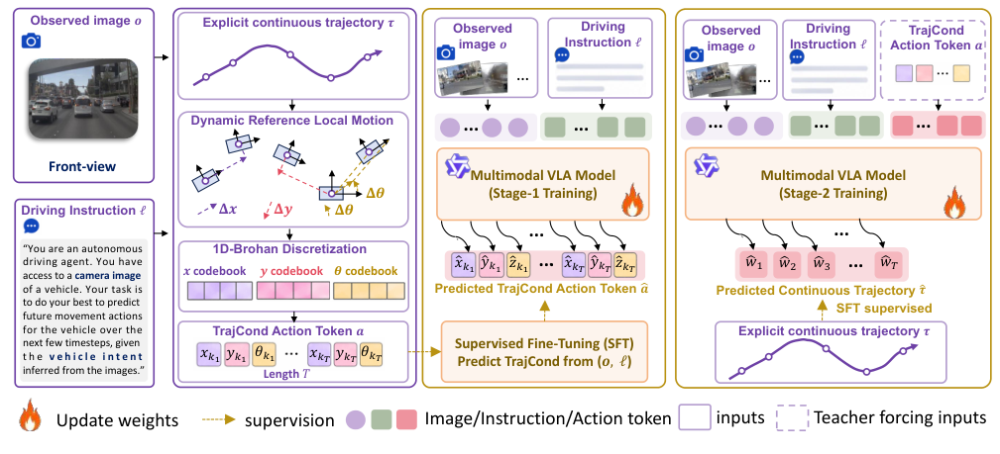
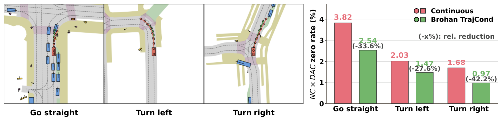
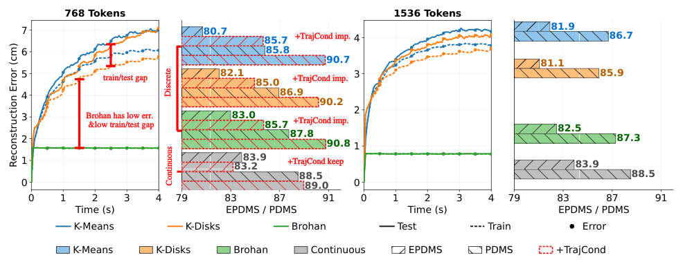
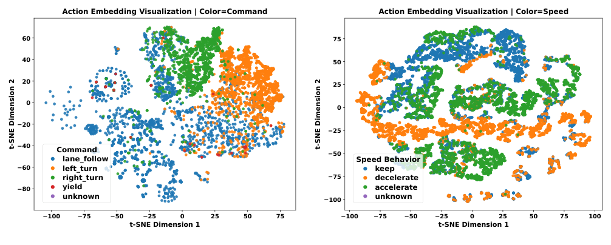
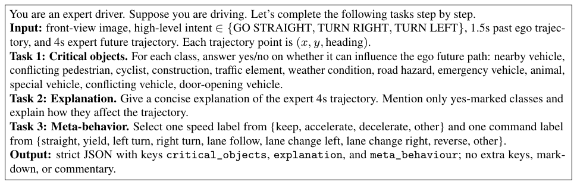
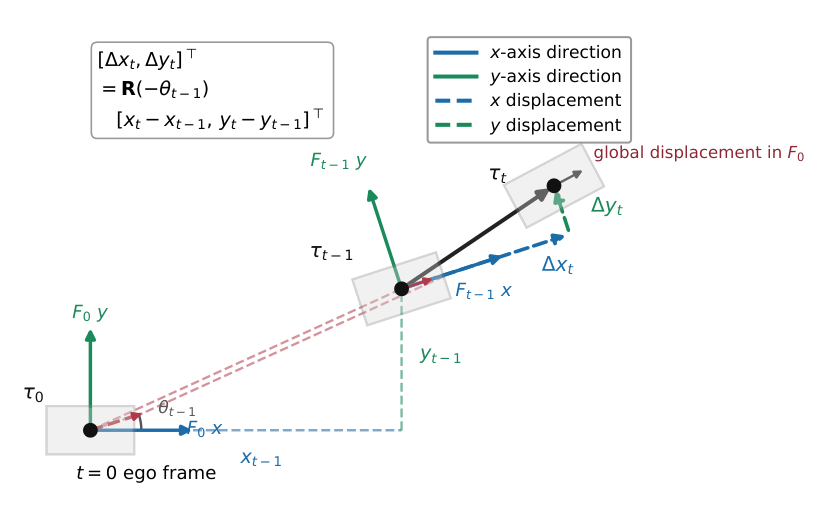
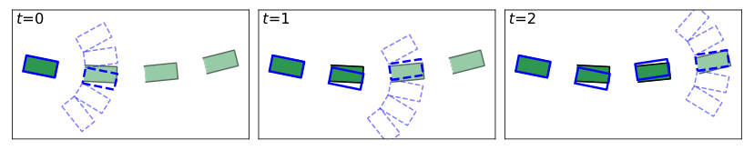
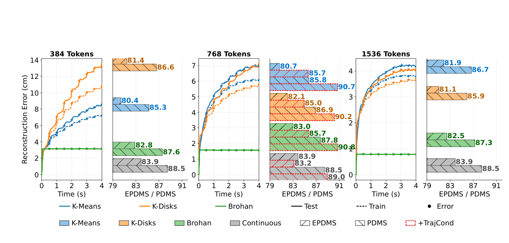
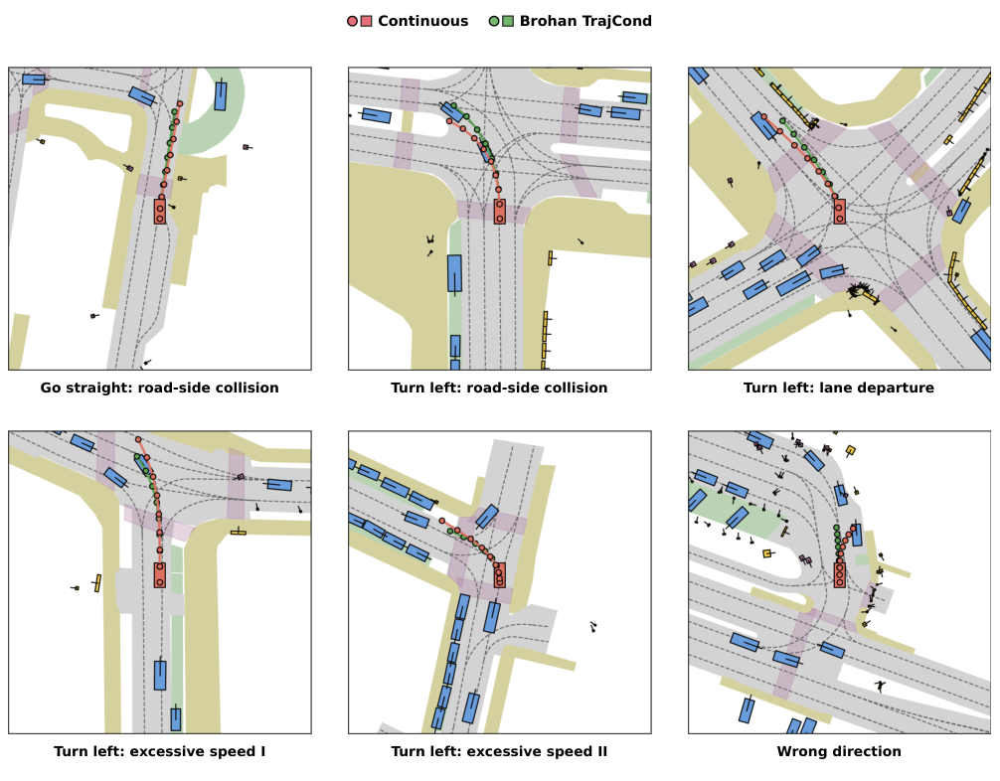

## 基础摘要


论文针对自回归视觉—语言—动作规划器将连续轨迹直接作为最终输出、而驾驶指令多描述动作而非自车状态，导致最终轨迹缺少直接条件约束的问题。作者提出TrajCond，将轨迹几何编码为离散的1D-Brohan差分动作轨迹，并在连续轨迹预测前通过两阶段训练学习该条件；离散轨迹与数值轨迹均自回归生成，故称AutoVLA-D。实验在NAVSIM navtest、nuScenes和NeuroNCAP上进行，设置离散轨迹直接输出与作为TrajCond条件两种用法作对照，并在开环、闭环场景检验最终连续轨迹预测。推理时先自回归生成离散几何条件，再据此预测连续轨迹；代码已开源。

## 论文结构图

<!--RAW-->
<figure class="paper-figure">
  
  <figcaption>图 1：AutoVLA-D 总体流程。左侧将观测图像与驾驶指令输入 VLA；中间把显式连续轨迹经“动态参考局部运动”转换为局部差分 (Δx, Δy, Δθ)，再由 x、y、θ 三个一维 Brohan 码本离散为 TrajCond 动作 token；右侧为两阶段训练：Stage 1 从 (o, ℓ) 预测 TrajCond token，Stage 2 在给定 (o, ℓ, a) 的条件下预测最终连续轨迹，训练时对动作 token 使用教师强制，推理时则先自回归生成 TrajCond、再生成连续轨迹。</figcaption>
</figure>
<!--/RAW-->

<!--RAW-->
<figure class="paper-figure">
  
  <figcaption>图 2：NAVSIM navtest 上的碰撞相关示例与失败 NC×DAC 乘积率。左侧三幅图分别对应“直行、左转、右转”三种高层意图下的典型碰撞场景；右侧柱状图比较 Continuous 基线与 Brohan TrajCond 的 NC×DAC 零值率：直行由 3.82% 降至 2.54%（相对 −33.6%），左转由 2.03% 降至 1.47%（−27.6%），右转由 1.68% 降至 0.97%（−42.2%）。完整 NC/DAC/乘积计数见附录表 14。</figcaption>
</figure>
<!--/RAW-->

## 中文完整翻译

### AutoVLA-D：从推理中学习用于自动驾驶 VLA 的轨迹几何条件

**作者**：Yuguang Yang¹,³∗、Zhewen Tan⁸∗、Canyu Chen²,³∗、Linlin Yang⁵、Cheng Chi⁷、Chunyang Liu⁴、Kehua Sheng⁴、Jinyu Yang⁹、Baochang Zhang⁶†、Bo Zhang⁴‡、Yan Wang³‡、Xianbin Cao¹‡

¹ 北京航空航天大学电子信息工程学院；² 北京航空航天大学国家卓越工程师学院；³ 清华大学人工智能产业研究院（AIR）；⁴ 滴滴；⁵ 中国传媒大学媒体融合与传播国家重点实验室；⁶ 北京航空航天大学杭州创新研究院；⁷ 中国人民大学信息学院；⁸ 北京航空航天大学计算机科学与工程学院；⁹ 哈尔滨工业大学（深圳）

∗ 同等贡献：{guangbuaa, chencanyu, tanzhewen}@buaa.edu.cn  
† 项目负责人  
‡ 通讯作者：xbcao@buaa.edu.cn、zhangbo@didiglobal.com、wangyan@air.tsinghua.edu.cn

第 40 届神经信息处理系统大会（NeurIPS 2026）  
arXiv:2611.12382v1 [cs.RO] · 2026 年 11 月 9 日

---

### 摘要

自回归 VLA 规划通常把连续轨迹作为最终输出，但驾驶指令描述的往往是动作而非自车状态，这削弱了对最终连续轨迹的直接条件约束。为填补这一鸿沟，作者提出 TrajCond，即为 VLA 规划引入一种离散的轨迹几何条件。具体而言，TrajCond 被表示为 1D-Brohan 差分动作轨迹，并在最终连续轨迹预测之前通过两阶段训练框架学习。由于模型同时自回归生成离散轨迹与数值轨迹，该方法被命名为 AutoVLA-D（Double）。在 NAVSIM navtest、nuScenes 与 NeuroNCAP 上的实验表明：离散轨迹作为直接输出较弱，但作为 TrajCond 更有效，能在闭环与开环驾驶基准上一致地改善最终连续轨迹预测。代码见 https://github.com/ShivaTeam/AutoVLA-D。

---

### 1 引言

自回归视觉—语言—动作（VLA）规划已成为一种实用的、以多模态大语言模型（MLLM）为原生范式的自动驾驶方案。给定相机观测与驾驶指令，VLA 规划器遵循现代 MLLM 的下一 token 接口：以视觉—语言输入为条件，产生中间驾驶推理，再解码未来自车轨迹 [22]。近期方法已在这一“输入—推理—轨迹生成”流程上展示了较强的闭环规划能力 [30; 2; 16; 17; 11]。

尽管取得了这些进展，现有 VLA 规划器仍可按最终自车规划所使用的轨迹形式加以区分。一类工作把未来若干秒内的自车状态（包括当前自车坐标系下的相对 x 轴位置、y 轴位置与航向）建模为数值文本路点 token [16; 17; 2]，本文称之为**连续轨迹**；另一类工作即**离散轨迹**，把逐步自车运动或状态转移表示为离散动作 token [25; 11; 30]。这两类轨迹形式各有互补的优势与局限。动作 token 在离散化连续轨迹时引入重建误差；作者在多种离散化策略（如 K-Means、K-Disks [30; 25; 20] 以及 Brohan 式离散化 [31]）上的实验表明，直接回归离散轨迹始终弱于直接回归连续轨迹。然而，驾驶指令常常描述让行、保持或转弯等动作，这类局部运动变化天然与离散轨迹 token 对齐，因为每个动作 token 都描述一次局部状态转移。当指令被直接映射到最终连续轨迹时，便产生了表示形式上的鸿沟。

为解决该问题，作者提出 AutoVLA-D（Double），一种两阶段 VLA 规划器：在回归最终连续轨迹之前，先把离散轨迹作为**轨迹几何条件（Trajectory-geometric Condition，TrajCond）**。该方法有三项核心创新：

- **以离散轨迹作为轨迹几何条件。** TrajCond 先预测离散轨迹，再将其几何—语义作为最终连续预测的条件。这样既让最终输出保留在更强的连续空间，又利用离散条件传递面向动作的信息。
- **采用 1D-Brohan 离散化的动作 token。** 从自车差分运动中构造 TrajCond，并用彼此独立的 Brohan 式码本分别离散 x、y 与 yaw 差分。与 K-Means、K-Disks [30; 25; 20] 等共享码本聚类 tokenizer 相比，该设计在所测试的 TrajCond 结果中最强，重建误差也最低。
- **两阶段对齐训练。** 通过离散化真值轨迹构造 Brohan TrajCond 后，新建的动作词表没有任何与 VLA 任务相关的初始化。因此第一阶段先用“观测与指令 ↔ 编码 TrajCond 的动作 token 序列”对齐，以预热 TrajCond 的语义；第二阶段利用解码后的 TrajCond 与可用推理上下文回归最终连续轨迹。这样把条件学习与最终轨迹预测分离开来。

作者在 NAVSIM navtest、nuScenes 与 NeuroNCAP 上评估 AutoVLA-D。AutoVLA-D 在这些设置中取得最先进结果，包括 NAVSIM navtest 上的 92.0 PDMS 与 86.8 EPDMS。除基准比较外，实验还围绕“轨迹形式为何以及如何影响驾驶 VLA”展开：在 TrajCond 消融与渐进分析中考察 AutoVLA-D 的分阶段性能增益，并验证训练与推理各组件的贡献；在 TrajCond 形式分析中比较连续轨迹与不同动作 token 形式，表明离散轨迹作为最终自回归输出较弱，但作为 TrajCond 用于最终连续预测时更有效；在 TrajCond 语义分析中，定性与定量验证 TrajCond 是否除了提供几何引导，还吸收了面向动作的规划语义。综合来看，这些实验表明：在自回归 VLA 中，作为 TrajCond 使用的离散轨迹既能编码指令语义，又能保留轨迹几何，从而缩小指令与连续轨迹之间的表示鸿沟并提升 VLA 规划性能。

---

### 2 相关工作

**自动驾驶 VLA。** 自动驾驶规划最初通过端到端系统发展起来，这类系统把传感器观测映射为未来轨迹，包括 ST-P3 [6]、VAD [9]、UniAD [7]、DiffusionDrive [13]、SparseDrive [24] 与 BridgeAD [28]。随着视觉—语言模型（VLM）的出现，近期 VLA 方法利用视觉—语义知识进行驾驶理解、推理与规划，主要遵循两种模式：规划器式方法（包括 ReCogDrive [12]、ImagiDrive-S [10]、DriveVLA-W0 [11] 与 FLARE [26]）把 VLM 用作特征提取器或语义推理器，并配合外部规划器或动作头；自回归方法（包括 EMMA [8]、OpenEMMA [27]、OpenDriveVLA [29]、Impromptu VLA [3]、AutoVLA [30]、AdaThinkDrive [16]、Curious-VLA [2] 与 ELF-VLA [17]）通过下一 token 接口预测路点或动作 token 序列。与推理后直接解码最终轨迹的自回归 VLA 不同，AutoVLA-D 在最终连续轨迹生成之前插入一个学习得到的轨迹几何条件。

**自回归 VLA 中的轨迹形式。** 自回归 VLA 规划器用三个自由度表示未来自车轨迹：x 轴位置、y 轴位置与航向。现有轨迹形式可分为两类。连续轨迹方法（包括 Impromptu VLA [3]、AdaThinkDrive [16]、Curious-VLA [2] 与 ELF-VLA [17]）把每个未来自车状态序列化为数值文本路点 token；其中 Curious-VLA [2] 进一步通过逐步轨迹归一化提升性能。离散轨迹方法则把每次局部自车状态转移序列化为动作 token，并通过时间积分恢复未来轨迹。AutoVLA [30] 构建 K-Means/K-Disks 式动作码本，其 token 表示 3 自由度局部运动 [25; 20]；DriveVLA-W0 [11] 使用基于频率的 FAST tokenization [19]。AutoVLA-D 的不同之处在于把离散轨迹用作轨迹几何条件而非最终输出，并采用 1D-Brohan 形式，使每个动作 token 表示 1 自由度局部运动。

---

### 3 方法

#### 3.1 预备知识与问题形式化

**任务形式化。** 给定观测图像 $o$ 与语言用户指令 $\ell$，传统 VLA 规划器直接预测最终未来轨迹：

$$
\tau = f_{\mathrm{VLA}}(o,\ell), \tag{1}
$$

本文中最终预测目标 $\tau$ 始终是连续轨迹，为进行自回归解码而表示为归一化文本路点序列 $\{\tilde{\tau}_t\}_{t=1}^{T}$。因此，这种直接形式要求模型自回归地把语言指令映射到最终连续轨迹。

如图 1 所示，AutoVLA-D 引入了一个显式的中间轨迹几何条件。令 $a=\{a_t\}_{t=1}^{T}$ 表示编码该条件的动作 token 序列。与最终输出轨迹不同，TrajCond 是离散的。作者不是把 $\ell$ 直接映射到最终连续轨迹 $\tau$，而是通过两个监督阶段训练同一个 VLA 模型：

$$
a=f_{\mathrm{VLA}}^{(1)}(o,\ell),\qquad
\tau=f_{\mathrm{VLA}}^{(2)}(o,\ell,a),\qquad
f_{\mathrm{VLA}}^{(2)}\leftarrow f_{\mathrm{VLA}}^{(1)}. \tag{2}
$$

其中上标表示训练阶段而非独立架构；$f_{\mathrm{VLA}}^{(2)}\leftarrow f_{\mathrm{VLA}}^{(1)}$ 表示第二阶段模型由第一阶段模型初始化后继续训练。两个阶段都使用 MLLM 的自回归 token 解码器：第一阶段从 $(o,\ell)$ 预测 TrajCond 动作 token，第二阶段从 $(o,\ell,a)$ 预测最终连续路点 token。

**图 1：AutoVLA-D 总体流程（图见“论文结构图”）。** 左侧将观测图像与驾驶指令输入 VLA；中间把显式连续轨迹经动态参考局部运动转换为局部差分 $(\Delta x,\Delta y,\Delta\theta)$，再由 $x$、$y$、$\theta$ 三个一维 Brohan 码本离散为 TrajCond 动作 token；右侧为两阶段训练：第一阶段从 $(o,\ell)$ 预测 TrajCond token，第二阶段在给定 $(o,\ell,a)$ 的条件下预测最终连续轨迹。训练时对动作 token 使用教师强制，推理时先自回归生成 TrajCond，再生成连续轨迹。

**连续轨迹预备知识。** 给定观测图像 $o$ 与语言用户指令 $\ell$，模型预测未来自车轨迹 $\tau=\{(x_t,y_t,\theta_t)\}_{t=1}^{T}$。参照 Curious-VLA [2]，最终连续轨迹被序列化为归一化文本路点。具体而言，令 $\tau_t=(x_t,y_t,\theta_t)$ 表示第 $t$ 步的轨迹状态，采用逐步归一化表示：

$$
\tilde{\tau}_t=\frac{\tau_t-\mu_t}{\sigma_t},\qquad
\hat{\tau}_t=\tilde{\tau}_t\,\sigma_t+\mu_t, \tag{3}
$$

其中 $(\mu_t,\sigma_t)$ 是由训练集估计的逐步统计量。作者用 TrajCond 在面向动作的指令与连续自车状态输出之间架桥。

**上下文预备知识。** 对所有数据集，$\ell$ 都表示语言用户指令。对 NAVSIM，作者额外使用 Qwen3-VL-235B 从前视图图像、高层意图、过去自车轨迹与专家未来轨迹中标注思维链（CoT）推理。参照既有 VLA 推理实践 [22]，标注包含三个字段：关键对象与条件、对专家轨迹的自然语言解释、速度/命令元行为标签。CoT 序列可视为式 (2) 中与 $\ell$ 相关联的扩展项，但它不作为输入提供；相反，模型被训练来回归它，作为额外的语言监督。完整标注提示词以及各数据集的第一/第二阶段用户提示词见附录 C。nuScenes 与 NeuroNCAP 不使用 CoT 标注。为公平比较，NAVSIM 与 nuScenes 上的 $o$ 使用单张前视图图像，NeuroNCAP 上使用左—前—右三视图图像。

#### 3.2 通过动作 token 构造轨迹几何条件

有用的 TrajCond 应能由离散 token 预测，同时保留足够几何信息来引导连续规划。因此，作者从轨迹差分构造 TrajCond；差分既保留局部运动变化，又允许使用紧凑的离散词表。

**动作 tokenizer。** 轨迹 $\tau=\{(x_t,y_t,\theta_t)\}_{t=1}^{T}$ 表示在 $t=0$ 时刻的自车坐标系中。与依赖静态坐标系的已有工作 [30; 11] 不同，为描述从第 $t-1$ 步到第 $t$ 步的运动，作者使用第 $t-1$ 步的局部坐标系，并通过标准平面旋转变换计算差分运动 [18]。附录图 6 展示了这种局部坐标系差分构造：

$$
\delta_t=(\Delta x_t,\Delta y_t,\Delta\theta_t),\qquad
\Delta\theta_t=\theta_t-\theta_{t-1},
$$

$$
\begin{bmatrix}\Delta x_t\\ \Delta y_t\end{bmatrix}
=R(-\theta_{t-1})
\begin{bmatrix}x_t-x_{t-1}\\ y_t-y_{t-1}\end{bmatrix},
\qquad
R(\theta)=
\begin{bmatrix}\cos\theta&-\sin\theta\\ \sin\theta&\cos\theta\end{bmatrix}. \tag{4}
$$

令 $\Delta\tau=\{\delta_t\}_{t=1}^{T}$ 表示差分轨迹。参照既有动作 token 实践 [30; 25; 20]，作者从训练轨迹中提取差分动作并构建动作模板集合。现有动作模板提取方法通常用 K-Means 或 K-Disks 把联合 3 自由度运动向量 $(\Delta x,\Delta y,\Delta\theta)$ 聚类为一个大小为 $Q$ 的共享码本。在本文分析中，这称为 **3D 共享码本形式**，因为每个时间步由一个编码 3 自由度局部运动的动作 token 表示。

相比之下，作者在 4.4 节发现，基于聚类的 K-Means/K-Disks tokenizer 会产生明显的训练—测试重建误差差距。因此最终设置遵循 RT-2 [31] 使用的逐维线性离散化策略。对每个动作维度 $i\in\{1,2,3\}$（分别对应 x、y 与 θ），在训练集上计算第 1 与第 99 百分位数，并把该区间均匀划分为 $Q_i$ 个 bin。动作 token 码本总大小为 $Q=\sum_{i=1}^{3}Q_i$。由此得到 x、y、θ 三个码本，每个运动维度一个，即 **1D-Brohan 形式**：单个动作 token 表示 1 自由度局部运动，而同一时间步的三个 token 共同描述一次 3 自由度局部转移。

**轨迹离散化。** 参照 [20; 30; 25]，作者迭代寻找与下一状态之间角点距离最小的 token。在最终的 1D-Brohan 设置中，候选元组 $k=(k_1,k_2,k_3)$ 从每个动作码本中各选择一个 bin 中心：

$$
\bar{\delta}(k)=(x_{k_1},y_{k_2},\theta_{k_3}),\qquad k_i\in\{1,\ldots,Q_i\}. \tag{5}
$$

从当前自车位姿 $\hat{\tau}_0=(0,0,0)$ 开始，由前一个已 token 化位姿 $\hat{\tau}_{t-1}$ 渲染每个候选：

$$
\begin{bmatrix}\bar{x}_t(k)\\ \bar{y}_t(k)\end{bmatrix}
=
\begin{bmatrix}\hat{x}_{t-1}\\ \hat{y}_{t-1}\end{bmatrix}
+R(\hat{\theta}_{t-1})
\begin{bmatrix}x_{k_1}\\ y_{k_2}\end{bmatrix},
\qquad
\bar{\theta}_t(k)=\hat{\theta}_{t-1}+\theta_{k_3}. \tag{6}
$$

第 $t$ 步的最佳候选元组通过比较渲染候选状态与真值下一状态来选取：

$$
k_t^*=\arg\min_{k}\,
d_{\mathrm{corner}}\!\left((\bar{x}_t(k),\bar{y}_t(k),\bar{\theta}_t(k)),\,
(x_t,y_t,\theta_t)\right), \tag{7}
$$

其中 $d_{\mathrm{corner}}$ 是有序检测框角点之间的平均距离。动作 token 元组为 $a_t=k_t^*$。迭代该过程得到完整离散动作序列 $a=\{a_t\}_{t=1}^{T}$。由于三个一维码本对应不同自由度，若穷举元组搜索，每一步需要 $Q_i^3$ 个候选。因此作者先为每个自由度取逐维绝对残差最小的四个 token，枚举所得的 $4\times4\times4$ 个候选元组，再选择角点误差最小的元组。该设计把连续轨迹转换为一系列局部动作分量；附录 D 给出完整过程的可视化与伪代码。

#### 3.3 AutoVLA-D 的训练与推理

本节详述 3.1 节任务形式化中描述的训练与推理过程。

**第一阶段的推理与训练。** 新建的动作词表没有与 VLA 任务相关的初始化，因此第一阶段以多模态视觉—语言上下文 $(o,\ell)$ 为输入、输出动作 token 序列 $a$，以预热 TrajCond 的语义。该阶段用监督微调（SFT）和自回归 token 损失训练：

$$
\mathcal{L}_{\mathrm{stage1}}
=-\sum_{t=1}^{T}\log P(a_t\mid o,\ell,a_{<t}). \tag{8}
$$

第一阶段不用于直接产生最终轨迹；它学习作为轨迹几何条件、用于引导第二阶段的 TrajCond。

**第二阶段的推理与训练。** 该阶段模型学习利用 TrajCond $a$ 以及视觉—语言指令上下文 $(o,\ell)$ 回归目标连续轨迹。令 $w=\{w_t\}_{t=1}^{T}$ 表示目标连续轨迹对应的 token 序列。第二阶段以相同的多模态上下文 $(o,\ell)$ 为输入，并遵循输出顺序 $a\rightarrow w$。该阶段用 SFT 训练，目标结合动作 token 损失与最终路点 token 损失：

$$
\mathcal{L}_{\mathrm{stage2}}
=-\sum_{t=1}^{T}\log P(a_t\mid o,\ell,a_{<t})
-\sum_{t=1}^{T}\log P(w_t\mid o,\ell,a,w_{<t}). \tag{9}
$$

第二阶段优化包含 TrajCond 动作 token 与最终轨迹 token 的完整有序输出序列。如图 1 虚线框所示，作者采用教师强制策略：训练时动作 token 由真值轨迹监督；推理时完全自回归，即先预测 TrajCond 动作轨迹，再预测最终连续轨迹。

**推理与 RFT。** 对 NAVSIM，作者额外使用 3.1 节上下文预备知识中描述的 CoT 推理。令 $r$ 表示 CoT 推理 token；输出顺序在第一阶段变为 $r\rightarrow a$，在第二阶段变为 $a\rightarrow r\rightarrow w$。参照 Curious-VLA [2]，作者增加第三训练阶段，输出格式为 $a\rightarrow r\rightarrow w$，并使用 GRPO [23] 进行强化微调（RFT）。为公平比较，nuScenes 与 NeuroNCAP 只使用第一/第二阶段的 SFT 训练，不含 CoT 推理。

如图 3 的轨迹表示分析所支持的那样，直接预测离散轨迹弱于预测最终连续轨迹，但把离散轨迹用作 TrajCond 会增强最终规划器。因此，两阶段设计既保留连续输出空间的强度，又利用 TrajCond 的对齐优势。

---

### 4 实验

4.2 节报告 NAVSIM navtest、nuScenes 与 NeuroNCAP 上的性能；4.3 节进行 TrajCond 消融与渐进分析；4.4 节比较不同 TrajCond 形式，并验证 TrajCond 与不同离散轨迹 tokenizer 的兼容性；4.5 节对 TrajCond 进行语义分析。

#### 4.1 实验设置

**数据集与基准设置。** 作者报告 NAVSIM navtest [4; 2]（大规模非反应式闭环仿真基准）、nuScenes [1]（开环真实世界驾驶基准）与 NeuroNCAP [14]（构建于 nuScenes 之上的照片级闭环仿真器）上的结果。为公平比较，NAVSIM navtest 按 ReCogDrive [12] 报告，nuScenes 按 Impromptu VLA [3] 报告，NeuroNCAP 按 ImagiDrive [10] 报告。更多基准细节见附录 B。

**训练设置。** NAVSIM 与表示消融实验默认使用 Qwen3-VL-4B，除非另有说明。nuScenes 与 NeuroNCAP 报告 Qwen2.5-VL 与 Qwen3-VL 两种变体。训练由 SFT 与可选的 RFT 组成。SFT 用 LLaMA-Factory 实现，RFT 用 EasyR1 实现。优化器为 AdamW [15]，权重衰减 0.05，预热比例 0.10，余弦学习率调度，全局批大小 32。第一阶段与第二阶段各训练 3 个 epoch，学习率 $4\times10^{-5}$。RFT 使用 GRPO 训练 160 步，actor 批大小 512，与 Curious-VLA（Chen et al., 2026）大体一致。NeuroNCAP、NAVSIM 与 nuScenes 的模型上下文设置见 3.1 节上下文预备知识。

**轨迹形式。** 除非另有说明，连续轨迹指默认最终轨迹形式，即归一化文本路点；TrajCond 指由 1D-Brohan $Q=768$ 码本编码的离散轨迹，其中每个自由度的码本有 $Q_i=256$ 个 bin。作者在 4.4 节比较不同码本大小设置后选择 $Q=768$。

#### 4.2 基准比较

**NAVSIM navtest PDMS 结果。** 表 1 报告 NAVSIM navtest 比较。对比方法包括 VLA 规划器方法 ImagiDrive-S（Li et al., 2025）、ReCogDrive（Li et al., 2025）与 DriveVLA-W0（Li et al., 2025），以及 VLA token 方法 AutoVLA（Zhou et al., 2025）、AdaThinkDrive（Luo et al., 2025）、Curious-VLA（Chen et al., 2026）与 FLARE（Xie et al., 2026）。附加基线见附录表 7。本文 NAVSIM 设置使用前视图输入、reason 数据与可选 GRPO [23]。实验结果表明，AutoVLA-D 达到 92.0 PDMS，超过此前 VLA 规划器报告的成绩。

**表 1：公开指标设置下的 NAVSIM navtest PDMS 结果。** † 表示作者复现的结果，∗ 表示同期工作。

| 方法 | 基础模型 | NC↑ | DAC↑ | EP↑ | TTC↑ | C↑ | PDMS↑ |
|---|---|---:|---:|---:|---:|---:|---:|
| ImagiDrive-S | InternVL2.5-4B | 98.6 | 96.2 | 80.5 | 94.5 | 100.0 | 87.4 |
| ReCogDrive | InternVL3-8B | 98.2 | 97.8 | 83.5 | 95.2 | 100.0 | 89.6 |
| ReCogDrive† | Qwen3-VL-4B | 98.2 | 97.7 | 86.0 | 97.7 | 100.0 | 90.7 |
| DriveVLA-W0 | Emu3-8B | 98.7 | 99.1 | 83.3 | 95.3 | 99.3 | 90.2 |
| AutoVLA | Qwen2.5-VL-3B | 98.4 | 95.6 | 81.9 | 98.0 | 99.9 | 89.1 |
| AdaThinkDrive | InternVL3-8B | 98.4 | 97.8 | 84.4 | 95.2 | 100.0 | 90.3 |
| Curious-VLA | Qwen2.5-VL-3B | 98.4 | 96.9 | 88.5 | 97.9 | 98.1 | 90.3 |
| Curious-VLA† | Qwen3-VL-4B | 98.5 | 96.7 | 87.3 | 98.0 | 98.3 | 89.7 |
| FLARE∗ | Qwen3-VL-4B | 98.5 | 98.4 | 86.0 | 96.0 | 100.0 | 91.4 |
| **Ours** | **Qwen3-VL-4B** | **98.8** | **97.7** | **89.8** | **97.7** | **99.8** | **92.0** |

**NAVSIM navtest EPDMS 结果。** 表 2 在同一基准上按更严格的 EPDMS 指标集报告结果。对比方法包括 ReCogDrive（Li et al., 2025）、DiffusionDrive（Liao et al., 2025）、DriveVLA-W0（Li et al., 2025）、Curious-VLA（Chen et al., 2026）与 FLARE（Xie et al., 2026）；附加端到端（E2E）基线见附录表 8。在该设置下，AutoVLA-D 达到 86.8 EPDMS，优于 Curious-VLA（Chen et al., 2026）报告的 85.3。

**表 2：遵循官方 EPDMS 协议的 NAVSIM navtest EPDMS 结果。** AutoVLA-D 使用与 PDMS 实验相同的单相机设置，并报告完整的 EPDMS 评估。† 表示作者复现的结果，∗ 表示同期工作。EPDMS 指 NAVSIM v2 官方仓库发布的修复后 EPDMS 指标。

| 方法 | 基础模型 | NC↑ | DAC↑ | DDC↑ | TLC↑ | EP↑ | TTC↑ | LK↑ | C↑ | EC↑ | EPDMS↑ |
|---|---|---:|---:|---:|---:|---:|---:|---:|---:|---:|---:|
| ReCogDrive | InternVL3-8B | 98.3 | 95.2 | 99.5 | 99.8 | 87.1 | 97.5 | 96.6 | 98.3 | 86.5 | 83.6 |
| DiffusionDrive | – | 98.2 | 95.9 | 99.4 | 99.8 | 87.5 | 97.3 | 96.8 | 98.3 | 87.7 | 84.5 |
| Curious-VLA | Qwen2.5-VL-3B | 98.4 | 96.9 | 99.2 | 99.8 | 88.5 | 97.9 | 96.9 | 98.1 | 81.5 | 85.3 |
| Curious-VLA† | Qwen3-VL-4B | 98.5 | 96.7 | 99.37 | 99.9 | 87.3 | 98.0 | 96.5 | 98.3 | 83.0 | 84.9 |
| DriveVLA-W0 | Emu3-8B | 98.5 | 99.1 | 98.0 | 99.7 | 86.4 | 98.1 | 93.2 | 97.9 | 58.9 | 86.1 |
| FLARE∗ | Qwen3-VL-4B | 98.8 | 96.6 | 99.5 | 99.9 | 87.9 | 98.2 | 95.8 | 98.4 | 87.5 | 86.3 |
| **Ours** | **Qwen3-VL-4B** | **98.8** | **97.7** | **98.8** | **99.8** | **91.2** | **98.2** | **96.9** | **98.2** | **80.2** | **86.8** |

**nuScenes 开环比较。** 表 3 报告 nuScenes 开环比较，对比 ST-P3（Hu et al., 2022）、VAD（Jiang et al., 2023）、UniAD（Hu et al., 2023）、EMMA（Hwang et al., 2024）、OpenEMMA（Xing et al., 2025）、OpenDriveVLA（Zhou et al., 2025）、AutoVLA（Zhou et al., 2025）与 Impromptu VLA（Chi et al., 2025）。Qwen2.5-VL 行是主要设置，灰色 Qwen3-VL 行用于分离骨干网络与 TrajCond 消融。值得注意的是，nuScenes 上的 L2 误差在现有方法之间已接近饱和，约 0.30 m，而碰撞率提供了更具区分度的度量。

**表 3：nuScenes 开环比较。** 报告 L2 误差与碰撞率（Col.）。灰色行表示作者去除 TrajCond（TC）的消融。

| 方法 | 基础模型 | ST-P3 指标 L2↓ | ST-P3 指标 Col.↓ | UniAD 指标 L2↓ | UniAD 指标 Col.↓ |
|---|---|---:|---:|---:|---:|
| ST-P3 | – | 2.11 | 0.71 | – | – |
| VAD | – | 0.37 | 0.14 | – | – |
| UniAD | – | 0.69 | 0.12 | 1.03 | 0.31 |
| EMMA | Gemini | 0.32 | – | – | – |
| OpenEMMA | Qwen2-VL-7B | 2.81 | – | – | – |
| OpenDriveVLA | Qwen2.5-VL-3B | 0.33 | 0.10 | 0.67 | 0.30 |
| AutoVLA | Qwen2.5-VL-3B | 0.48 | 0.13 | 0.86 | 0.35 |
| Impromptu VLA | Qwen2.5-VL-3B | 0.33 | 0.13 | 0.67 | 0.38 |
| **Ours** | **Qwen2.5-VL-3B** | **0.30** | **0.10** | **0.60** | **0.35** |
| Ours（去 TC） | Qwen3-VL-4B | 0.30 | 0.11 | 0.60 | 0.34 |
| **Ours** | **Qwen3-VL-4B** | **0.30** | **0.09** | **0.60** | **0.29** |

**NeuroNCAP 闭环比较。** 表 4 使用 NeuroNCAP Score 与碰撞率报告 NeuroNCAP 闭环比较。对比方法包括 UniAD（Hu et al., 2023）、VAD（Jiang et al., 2023）、BridgeAD（Zhang et al., 2025）、ImagiDrive-S（Li et al., 2025）与 Impromptu VLA（Chi et al., 2025），以及表中列出的附加 E2E 行。Qwen2.5-VL AutoVLA-D 行是主要设置；灰色行表明去除 TrajCond 或更换骨干网络会削弱结果。

**表 4：NeuroNCAP 闭环比较。** 灰色行表示作者去除 TrajCond（TC）的消融。

| 方法 | 基础模型 | 得分 Avg.↑ | 得分 Stat.↑ | 得分 Frontal↑ | 得分 Side↑ | 碰撞率 Avg.↓ | 碰撞率 Stat.↓ | 碰撞率 Frontal↓ | 碰撞率 Side↓ |
|---|---|---:|---:|---:|---:|---:|---:|---:|---:|
| UniAD | – | 0.73 | 0.84 | 0.10 | 1.26 | 0.89 | 0.88 | 0.98 | 0.80 |
| VAD | – | 0.66 | 0.47 | 0.04 | 1.45 | 0.93 | 0.96 | 1.00 | 0.82 |
| SparseDrive | – | 0.92 | – | – | – | 0.94 | – | – | – |
| BridgeAD-S | – | 1.52 | – | – | – | 0.76 | – | – | – |
| BridgeAD-B | – | 1.60 | – | – | – | 0.73 | – | – | – |
| ImagiDrive-S | InternVL2.5-4B | 3.49 | 4.15 | 2.45 | 3.88 | 0.45 | 0.34 | 0.74 | 0.27 |
| Impromptu VLA | Qwen2.5-VL-3B | 2.15 | 1.77 | 2.31 | 2.10 | 0.66 | 0.70 | 0.59 | 0.65 |
| Ours（去 TC） | Qwen2.5-VL-3B | 2.76 | 2.95 | 2.98 | 2.35 | 0.49 | 0.43 | 0.48 | 0.56 |
| **Ours** | **Qwen2.5-VL-3B** | **3.63** | **4.02** | **3.43** | **3.44** | **0.36** | **0.26** | **0.44** | **0.36** |
| Ours（去 TC） | Qwen3-VL-4B | 1.66 | 1.81 | 1.06 | 1.66 | 0.68 | 0.69 | 0.82 | 0.68 |
| **Ours** | **Qwen3-VL-4B** | **3.23** | **3.17** | **3.68** | **2.86** | **0.39** | **0.41** | **0.32** | **0.44** |

#### 4.3 TrajCond 消融与渐进分析

**NAVSIM 上的渐进分析。** 表 5 追踪从连续轨迹回归到完整 AutoVLA-D 方案的改进路径。单阶段 Brohan TrajCond 已优于直接连续基线（C < B-TC(1)）；把过程分成两个阶段还能进一步提升（B-TC(1) < B-TC），因为 TrajCond 应先吸收面向动作的语义，再被用作最终连续轨迹预测的条件。该进程也说明：Brohan 作为直接输出目标较弱（B < C），但作为中间条件更强（B < C < B-TC），表明 AutoVLA-D 的增益并非来自蒸馏离散轨迹，而来自把离散轨迹用作条件。

**表 5：Qwen3-VL-4B 在 NAVSIM 上的渐进性能提升。** 将 Reason、Continuous、Brohan 与 epochs 分别缩写为 R、C、B 与 ep.。右侧面板报告相应的 EPDMS/PDMS 分数。

| 方法 | 第一阶段 | 第二阶段 | RFT |
|---|---|---|---|
| **含推理（R）的仅 SFT 结果** | | | |
| Continuous (C) | R → C (6 ep.) | – | – |
| Continuous TrajCond | R → C (3 ep.) | C → R → C (3 ep.) | – |
| Brohan (B) | R → B (6 ep.) | – | – |
| Brohan TrajCond (1) | – | B → R → C (6 ep.) | – |
| Brohan TrajCond | R → B (3 ep.) | B → R → C (3 ep.) | – |
| **SFT + RFT（GRPO）结果，含推理（R）** | | | |
| Continuous + RFT | R → C (6 ep.) | – | ✓ |
| Brohan TrajCond + RFT | R → B (3 ep.) | B → R → C (3 ep.) | ✓ |

右侧面板对应的 EPDMS/PDMS 数值为：B 82.4/86.8，C 83.9/88.5，B-TC(1) 84.0/89.2，B-TC 85.6/90.8，C+RFT 84.9/89.7，B-TC+RFT 86.8/92.0。增益路径标注为 B<C<B-TC，随后依次为 +TrajCond、+2 stage、+RFT。

**nuScenes/NeuroNCAP 上的 TrajCond 消融。** 完整比较进一步在 NAVSIM 之外验证 AutoVLA-D。在仅 SFT 的 nuScenes 设置中，无论采用 ST-P3 还是 UniAD 指标，TrajCond 都相对去 TC 变体改善了开环规划。在 NeuroNCAP 上，TrajCond 也提升了闭环安全性并减少了碰撞。这支持 TrajCond 并非 NAVSIM 专属现象。

**归因分析。** 闭环结果表明，TrajCond 最明显地改善了碰撞相关行为。除 TrajCond 外，作者的技术路线也接近 Curious-VLA [2]；与该基线相比，主要增益来自碰撞率下降。因此作者在图 2 中进一步分析 NAVSIM 碰撞相关指标。该图聚焦无碰撞（NC）与可行驶区域合规（DAC），展示了高层元行为已经正确、但 TrajCond 产生更准确局部控制并避免易碰撞运动的代表性案例。表 3 与表 4 的消融行在 nuScenes 与 NeuroNCAP 上显示一致趋势，表明 TrajCond 改善的是安全关键的自身控制，而不只是路线推进。

**图 2：NAVSIM navtest 上的碰撞相关示例与失败 NC×DAC 乘积率（图见“论文结构图”）。** 左侧三幅图分别对应直行、左转、右转三种高层意图下的典型碰撞场景；右侧柱状图比较 Continuous 基线与 Brohan TrajCond 的 NC×DAC 零值率：直行由 3.82% 降至 2.54%（相对下降 33.6%），左转由 2.03% 降至 1.47%（下降 27.6%），右转由 1.68% 降至 0.97%（下降 42.2%）。完整 NC/DAC/乘积计数见附录表 14。

#### 4.4 TrajCond 形式分析

**离散化误差与泛化。** 参照 Trajeglish [20]，作者测量把连续轨迹离散为动作 token 所引入的重建误差。图 3/附录图 8 显示：当 $Q=384\rightarrow768\rightarrow1536$ 时，码本越大，重建误差越低；1D-Brohan 始终给出最小的重建误差，且训练—测试差距小于基于聚类的码本；附录表 11 量化了同样的变化。

**TrajCond 作为最终预测。** 当离散表示被用作直接自回归输出目标时，它们都仍弱于连续文本路点（图 3 中灰色柱对蓝色/黄色/绿色柱），即使 Brohan 给出最好的离散结果。K-Means/K-Disks 的比较还表明，规划性能并不只由 oracle 重建误差决定。

**TrajCond 形式消融。** 作者进一步把码本大小 768 的表示作为轨迹格式语义条件进行评估。在图 3 中，三种离散 tokenizer 用作 TrajCond 时都强得多，而把连续轨迹用作条件只带来有限增益。这确认动作 token 最适合作为中间接口，而不是替代最终连续预测。由于 1D-Brohan 同时具有最低重建误差与最佳 TrajCond 分数，作者将其用作默认表示。

**图 3：动作 token 的 TrajCond 形式分析。** 每个码本大小分组把重建误差曲线与对应的 EPDMS/PDMS 柱配对。左轴报告轨迹重建误差，右轴报告 EPDMS/PDMS。受篇幅限制，码本大小 384 的结果移至附录图 8。

#### 4.5 TrajCond 语义分析

**推理依赖与困惑度分析。** Pause token 遵循 Goyal et al. [5]，只作为保持结构的占位符，即用 [PAUSE] 代理 token 替换有意义内容。

（I）表 6 左半部分检验 TrajCond 是否真正学习语义，而不只是充当几何辅助信号。第一阶段比较已经支持这一点：去除 TrajCond 并退回连续回归会降低性能（B-TC > B-TC w/o TrajCond）。随后保持相同的两阶段 SFT 配方，但删除第二阶段的文本 reason，并用 pause token 替换，使第二阶段预测必须依赖 TrajCond，而不是再次读取显式推理文本。由此得到的增益（B-TC < B-TC w/o R）表明：一旦推理语义被吸收进 TrajCond，轨迹结构化条件能比在第二阶段再次注入 reason 文本提供更干净的引导。

（II）表 6 右半部分提供互补的解码视角。在 nuScenes 上，用 pause token 替换动作 token 会增加最终连续轨迹的困惑度。在 NAVSIM 第二阶段，用 pause token 替换动作 token 或推理都会增加困惑度，其中替换推理造成的退化最大。在 NAVSIM 第一阶段，用 pause token 替换推理同样会增加 TrajCond 预测自身的困惑度。结合推理依赖消融，这些结果表明 TrajCond 与推理都降低轨迹解码的不确定性，而 TrajCond 是语义有意义的轨迹几何条件，而非纯几何辅助信号。

（III）C-TC < B-TC 证明增益不是来自更长的输出/辅助损失，而是来自 Brohan 动作 token 的语义性质。

（IV）RFT 结果进一步阐明 TrajCond 在两个 SFT 阶段之外的作用。从去 R 变体出发，GRPO 会降低性能；而完整 B-TC + RFT 流程仍最强。这表明 TrajCond 是推理的有力补充，但在 RFT 期间不能完全替代文本推理，原因可能是没有可靠 CoT 推理支持时 RFT 更难提升 [21]。

**表 6：Qwen3-VL-4B 在 NAVSIM 上的 TrajCond 语义验证。** 左：推理依赖消融。除使用独立 6 epoch 运行的设置（B-TC w/o TrajCond）外，左表其余设置都采用相同的 3+3 阶段分配。右：pause token 替换下的困惑度分析。两表中 B、R、C 分别表示 Brohan、Reason、Continuous；Pause 写全称。绝对困惑度值见附录表 13。

| 方法 | 第一阶段 | 第二阶段 | RFT | EPDMS/PDMS |
|---|---|---|---|---:|
| C-TC | R→C | C→R→C | – | 83.2 / 89.0 |
| B-TC | R→B | B→R→C | – | 84.9 / 90.6 |
| B-TC w/o TrajCond | R → C (6 ep.) | – | – | 83.9 / 88.5 |
| B-TC w/o R | R→B | B → Pause → C | – | 85.3 / 90.5 |
| B-TC w/o R | R→B | B → Pause → C | ✓ | 84.1 / 89.1 |
| B-TC | R→B | B→R→C | ✓ | 86.8 / 92.0 |

| 设置 | 条件 | 目标 | ΔPPL |
|---|---|---|---:|
| nuScenes | B→Pause | C | +0.0094 |
| NAVSIM | B→Pause | C | +0.0011 |
| NAVSIM | R→Pause | C | +0.0012 |
| NAVSIM | R→Pause | B | +0.0002 |

**t-SNE 可视化。** 作者进一步检查 NAVSIM navtest 上作为 TrajCond 的离散轨迹隐藏状态。他们从 CoT 推理元行为中提取运动方向/速度行为。图 4 左面板按运动方向分组，右面板按速度行为分组。t-SNE 结构揭示了不同运动类型之间的倾向边界。有趣的是，同一动作类别内的样本仍表现出较大散布，而非坍缩为单一紧凑中心，表明 TrajCond 捕获了超越单纯动作标签的丰富语义变化。

**图 4：作为 TrajCond 的离散轨迹隐藏状态 t-SNE 可视化。** 左：点按指令运动方向着色。右：点按速度行为着色。

---

### 5 结论与局限

**结论。** 本文引入离散轨迹作为 TrajCond，并提出在 VLA 规划中使用它的两阶段框架。分析得出三点结论。第一，直接回归离散轨迹弱于直接回归连续轨迹。第二，当用作 TrajCond 时，离散轨迹比连续轨迹条件更有效，并能一致改善最终连续轨迹预测。第三，该增益来自 TrajCond 吸收了有用的规划语义，而非辅助损失或输出长度。

**局限。** AutoVLA-D 通过中间轨迹条件增加了推理/训练成本，且某些低频动作 token 可能学习不足。

---

### 致谢

本工作由滴滴与清华大学无锡应用技术研究院资助，资助号 20242001120。

---

### 参考文献

[1] Holger Caesar, Varun Bankiti, Alex H Lang, Sourabh Vora, Venice Erin Liong, Qiang Xu, Anush Krishnan, Yu Pan, Giancarlo Baldan, and Oscar Beijbom. nuScenes: A multimodal dataset for autonomous driving. CVPR, pp. 11618–11628, 2020.

[2] Canyu Chen, Yuguang Yang, Zhewen Tan, Yizhi Wang, Ruiyi Zhan, Haiyan Liu, Xuanyao Mao, Jason Bao, Xinyue Tang, Linlin Yang, et al. Devil is in narrow policy: Unleashing exploration in driving VLA models. arXiv:2603.06049, 2026.

[3] Haohan Chi, Huan-ang Gao, Ziming Liu, Jianing Liu, Chenyu Liu, Jinwei Li, Kaisen Yang, Yangcheng Yu, Zeda Wang, Wenyi Li, et al. Impromptu VLA: Open weights and open data for driving vision-language-action models. arXiv:2505.23757, 2025.

[4] Daniel Dauner, Marcel Hallgarten, Tianyu Li, Xinshuo Weng, Zhiyu Huang, Zetong Yang, Hongyang Li, Igor Gilitschenski, Boris Ivanovic, Marco Pavone, et al. NAVSIM: Data-driven non-reactive autonomous vehicle simulation and benchmarking. NeurIPS, 37:28706–28719, 2024.

[5] Sachin Goyal, Ziwei Ji, Ankit Singh Rawat, Aditya Krishna Menon, Sanjiv Kumar, and Vaishnavh Nagarajan. Think before you speak: Training language models with pause tokens. ICLR, 2024.

[6] Shengchao Hu, Li Chen, Penghao Wu, Hongyang Li, Junchi Yan, and Dacheng Tao. ST-P3: End-to-end vision-based autonomous driving via spatial-temporal feature learning. ECCV, pp. 533–549, 2022.

[7] Yihan Hu, Jiazhi Yang, Li Chen, Keyu Li, Chonghao Sima, Xizhou Zhu, Siqi Chai, Senyao Du, Tianwei Lin, Wenhai Wang, et al. Planning-oriented autonomous driving. CVPR, pp. 17853–17862, 2023.

[8] Jyh-Jing Hwang, Runsheng Xu, Hubert Lin, Wei-Chih Hung, Jingwei Ji, Kristy Choi, Di Huang, Tong He, Paul Covington, Benjamin Sapp, et al. EMMA: End-to-end multimodal model for autonomous driving. arXiv:2410.23262, 2024.

[9] Bo Jiang, Shaoyu Chen, Qing Xu, Bencheng Liao, Jiajie Chen, Helong Zhou, Qian Zhang, Wenyu Liu, Chang Huang, and Xinggang Wang. VAD: Vectorized scene representation for efficient autonomous driving. ICCV, pp. 8340–8350, 2023.

[10] Jingyu Li, Bozhou Zhang, Xin Jin, Jiankang Deng, Xiatian Zhu, and Li Zhang. ImagiDrive: A unified imagination-and-planning framework for autonomous driving. arXiv:2508.11428, 2025.

[11] Yingyan Li, Shuyao Shang, Weisong Liu, Bing Zhan, Haochen Wang, Yuqi Wang, Yuntao Chen, Xiaoman Wang, Yasong An, Chufeng Tang, et al. DriveVLA-W0: World models amplify data scaling law in autonomous driving. arXiv:2510.12796, 2025.

[12] Yongkang Li, Kaixin Xiong, Xiangyu Guo, Fang Li, Sixu Yan, Gangwei Xu, Lijun Zhou, Long Chen, Haiyang Sun, Bing Wang, et al. ReCogDrive: A reinforced cognitive framework for end-to-end autonomous driving. arXiv:2506.08052, 2025.

[13] Bencheng Liao, Shaoyu Chen, Haoran Yin, Bo Jiang, Cheng Wang, Sixu Yan, Xinbang Zhang, Xiangyu Li, Ying Zhang, Qian Zhang, et al. DiffusionDrive: Truncated diffusion model for end-to-end autonomous driving. CVPR, pp. 12037–12047, 2025.

[14] William Ljungbergh, Adam Tonderski, Joakim Johnander, Holger Caesar, Kalle Åström, Michael Felsberg, and Christoffer Petersson. NeuroNCAP: Photorealistic closed-loop safety testing for autonomous driving. ECCV, pp. 161–177, 2024.

[15] Ilya Loshchilov and Frank Hutter. Decoupled weight decay regularization. arXiv:1711.05101, 2017.

[16] Yuechen Luo, Fang Li, Shaoqing Xu, Zhiyi Lai, Lei Yang, Qimao Chen, Ziang Luo, Zixun Xie, Shengyin Jiang, Jiaxin Liu, et al. AdaThinkDrive: Adaptive thinking via reinforcement learning for autonomous driving. arXiv:2509.13769, 2025.

[17] Yuechen Luo, Qimao Chen, Fang Li, Shaoqing Xu, Jaxin Liu, Ziying Song, Zhi-Xin Yang, and Fuxi Wen. Unleashing VLA potentials in autonomous driving via explicit learning from failures. arXiv:2603.01063, 2026.

[18] Kevin M. Lynch and Frank C. Park. Modern Robotics: Mechanics, Planning, and Control. Cambridge University Press, 2017.

[19] Karl Pertsch, Kyle Stachowicz, Brian Ichter, Danny Driess, Suraj Nair, Quan Vuong, Oier Mees, Chelsea Finn, and Sergey Levine. FAST: Efficient action tokenization for vision-language-action models. arXiv:2501.09747, 2025.

[20] Jonah Philion, Xue Bin Peng, and Sanja Fidler. Trajeglish: Traffic modeling as next-token prediction. ICLR, 2024.

[21] Salman Rahman, Jingyan Shen, Anna Mordvina, Hamid Palangi, Saadia Gabriel, and Pavel Izmailov. When can LLMs learn to reason with weak supervision? arXiv:2604.18574, 2026.

[22] Luke Rowe, Rodrigue de Schaetzen, Roger Girgis, Christopher Pal, and Liam Paull. Poutine: Vision-language-trajectory pre-training and reinforcement learning post-training enable robust end-to-end autonomous driving. arXiv:2506.11234, 2025.

[23] Zhihong Shao, Peiyi Wang, Qihao Zhu, Runxin Xu, Junxiao Song, Xiao Bi, Haowei Zhang, Mingchuan Zhang, YK Li, Yang Wu, et al. DeepSeekMath: Pushing the limits of mathematical reasoning in open language models. arXiv:2402.03300, 2024.

[24] Wenchao Sun, Xuewu Lin, Yining Shi, Chuang Zhang, Haoran Wu, and Sifa Zheng. SparseDrive: End-to-end autonomous driving via sparse scene representation. ICRA, 2025.

[25] Wei Wu, Xiaoxin Feng, Ziyan Gao, and Yuheng Kan. SMART: Scalable multi-agent real-time motion generation via next-token prediction. NeurIPS, 37:114048–114071, 2024.

[26] Chengen Xie, Chonghao Sima, Tianyu Li, Bin Sun, Junjie Wu, Zhihui Hao, and Hongyang Li. FLARE: Learning future-aware latent representations from vision-language models for autonomous driving. arXiv:2601.05611v2, 2026.

[27] Shuo Xing, Chengyuan Qian, Yuping Wang, Hongyuan Hua, Kexin Tian, Yang Zhou, and Zhengzhong Tu. OpenEMMA: Open-source multimodal model for end-to-end autonomous driving. WACV, pp. 1001–1009, 2025.

[28] Bozhou Zhang, Nan Song, Xin Jin, and Li Zhang. Bridging past and future: End-to-end autonomous driving with historical prediction and planning. arXiv:2503.14182, 2025.

[29] Xingcheng Zhou, Xuyuan Han, Feng Yang, Yunpu Ma, and Alois C Knoll. OpenDriveVLA: Towards end-to-end autonomous driving with large vision language action model. arXiv:2503.23463, 2025.

[30] Zewei Zhou, Tianhui Cai, Seth Z Zhao, Yun Zhang, Zhiyu Huang, Bolei Zhou, and Jiaqi Ma. AutoVLA: A vision-language-action model for end-to-end autonomous driving with adaptive reasoning and reinforcement fine-tuning. arXiv:2506.13757, 2025.

[31] Brianna Zitkovich, Tianhe Yu, Sichun Xu, Peng Xu, Ted Xiao, Fei Xia, Jialin Wu, Paul Wohlhart, Stefan Welker, Ayzaan Wahid, et al. RT-2: Vision-language-action models transfer web knowledge to robotic control. CoRL, pp. 2165–2183, PMLR, 2023.

---

### 附录

#### A 计算资源

所有实验——包括两阶段模型训练、强化微调与全面基准评估——都在高性能内部计算集群上进行。具体而言，所用计算节点配备 8 块 NVIDIA H100 GPU、2TB 系统内存（RAM）与 192 个 CPU 核心。在该硬件配置下，完整实验套件约需连续运行一周。

#### B 基准细节

作者简要给出正文三种评估设置的基准细节。

**NAVSIM navtest。** 参照 Curious-VLA [2]，作者把 NAVSIM navtest 作为主要的大规模非反应式闭环仿真基准。它聚焦挑战性驾驶场景下的规划评估，并在官方 navtest 划分上按与 ReCogDrive [12] 相同的协议族报告 PDMS 与 EPDMS。

**nuScenes。** 参照 Curious-VLA [2] 与 Impromptu VLA [3]，作者把 nuScenes 作为真实世界开环基准，用于辅助泛化评估。nuScenes 包含 1000 个各 20 秒的驾驶场景，此处按标准 3 秒规划指标评估，包括 L2 距离误差与碰撞率。

**NeuroNCAP。** 参照 ImagiDrive [10]，作者把 NeuroNCAP 作为安全关键闭环基准。NeuroNCAP 是构建于 nuScenes 之上的照片级仿真器，旨在交互式闭环 rollout 下对驾驶策略进行压力测试。作者在与既有 VLA 比较工作相同的评估设置下报告 NeuroNCAP Score 与碰撞率。

#### C 系统提示词

对 NAVSIM，作者使用 Qwen3-VL-235B 生成伪标注 CoT 推理。提示词改编自 DriveTeach-VLA，保留推理子任务并移除未来轨迹预测任务。

> 你是一位专家驾驶员。假设你正在驾驶。让我们逐步完成以下任务。  
> 输入：前视图图像、高层意图 ∈ {直行, 右转, 左转}、1.5 秒过去自车轨迹与 4 秒专家未来轨迹。每个轨迹点为 (x, y, heading)。  
> 任务 1：关键对象。对每个类别回答是/否，说明其是否可能影响自车未来路径：附近车辆、冲突行人、骑行者、施工、交通元素、天气条件、道路危险、紧急车辆、动物、特殊车辆、冲突车辆、开门车辆。  
> 任务 2：解释。简要解释专家 4 秒轨迹。只提及标记为“是”的类别，并解释它们如何影响轨迹。  
> 任务 3：元行为。从 {keep, accelerate, decelerate, other} 中选择一个速度标签，并从 {straight, yield, left turn, right turn, lane follow, lane change left, lane change right, reverse, other} 中选择一个命令标签。  
> 输出：严格 JSON，键为 critical_objects、explanation 与 meta_behaviour；不要额外键、markdown 或评论。

**图 5：用于伪标注 NAVSIM CoT 推理数据的 Qwen3-VL-235B 提示词。**

**NAVSIM 第一阶段用户提示词。** 第一阶段 NAVSIM 训练提示词要求模型从图像、意图与过去轨迹预测 TrajCond 动作 token：

> 你是一位专家驾驶员。假设你正在驾驶。让我们逐步完成以下任务。  
> 输入：  
> - 当前时刻从自车采集的 1 帧前视图图像  
> 图片 1：`<image>` 自车前视图  
> - 当前高层意图（字符串）：直行  
> - 1.5 秒过去轨迹（2 Hz 下 3 步）：t-3: (0.0, 0.0, 0.0)；t-2: (0.0, 0.0, 0.0)；t-1: (0.0, 0.0, 0.0)；t-0: (0.0, 0.0, 0.0)  
> 每个轨迹点格式：(x:float, y:float, heading:float)  
> 任务 1：关键对象与条件检测  
> 判断每个类别是否至少有一个关键实例可能影响自车未来路径（不得遗漏）。车辆可以是轿车、公交车、卡车、摩托车、滑板车等。traffic_element 包括交通标志与交通灯。road_hazard 可包括危险道路状况、道路碎片、障碍物等。conflicting_vehicle 是可能与自车未来路径冲突的车辆。对每个类别输出“yes”或“no”（不得遗漏）。  
> 需要审计的对象类别：  
> - nearby_vehicle  
> - conflicting_pedestrian  
> - cyclist  
> - construction  
> - traffic_element  
> - weather_condition  
> - road_hazard  
> - emergency_vehicle  
> - animal  
> - special_vehicle  
> - conflicting_vehicle  
> - door_opening_vehicle  
>  
> 任务 2：自然语言解释  
> （thinking 输出应包在 `<thinking>...</thinking>` 中）  
> 撰写约 100 词的简洁自然语言描述，说明专家驾驶员（你）规划的最优未来 4 秒轨迹，并解释专家为何规划执行该轨迹。  
> - 只提及上一任务中标记为“yes”的类别。  
> - 描述每个关键对象或条件如何影响最优轨迹。  
> - 不要虚构输入中不存在的对象或条件。  
>  
> 任务 3：元行为选择  
> 从每个列表中恰好选择一个类别。选择最能概括最优未来轨迹整体行为的标签：  
> - speed ? { keep, accelerate, decelerate }  
> - command ? { straight, yield, left_turn, right_turn, lane_follow, lane_change_left, lane_change_right, reverse }  
> 选择最能概括最优未来轨迹整体行为的标签。  
> - 若都不合适，使用 “other”，但应尽量少用。  
>  
> 任务 4：未来轨迹预测  
> （answer 输出应包在 `<answer>...</answer>` 中）  
> 给定输入、关键对象/条件、自然语言解释与元行为，预测自车最优未来 4 秒轨迹（2 Hz 下 8 步）。以 `[AT, ...]` 格式预测 8 组三未来轨迹动作 token。  
> 输出格式（严格 JSON，无额外键，无 markdown 代码块字符 ```，无评论）：  
> ```json  
> {  
>   "critical_objects": {  
>     "nearby_vehicle": "yes | no",  
>     "conflicting_pedestrian": "yes | no",  
>     "cyclist": "yes | no",  
>     "construction": "yes | no",  
>     "traffic_element": "yes | no",  
>     "weather_condition": "yes | no",  
>     "road_hazard": "yes | no",  
>     "emergency_vehicle": "yes | no",  
>     "animal": "yes | no",  
>     "special_vehicle": "yes | no",  
>     "conflicting_vehicle": "yes | no",  
>     "door_opening_vehicle": "yes | no"  
>   },  
>   "explanation": "只引用标记为 'yes' 类别的一段约 100 词描述",  
>   "meta_behaviour": {  
>     "speed": "keep | accelerate | decelerate | other",  
>     "command": "straight | yield | left_turn | right_turn | lane_follow | lane_change_left | lane_change_right | reverse | other"  
>   },  
>   "future_trajectory": "<answer>[AT, ...]</answer>"  
> }  
> ```

**NAVSIM 第二阶段用户提示词。** 第二阶段 NAVSIM 训练提示词要求模型在产生最终连续轨迹前使用离散动作 token 规划、环境推理与驾驶逻辑：

> 你是一位专家驾驶员。假设你正在驾驶。让我们逐步完成以下任务。  
> 输入：  
> - 当前时刻从自车采集的 1 帧前视图图像  
> 图片 1：`<image>` 自车前视图  
> - 当前高层意图（字符串）：直行  
> - 1.5 秒过去轨迹（2 Hz 下 3 步）：t-3: (0.0, 0.0, 0.0)；t-2: (0.0, 0.0, 0.0)；t-1: (0.0, 0.0, 0.0)；t-0: (0.0, 0.0, 0.0)  
> 每个轨迹点格式：(x:float, y:float, heading:float)  
>  
> 任务 1：离散动作轨迹规划  
> （answer 输出应包在 `<answer>...</answer>` 中）  
> 基于道路几何与意图，规划一个朴素的“离散动作轨迹”（2 Hz 下 8 步）。假设没有动态障碍物（例如沿车道中心行驶、保持速度）。以 `[AT, ...]` 格式预测 8 个未来运动动作。  
>  
> 任务 2：关键对象与条件检测  
> 识别可能迫使模型偏离离散动作轨迹的关键对象/条件。对每个类别输出“yes”或“no”。  
> 需要审计的对象类别：  
> - nearby_vehicle  
> - conflicting_pedestrian  
> - cyclist  
> - construction  
> - traffic_element  
> - weather_condition  
> - road_hazard  
> - emergency_vehicle  
> - animal  
> - special_vehicle  
> - conflicting_vehicle  
> - door_opening_vehicle  
>  
> 任务 3：元行为选择  
> 从每个列表中恰好选择一个类别来描述**最终**行为：  
> - speed ? { keep, accelerate, decelerate }  
> - command ? { straight, yield, left_turn, right_turn, lane_follow, lane_change_left, lane_change_right, reverse }  
>  
> 任务 4：自然语言解释  
> （thinking 输出应包在 `<thinking>...</thinking>` 中）  
> 撰写约 100 词的简洁描述，解释驾驶过程。  
> - 将离散动作计划与环境进行对比。  
> - 基于视觉证据解释为什么必须把离散动作计划调整为最终计划。  
>  
> 任务 5：文本数值轨迹规划  
> （answer 输出应包在 `<answer>...</answer>` 中）  
> 基于任务 4 的推理，规划考虑所有安全因素的最优“文本数值轨迹”（2 Hz 下 8 步）。以 `[PT, ...]` 格式预测 8 个轨迹点。  
>  
> 输出格式（严格 JSON，无额外键，无 markdown 代码块字符 ```，无评论）：  
> ```json  
> {  
>   "discrete_action_trajectory": "<answer>[AT, ...]</answer>",  
>   "critical_objects": {  
>     "nearby_vehicle": "yes | no",  
>     "conflicting_pedestrian": "yes | no",  
>     "cyclist": "yes | no",  
>     "construction": "yes | no",  
>     "traffic_element": "yes | no",  
>     "weather_condition": "yes | no",  
>     "road_hazard": "yes | no",  
>     "emergency_vehicle": "yes | no",  
>     "animal": "yes | no",  
>     "special_vehicle": "yes | no",  
>     "conflicting_vehicle": "yes | no",  
>     "door_opening_vehicle": "yes | no"  
>   },  
>   "meta_behaviour": {  
>     "speed": "keep | accelerate | decelerate | other",  
>     "command": "straight | yield | left_turn | right_turn | lane_follow | lane_change_left | lane_change_right | reverse | other"  
>   },  
>   "explanation": "约 100 词的驾驶逻辑描述",  
>   "future_trajectory": "<answer>[PT, ...]</answer>"  
> }  
> ```

**nuScenes 与 NeuroNCAP 用户提示词。** 对 nuScenes 与 NeuroNCAP，第一阶段与第二阶段共享同一用户提示词模板，只在期望输出目标上不同。文件第一行是提示词，其后是第一阶段与第二阶段输出示例：

> 你是一个自动驾驶智能体。你可以访问车辆的前视相机图像 `<image>`。你的任务是根据从图像推断出的车辆意图，尽最大努力预测未来 6 个时间步的运动动作。下面提供过去 3.0 秒（0.5 秒间隔）记录的自车状态，包括自车 x、y 坐标。正 x 表示前进方向，正 y 表示向左。数据格式为 [x, y]：。(t-3.0s) [-19.78, -0.68]，加速度：X +0.72, Y -0.43 m/s²，速度：+5.72 m/s，转向角：-0.21（正：左转，负：右转）；(t-2.5s) [-16.86, -0.34]，加速度：X +0.71, Y -1.03 m/s²，速度：+5.93 m/s，转向角：-0.62；(t-2.0s) [-13.73, -0.12]，加速度：X +0.83, Y -1.07 m/s²，速度：+6.19 m/s，转向角：-0.53；(t-1.5s) [-10.50, -0.02]，加速度：X +1.03, Y -0.69 m/s²，速度：+6.52 m/s，转向角：-0.20；(t-1.0s) [-7.05, +0.01]，加速度：X +1.08, Y -0.41 m/s²，速度：+6.87 m/s，转向角：-0.10；(t-0.5s) [-3.42, 0.00]，加速度：X +1.00, Y -0.38 m/s²，速度：+7.26 m/s，转向角：-0.04；(t-0.0s) [0.00, 0.00]，加速度：X +0.95, Y -0.43 m/s²，速度：+7.56 m/s，转向角：-0.02。  
>  
> ------------第一阶段输出------------  
>  
> `<PLANNING>`未来 3.0 秒（0.5 秒间隔采样）的预测运动细节，包括 x、y 方向运动动作与航向旋转。每个时间步只输出括号内以逗号分隔的三个动作 token。动作输出格式为 `[<action_x>,<action_y>,<action_h>]`：`[<action_110>,<action_382>,<action_636>]`, `[<action_110>,<action_383>,<action_638>]`, `[<action_116>,<action_387>,<action_637>]`, `[<action_120>,<action_388>,<action_638>]`, `[<action_131>,<action_384>,<action_637>]`, `[<action_124>,<action_383>,<action_637>]` `</PLANNING>`  
>  
> ------------第二阶段输出------------  
>  
> `<PLANNING>`未来 3.0 秒（0.5 秒间隔采样）的预测运动细节，包括 x、y 方向运动动作与航向旋转。每个时间步只输出括号内以逗号分隔的三个动作 token。动作输出格式为 `[<action_x>,<action_y>,<action_h>]`：`[<action_110>,<action_382>,<action_636>]`, `[<action_110>,<action_383>,<action_638>]`, `[<action_116>,<action_387>,<action_637>]`, `[<action_120>,<action_388>,<action_638>]`, `[<action_131>,<action_384>,<action_637>]`, `[<action_124>,<action_383>,<action_637>]`  
>  
> 现在我要累积 6 组动作，并将其转换为每个时间步的文本路点。让我们进行综合安全评估，识别碰撞、翻车、越界或驶离可行驶区域等风险，标记高风险对象，并提出优化轨迹以避开危险，同时保留原运动意图。未来 3 秒（0.5 秒间隔采样）的预测运动细节，包括 x、y 方向 BEV 位置（米）。x 越大表示前进，y 越大表示向左。输出格式为 `[x, y]`：`[+3.97, -0.03]`, `[+8.00, -0.07]`, `[+12.23, -0.08]`, `[+16.65, -0.09]`, `[+21.53, -0.10]`, `[+26.11, -0.12]` `</PLANNING>`

#### D 轨迹差分图示

图 6 展示用于计算差分运动的坐标变换。虽然轨迹路点表示在 $t=0$ 时刻的自车坐标系中，但从第 $t-1$ 步到第 $t$ 步的转移是在第 $t-1$ 步的局部坐标系中表示的。图 7 可视化迭代轨迹 token 化过程；算法 1 给出 AutoVLA-D 使用的完整 1D-Brohan 码本构建与动作 token 分配流程。

**图 6：局部坐标系差分运动示意。** $\tau_{t-1}$ 与 $\tau_t$ 之间的位移先在 $t=0$ 自车坐标系中观测，再经 $R(-\theta_{t-1})$ 旋转到第 $t-1$ 步局部坐标系，从而得到 $(\Delta x_t,\Delta y_t)$。

**图 7：轨迹 token 化示意（引自 Trajeglish [20]）。** 绿色为示例轨迹，蓝色轮廓框为 token 化轨迹的原始表示，浅绿色为尚未 token 化的状态。token 模板经过优化，以最小化 token 化轨迹与原始轨迹之间的误差。

**算法 1：1D-Brohan 码本构建与动作 token 分配**

**输入：** 训练轨迹集 $\mathcal{D}$，目标轨迹 $\tau=\{(x_t,y_t,\theta_t)\}_{t=1}^{T}$，各维 bin 数 $\{Q_i\}_{i=1}^{3}$  
**输出：** 码本 $x,y,\theta$ 与动作 token 序列 $a=\{a_t\}_{t=1}^{T}$

1. 使用式 (4) 为 $\mathcal{D}$ 中所有轨迹计算局部坐标系差分运动 $\delta_t=(\Delta x_t,\Delta y_t,\Delta\theta_t)$：
2. $\Delta x_t=(x_t-x_{t-1})\cos\theta_{t-1}+(y_t-y_{t-1})\sin\theta_{t-1}$。
3. $\Delta y_t=-(x_t-x_{t-1})\sin\theta_{t-1}+(y_t-y_{t-1})\cos\theta_{t-1}$，$\Delta\theta_t=\theta_t-\theta_{t-1}$。
4. 采用算法 1 中的 1D-Brohan 码本。对每个自由度，取训练差分的第 1 与第 99 百分位数作为离散化范围。
5. $r_i=\left[\operatorname{Quantile}_{1\%}(\{\delta_t^i\}),\ \operatorname{Quantile}_{99\%}(\{\delta_t^i\})\right],\quad i\in\{1,2,3\}$。
6. 把三个范围均匀划分为 $Q_1,Q_2,Q_3$ 个 bin，得到码本 $x,y,\theta$。
7. 初始化 $\hat{\tau}_0=(0,0,0)$。
8. **for** $t=1$ **to** $T$ **do**
9. &nbsp;&nbsp;&nbsp;&nbsp;按局部坐标系差分运动的绝对残差，为每个自由度选择最近的四个 token。
10. &nbsp;&nbsp;&nbsp;&nbsp;枚举所得 $4\times4\times4$ 元组构成的候选集 $\mathcal{K}_t$。
11. &nbsp;&nbsp;&nbsp;&nbsp;**for** 每个 $k=(k_1,k_2,k_3)\in\mathcal{K}_t$ **do**
12. &nbsp;&nbsp;&nbsp;&nbsp;&nbsp;&nbsp;&nbsp;&nbsp;由 $\hat{\tau}_{t-1}$ 使用式 (6) 渲染 $\bar{\tau}_t(k)=(\bar{x}_t(k),\bar{y}_t(k),\bar{\theta}_t(k))$：
13. &nbsp;&nbsp;&nbsp;&nbsp;&nbsp;&nbsp;&nbsp;&nbsp;$\begin{bmatrix}\bar{x}_t(k)\\ \bar{y}_t(k)\end{bmatrix}=\begin{bmatrix}\hat{x}_{t-1}\\ \hat{y}_{t-1}\end{bmatrix}+R(\hat{\theta}_{t-1})\begin{bmatrix}x_{k_1}\\ y_{k_2}\end{bmatrix}$。
14. &nbsp;&nbsp;&nbsp;&nbsp;&nbsp;&nbsp;&nbsp;&nbsp;$\bar{\theta}_t(k)=\hat{\theta}_{t-1}+\theta_{k_3}$。
15. &nbsp;&nbsp;&nbsp;&nbsp;**end for**
16. &nbsp;&nbsp;&nbsp;&nbsp;$k_t^*\leftarrow\arg\min_{k\in\mathcal{K}_t}d_{\mathrm{corner}}(\bar{\tau}_t(k),\tau_t)$。
17. &nbsp;&nbsp;&nbsp;&nbsp;$a_t\leftarrow k_t^*$，$\hat{\tau}_t\leftarrow\bar{\tau}_t(k_t^*)$。
18. **end for**
19. **return** $a$

**表 7：NAVSIM navtest 上 PDMS 的附加基线。** 这些行从主表移至此处，以使主比较聚焦于更强的 VLA 方法。

| 方法 | 基础模型 | NC↑ | DAC↑ | EP↑ | TTC↑ | C↑ | PDMS↑ |
|---|---|---:|---:|---:|---:|---:|---:|
| Ego-MLP | – | 93.1 | 78.3 | 63.2 | 84.0 | 100.0 | 66.4 |
| UniAD | – | 97.7 | 92.8 | 79.2 | 92.8 | 100.0 | 84.0 |
| DiffusionDrive | – | 98.2 | 96.2 | 82.2 | 94.7 | 100.0 | 88.1 |
| WoTE | – | 98.5 | 96.8 | 81.9 | 94.4 | 99.9 | 88.3 |
| Qwen2.5-VL | Qwen2.5-VL-7B | 97.8 | 92.1 | 78.3 | 92.8 | 100.0 | 83.3 |
| InternVL3 | InternVL3-8B | 97.0 | 92.4 | 78.9 | 91.8 | 100.0 | 83.3 |

**表 8：NAVSIM navtest 上 EPDMS 的附加端到端（E2E）基线。** 这些行从主表移至此处，以使主比较聚焦于 VLA 方法。

| 方法 | NC↑ | DAC↑ | DDC↑ | TLC↑ | EP↑ | TTC↑ | LK↑ | C↑ | EC↑ | EPDMS↑ |
|---|---:|---:|---:|---:|---:|---:|---:|---:|---:|---:|
| Ego-MLP | 93.1 | 77.9 | 92.7 | 99.6 | 86.0 | 91.5 | 89.4 | 98.3 | 85.4 | 64.0 |
| VADv2 | 97.3 | 91.7 | 98.2 | 99.9 | 77.6 | 92.7 | 66.0 | 100.0 | 97.4 | 76.6 |
| TransFuser | 96.9 | 89.9 | 97.8 | 99.7 | 87.1 | 95.4 | 92.7 | 98.3 | 87.2 | 76.7 |
| HydraMDP++ | 97.2 | 97.5 | 99.4 | 99.6 | 83.1 | 96.5 | 94.4 | 98.2 | 70.9 | 81.4 |
| DriveSuprim | 97.5 | 96.5 | 99.4 | 99.6 | 88.4 | 96.6 | 95.5 | 98.3 | 77.0 | 83.1 |
| ARTEMIS | 98.3 | 95.1 | 98.6 | 99.8 | 81.5 | 97.4 | 96.5 | 98.3 | – | 83.1 |

#### E 渐进分析数据

表 9 给出表 5 右侧面板所绘的数值。阶段描述沿用正文缩写：Reason、Continuous、Brohan 与 epochs 分别记为 R、C、B 与 ep.。

**表 9：表 5 背后的详细渐进分析数据。**

| 方法 | 第一阶段 | 第二阶段 | RFT | EPDMS↑ | PDMS↑ |
|---|---|---|---:|---:|---:|
| Brohan (B) | R → B (6 ep.) | – | – | 82.4 | 86.8 |
| Continuous (C) | R → C (6 ep.) | – | – | 83.9 | 88.5 |
| Brohan TrajCond (1) | – | B → R → C (6 ep.) | – | 84.0 | 89.2 |
| Brohan TrajCond | R → B (3 ep.) | B → R → C (3 ep.) | – | 85.6 | 90.8 |
| Continuous + RFT | R → C (6 ep.) | – | ✓ | 84.9 | 89.7 |
| Brohan TrajCond + RFT | R → B (3 ep.) | B → R → C (3 ep.) | ✓ | 86.8 | 92.0 |

#### F 完整轨迹表示分析

图 8 在正文图 3 的轨迹表示分析基础上增加了更小的码本大小 384 设置。重建误差曲线呈现与正文图相同的定性行为：更大的码本降低离散化误差，1D-Brohan 仍是最稳定的离散表示，基于聚类的 K-Means 与 K-Disks 则比基于规则的 Brohan 显示出更大的训练—测试差距。连续文本路点作为零离散化误差参照绘出，因为它们在轨迹回归前不需要 token 化。

表 10 报告图 8 曲线背后的重建误差值。数值从 80 步评估轨迹的 1、2、3、4 秒处采样，单位为厘米。

**图 8：跨码本大小 384、768 与 1536 的完整轨迹表示分析。** 图中报告每种离散化方法的重建误差，以及对应的 PDMS/EPDMS 性能柱。

**表 10：图 8 背后的轨迹重建误差值。越低越好。**

| 码本 | Tokenizer | 训练误差 1s | 2s | 3s | 4s | 测试误差 1s | 2s | 3s | 4s |
|---|---:|---:|---:|---:|---:|---:|---:|---:|---:|
| 384 | 3D K-Means | 4.81 | 6.04 | 6.81 | 7.21 | 5.13 | 6.70 | 7.83 | 8.58 |
| 384 | 3D K-Disks | 6.37 | 8.71 | 10.03 | 10.77 | 7.06 | 10.20 | 12.29 | 13.49 |
| 384 | 1D-Brohan | 3.16 | 3.15 | 3.15 | 3.14 | 3.15 | 3.14 | 3.15 | 3.14 |
| 768 | 3D K-Means | 4.64 | 5.57 | 5.97 | 6.07 | 5.05 | 6.12 | 6.75 | 7.01 |
| 768 | 3D K-Disks | 4.25 | 5.11 | 5.53 | 5.78 | 4.69 | 5.84 | 6.65 | 7.09 |
| 768 | 1D-Brohan | 1.57 | 1.56 | 1.57 | 1.57 | 1.58 | 1.57 | 1.57 | 1.56 |
| 1536 | 3D K-Means | 3.24 | 3.66 | 3.81 | 3.78 | 3.39 | 3.96 | 4.19 | 4.17 |
| 1536 | 3D K-Disks | 3.10 | 3.47 | 3.62 | 3.71 | 3.37 | 3.80 | 4.05 | 4.08 |
| 1536 | 1D-Brohan | 0.78 | 0.78 | 0.78 | 0.78 | 0.79 | 0.78 | 0.78 | 0.78 |

**表 11：由 Jensen-Shannon 散度度量的训练/测试动作 token 分布偏移。越低越好。**

| 码本大小 | 3D K-Means | 3D K-Disks | 1D-Brohan |
|---:|---:|---:|---:|
| 384 | 0.0108958 | 0.0107432 | 0.0039045 |
| 768 | 0.0126990 | 0.0135494 | 0.0044001 |
| 1536 | 0.0167875 | 0.0175003 | 0.0051211 |

为量化该趋势背后的训练/测试分布偏移，表 11 报告各 tokenizer 与码本大小下训练与测试动作 token 分布之间的 Jensen-Shannon（JS）散度。JS 散度越低，表示训练与留出 token 分布越接近。在所有码本大小下，1D-Brohan 的散度最小，而 3D K-Means 与 3D K-Disks 显示出更大的训练/测试分布偏移。这支持正文的解释：Brohan 式逐维离散化在留出轨迹下产生更稳定的动作 token 标签。

表 12 报告图 8 所示 PDMS/EPDMS 柱值。“直接输出”表示动作 token 表示被用作最终自回归输出目标；“TrajCond”表示该表示在预测最终连续轨迹之前被用作中间条件。

**表 12：图 8 背后的 PDMS/EPDMS 分数值。越高越好。**

| 码本 | 表示 | 直接输出 EPDMS↑ | 直接输出 PDMS↑ | TrajCond EPDMS↑ | TrajCond PDMS↑ |
|---:|---|---:|---:|---:|---:|
| 384 | 3D K-Means | 80.43 | 85.27 | – | – |
| 384 | 3D K-Disks | 81.44 | 86.61 | – | – |
| 384 | 1D-Brohan | 82.85 | 87.58 | – | – |
| 384 | Continuous | 83.90 | 88.49 | – | – |
| 768 | 3D K-Means | 80.69 | 85.78 | 85.65 | 90.72 |
| 768 | 3D K-Disks | 82.06 | 86.92 | 84.95 | 90.17 |
| 768 | 1D-Brohan | 83.00 | 87.75 | 85.69 | 90.75 |
| 768 | Continuous | 83.90 | 88.49 | 83.19 | 88.96 |
| 1536 | 3D K-Means | 81.92 | 86.68 | – | – |
| 1536 | 3D K-Disks | 81.06 | 85.92 | – | – |
| 1536 | 1D-Brohan | 82.46 | 87.29 | – | – |
| 1536 | Continuous | 83.90 | 88.49 | – | – |

384 码本的性能柱进一步解释了正文为何聚焦码本大小 768 与 1536。当动作 token 用作直接输出目标时，3D K-Means 达到 80.43/85.27 EPDMS/PDMS，3D K-Disks 达到 81.44/86.61，1D-Brohan 达到 82.85/87.58。这些结果遵循与正文图相同的排序：Brohan 是最好的离散直接输出表示，但所有离散直接输出变体仍低于连续文本路点基线 83.90/88.49。这支持正文结论：离散动作 token 的直接自回归生成同时受离散化误差与 token 预测难度限制。结合正文图的 768 与 1536 设置，完整研究支持 AutoVLA-D 的默认设计选择。动作 token 的最佳角色不是作为最终输出格式，而是作为引导第二阶段连续规划器的中间轨迹几何条件。

#### G 完整困惑度值

表 13 报告正文表 6 右半部分 pause token 替换分析背后的绝对困惑度值。所有评估使用 temperature = 1e−3、top-p = 1。沿用正文缩写，Brohan、Reason 与 Continuous 记为 B、R、C，Pause 写全称。

**表 13：pause token 替换分析的绝对困惑度值。越低越好。**

| 设置 | 条件 | 目标 | 平均 PPL |
|---|---|---|---:|
| nuScenes | 原始 | C | 1.0250 |
| nuScenes | B→Pause | C | 1.0344 |
| NAVSIM | 原始 | C | 1.0057 |
| NAVSIM | B→Pause | C | 1.0068 |
| NAVSIM | R→Pause | C | 1.0069 |
| NAVSIM | 原始 | B | 1.0339 |
| NAVSIM | R→Pause | B | 1.0341 |

#### H 按意图分组的 NC/DAC 统计

表 14 给出图 2 背后的完整统计。作者把 AutoVLA-D 与 Continuous（C）基线比较，报告 NC 相关碰撞项为零、DAC 相关可行驶区域项为零，以及二者 NC×DAC 乘积为零的样本数。乘积率以 12,146 个样本为分母。计数与比率越低，表示乘法 PDMS 项被清零的样本越少。

**表 14：相对 Continuous（C）基线按意图分组的 NC/DAC 零计数比较。** 乘积率以 12,146 个样本为分母，下降率按 (Baseline − Ours)/Baseline 计算。

| 意图 | NC 零计数（Ours） | NC 零计数（C） | 下降 | DAC 零计数（Ours） | DAC 零计数（C） | 下降 | NC×DAC 零（Ours） | NC×DAC 零（C） | Ours 率 | C 率 | 下降 |
|---|---:|---:|---:|---:|---:|---:|---:|---:|---:|---:|---:|
| 直行 | 160 | 263 | 39.16% | 153 | 209 | 26.79% | 308 | 464 | 2.54% | 3.82% | 33.62% |
| 左转 | 29 | 52 | 44.23% | 151 | 200 | 24.50% | 178 | 246 | 1.47% | 2.03% | 27.64% |
| 右转 | 35 | 53 | 33.96% | 85 | 162 | 47.53% | 118 | 204 | 0.97% | 1.68% | 42.16% |

**图 9：NC/DAC 分析的更多碰撞相关示例。** 图例中粉色圆形标记与方形柱对应 Continuous，绿色对应 Brohan TrajCond。六个面板在白色边框裁剪后保留原始样本图像分辨率，展示面板标签指示的代表性失败模式：路侧碰撞、车道偏离、超速与错误方向。

#### NeurIPS 论文检查清单

1. **主张。** 摘要与引言中的主要主张是否准确反映论文贡献与范围？**回答：是。** 摘要与引言准确概述核心贡献，包括 AutoVLA-D 框架、1D-Brohan 轨迹表示，以及在 NAVSIM、nuScenes 与 NeuroNCAP 上的性能提升，这些均在 4 节得到支持。**指南：** 回答“不适用”表示摘要与引言未包含论文提出的主张；摘要和/或引言应清楚说明主张、贡献、重要假设与局限；主张应与理论与实验结果一致，并反映结果可推广的程度；动机中的愿景性目标可以保留，但必须明确论文尚未实现这些目标。

2. **局限。** 论文是否讨论作者工作的局限？**回答：是。** 第 5 节（结论与局限）明确讨论局限，指出 TrajCond 不应被视为显式文本推理的完全替代，尤其是在强化微调期间。**指南：** 回答“不适用”表示论文没有局限，回答“否”表示有局限但未讨论；作者应尽量单设“局限”章节，指出强假设及假设被违反时的稳健性，反思主张适用范围（例如仅在少量数据集或少数运行上验证）、影响方法性能的因素、计算效率与随数据规模的扩展性，以及隐私和公平方面的潜在问题。诚实讨论局限不应被审稿人惩罚。

3. **理论假设与证明。** 每个理论结果是否给出完整假设与完整且正确的证明？**回答：不适用。** 论文不包含理论结果或数学证明。**指南：** 所有定理、公式与证明都应编号并可交叉引用；假设应在定理陈述中明确给出或引用；证明可放在正文或补充材料中，若放在补充材料，建议在正文给出简短证明梗概；正文中的非正式证明应由附录或补充材料中的形式化证明补充；证明依赖的定理与引理应正确引用。

4. **实验结果可复现性。** 论文是否充分披露复现主要实验所需信息（无论是否提供代码与数据）？**回答：是。** 4.1 节说明数据集、优化器、学习率、epoch 与超参数，附录 C 提供复现伪标注训练数据与模型行为所需的系统与用户提示词。**指南：** 若论文包含实验，回答“否”通常不利于审稿；若贡献是数据集和/或模型，应说明为保证结果可复现或可验证所采取的步骤。复现可通过完整描述新架构、用相同数据复现模型、提供模型访问、发布代码与数据、提供详细复现说明、托管模型或发布检查点等方式实现。NeurIPS 不强制公开代码，但要求提供合理的复现途径；若贡献主要是新算法，应说明如何复现该算法；若主要是新模型架构，应清楚完整描述架构；若贡献是新模型（如大语言模型），应提供访问该模型或复现该模型的途径（如开源数据或构造说明）；若复现确有困难，作者可说明其提供的特定复现方式；闭源模型即使仅向注册用户开放，也应让其他研究者存在复现或验证结果的路径。

5. **数据与代码开放获取。** 论文是否开放数据与代码，并提供足以忠实复现主要实验结果的说明？**回答：否。** 研究基于公开数据集（NAVSIM、nuScenes、NeuroNCAP）与开放权重模型（Qwen-VL）。作者表示目前无法整理并公开代码，但已提供足够信息以便复现。正文摘要给出了代码仓库链接，检查清单则给出“否”，两者存在表述差异。**指南：** 若论文不需要代码即可复现实验，可回答“不适用”；NeurIPS 鼓励但不强制公开代码与数据，缺少代码本身不能成为拒稿理由，除非代码是贡献核心（如新开源基准）；说明应包含运行复现所需的准确命令与环境；应提供数据访问与准备说明，包括原始数据、预处理数据、中间数据与生成数据；应提供复现新方法与全部基线的脚本，若仅部分实验可复现，应说明省略哪些及原因；投稿时应发布匿名版本（如适用）；建议在补充材料中提供尽可能多信息，但允许包含数据与代码 URL。

6. **实验设置/细节。** 论文是否说明理解结果所需的全部训练与测试细节（如数据划分、超参数及其选择方式、优化器类型）？**回答：是。** 4.1 节与附录 B 提供 AdamW、权重衰减、预热比例、批大小、学习率与数据划分等详细训练设置。**指南：** 若论文包含实验，应在正文以理解结果所必需的详细程度呈现实验设置；完整细节可放在代码、附录或补充材料中。

7. **实验统计显著性。** 论文是否适当报告误差棒，或给出定义正确的统计显著性信息？**回答：否。** NAVSIM 因计算资源不足只报告单次运行结果，无误差棒；nuScenes 与 NeuroNCAP 报告不同随机种子 10 次实验的均值，以缓解随机性与统计波动。**指南：** 若论文包含实验，至少支持主要主张的实验应报告误差棒、置信区间或统计显著性检验；应清楚说明误差棒刻画的可变性来源（如训练/测试划分、初始化、随机参数抽样或完整实验运行）；应解释误差棒计算方法（闭式公式、库函数、bootstrap 等）及其假设（如误差正态）；应说明误差棒是标准差还是均值标准误；可报告 1σ 误差棒但须说明，若未验证误差正态，最好报告 2σ 而非声称 96% 置信区间；对于非对称分布，应避免在表格或图中显示会产生越界结果（如负错误率）的对称误差棒；若表中或图中有误差棒，正文应解释其计算方式并引用对应图表。

8. **实验计算资源。** 每个实验是否提供复现所需的充分计算机资源信息（计算节点类型、内存、执行时间）？**回答：是。** 附录 A 给出硬件配置（8 块 NVIDIA H100 GPU、2TB RAM、192 CPU 的内部集群）与约一周的总运行时间。**指南：** 应说明计算节点是 CPU 还是 GPU、是内部集群还是云服务商，并给出相关内存与存储；应给出每个单独实验运行所需计算量，并估计总计算量；应披露完整研究项目是否比论文报告的实验需要更多计算（例如未进入论文的初步或失败实验）。

9. **伦理准则。** 研究是否在所有方面符合 NeurIPS 伦理准则？**回答：是。** 研究依赖标准公开自动驾驶基准与模型，遵守伦理规范与 NeurIPS 伦理准则。**指南：** 作者应确认已阅读 NeurIPS 伦理准则；若回答“否”，应解释需要偏离准则的特殊情况；作者应确保遵守匿名性要求（例如当地法律或法规有特殊考虑时）。

10. **更广泛影响。** 论文是否同时讨论潜在正面与负面社会影响？**回答：否。** 论文聚焦自动驾驶 VLA 规划器的技术开发，未专设章节讨论更广泛社会影响。作者认为方法可减少碰撞、改善安全关键控制，因而带来正面社会影响，且几乎不产生负面社会后果。**指南：** 回答“不适用”表示工作没有社会影响；若回答“不适用”或“否”，应解释为何没有社会影响或为何论文未讨论；负面社会影响示例包括恶意或非预期使用（虚假信息、生成虚假档案、监控）、公平性（技术决策不公平地影响特定群体）、隐私与安全；会议预期许多论文是基础研究，不绑定具体应用或部署，但若存在直接负面应用路径应指出；作者应考虑技术按预期使用且正常工作时可能造成的伤害、按预期使用但结果错误时可能造成的伤害，以及有意或无意误用造成的伤害；若有负面社会影响，可讨论缓解策略（模型门控发布、在攻击之外提供防御、误用监测、持续监测系统从反馈中学习、提高机器学习效率与可及性）。

11. **防护措施。** 论文是否描述针对高风险误用数据或模型（如预训练语言模型、图像生成器或爬取数据集）的防护措施？**回答：不适用。** 论文未引入或发布需要特定防护措施的高风险资产、数据集或模型。**指南：** 高风险或两用模型发布时应提供必要防护，例如要求用户遵守使用指南、限制模型访问或实现安全过滤器；从互联网爬取的数据集可能带来安全风险，作者应说明如何避免发布不安全图像；提供有效防护很难，许多论文也不需要，但作者应认真考虑并尽力而为。

12. **现有资产许可。** 论文所用资产（代码、数据、模型）的创作者或原所有者是否得到适当署名，许可与使用条款是否明确说明并得到遵守？**回答：是。** 原始资产（NAVSIM、nuScenes、NeuroNCAP、Qwen-VL 变体）在参考文献、4 节与附录 B 中得到适当引用。**指南：** 若论文不使用现有资产，可回答“不适用”；应引用产生代码包或数据集的原始论文；应说明所用资产版本，并在可能时给出 URL；应为每项资产注明许可证名称（如 CC-BY 4.0）；对来自特定来源（如网站）的爬取数据，应提供该来源的版权与服务条款；若发布资产，应提供包内许可证、版权信息与使用条款；对重新打包的现有数据集，应同时提供原始许可证与衍生资产许可证（若已变化）；若信息无法在线获得，建议联系资产创建者。

13. **新资产。** 论文引入的新资产是否有充分文档，且文档随资产提供？**回答：不适用。** 论文未发布新数据集或独立软件资产。**指南：** 研究者应通过结构化模板在投稿中传达数据集/代码/模型细节，包括训练、许可证、局限等；应讨论是否以及如何获得资产相关人员的同意；投稿时应匿名化资产（如适用），可创建匿名 URL 或包含匿名 zip 文件。

14. **众包与人类受试者研究。** 对众包实验与人类受试者研究，论文是否包含给参与者的完整指令、适用时的截图，以及报酬细节？**回答：不适用。** 研究不涉及人类受试者或众包。**指南：** 此类信息可放在补充材料中；若论文主要贡献涉及人类受试者，正文应包含尽可能多的细节；根据 NeurIPS 伦理准则，参与数据收集、整理或其他劳动的工作者应至少获得数据收集所在国家的最低工资。

15. **伦理审查委员会（IRB）批准或等效审查。** 论文是否描述研究参与者潜在风险、是否向受试者披露，以及是否获得 IRB 或等效批准？**回答：不适用。** 研究不涉及人类受试者或众包。**指南：** 根据研究所在国家，任何人类受试者研究可能需要 IRB 或等效批准；若获得批准，应在论文中清楚说明；不同机构与地区的程序可能差异很大，作者应遵守 NeurIPS 伦理准则及所在机构指南；初稿不得包含破坏匿名性的信息（如适用），例如评审机构名称。

16. **LLM 使用声明。** 若 LLM 是核心方法的重要、原创或非标准组件，论文是否说明其使用？若 LLM 仅用于写作、编辑或格式调整且不影响核心方法、科学严谨性或原创性，则无需声明。**回答：是。** 使用 Qwen3-VL-235B 生成伪标注 CoT 推理数据一事在 4.1 节明确记录，所用确切提示词列于附录 C。**指南：** 若核心方法开发不涉及 LLM 作为重要、原创或非标准组件，可回答“不适用”；具体应声明与不应声明的内容参见 NeurIPS 手册中的 LLM 政策。


## 补充图表

<figure class="paper-figure"><figcaption>图 3：Figure 3: TrajCond form analysis for action tokens. Each codebook-size group pairs the reconstruction-error curve with the corresponding EPDMS/PDMS bars. The left axis reports tra- jectory reconstruction error; the right axis reports EPDMS/PDMS. Due to space limits, we move codebook-size=384 to Supplement Fig. 8. TrajCond ablation on nuScenes/NeuroNCAP. The completed comparisons further validate AutoVLA-D beyond NAVSIM. In the SFT-only nuScenes setting, TrajCond improves open-loop planning over the w/o-TC variant under both ST-P3 and UniAD metrics. On NeuroNCAP, Traj- Cond also improves closed-loop safety and reduces collisions. This supports that TrajCond is not a NAVSIM-only artifact.</figcaption></figure>

<figure class="paper-figure"><figcaption>图 4：Figure 4: t-SNE visualization of hidden states from the discrete trajectory used as TrajCond. Left: points are colored by instruction motion direction. Right: points are colored by speed behavior.</figcaption></figure>

<figure class="paper-figure"><figcaption>图 5：Figure 5: Prompt for Qwen3-VL-235B to pseudo-label NAVSIM CoT reasoning data.</figcaption></figure>

<figure class="paper-figure"><figcaption>图 6：Figure 6: Illustration of local-frame differential motion. The displacement between τt−1 and τt is first observed in the t = 0 ego frame, then rotated by R(−θt−1) into the local frame at step t −1 to obtain (∆xt, ∆yt).</figcaption></figure>

<figure class="paper-figure"><figcaption>图 7：Figure 7: Trajectory tokenization illustration Copied From Trajeglish [20]. An example trajectory is shown in green. The raw representation of the tokenized trajectory is shown as boxes with blue outlines. States that have yet to be tokenized are light green. Token templates are optimized to minimize the error between the tokenized trajectories and the raw trajectories.</figcaption></figure>

<figure class="paper-figure"><figcaption>图 8：Figure 8: Complete trajectory-representation analysis across codebook sizes 384, 768, and 1536. The figure reports reconstruction error for each discretization method together with the corresponding PDMS/EPDMS performance bars.</figcaption></figure>

<figure class="paper-figure"><figcaption>图 9：Figure 9: Additional collision-related examples for the NC/DAC analysis. The legend maps pink circular markers and square bars to Continuous, and green circular markers and square bars to Brohan TrajCond. The six panels preserve the original sample-image resolution after white-border cropping and show representative failure modes indicated by their panel labels: road-side collision, lane departure, excessive speed, and wrong direction.</figcaption></figure>
