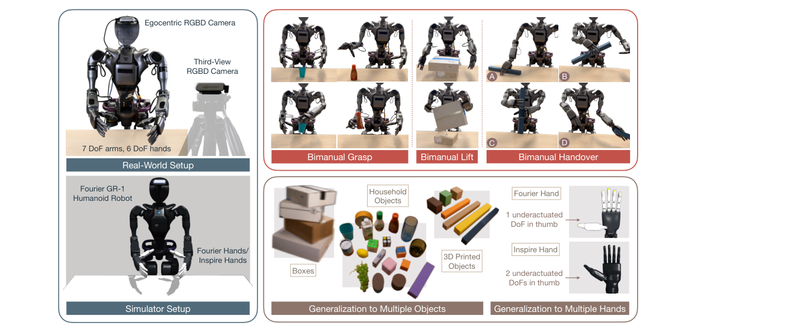
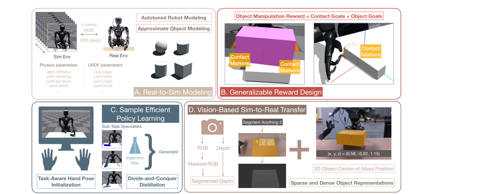
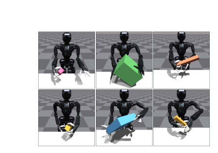
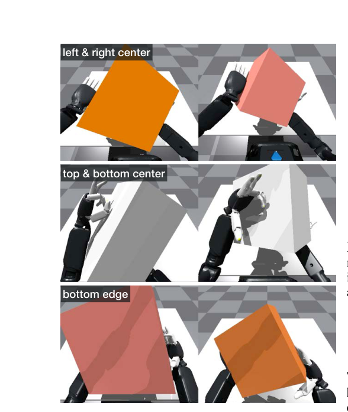
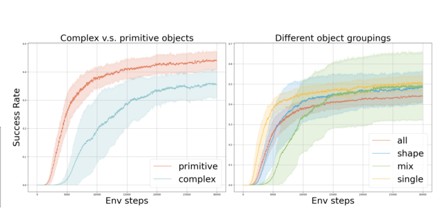
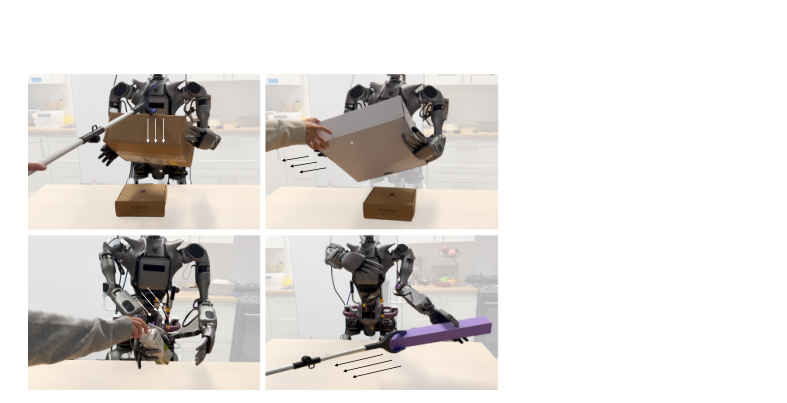

## 基础摘要

人形机器人视觉灵巧操作需要同时处理高维本体、接触丰富的双手协作和真实感知差异，现有工作多依赖昂贵且难以扩展的遥操作数据与模仿学习；sim-to-real 强化学习虽在状态输入或单手任务上有效，却尚未证明能扩展到基于视觉的双手操作。论文给出一套可落地的训练方案：自动校准真实与仿真之间的差异，用接触和物体目标构造通用奖励，以分治式策略蒸馏拆分复杂技能，并通过混合物体表示和模态特定增强提升视觉策略的泛化能力。其贡献不只是单项技巧，而是把仿真训练、真实对齐和视觉泛化串成完整流程。

## 论文结构图

<!--RAW-->
<figure class="paper-figure">
  
  <figcaption>图 1：系统总览。左侧为真实世界与仿真环境：Fourier GR-1 人形机器人配备 7 自由度双臂和 6 自由度多指手，头部安装第一视角 RGBD 相机，前方三脚架安装第三人称 RGBD 相机。右上展示三类任务：双手抓取、双手抬箱和双手交接；右下展示物体多样性（家用物品、盒子、3D 打印物体）与手部硬件多样性（Fourier 手与 Inspire 手，拇指分别具有 1 个和 2 个欠驱动自由度）。作者用同一套流程训练机器人，使其在形状、尺寸、颜色、材质和质量各异的未见真实物体上零样本泛化，并在外力扰动下保持鲁棒，同时在两种手部硬件上验证方法适应性。</figcaption>
</figure>
<!--/RAW-->

<!--RAW-->
<figure class="paper-figure">
  
  <figcaption>图 2：面向基于视觉的灵巧操作的 sim-to-real 强化学习配方。A. 真实到仿真建模：自动调节机器人物理参数与 URDF 参数，并用几何基元近似物体；B. 可泛化奖励设计：把操作奖励拆成“接触目标 + 物体目标”，通过在物体表面放置接触标记来指定期望接触位置；C. 样本高效策略学习：用任务相关的手部姿态初始化，把复杂任务拆成子任务专家，并在过滤成功轨迹后蒸馏为通用策略；D. 基于视觉的仿真到现实迁移：用 SAM2 从第一视角 RGB 与深度中分割物体，得到掩码 RGB 和分割深度，同时结合第三人称视角估计三维质心，形成稀疏与稠密结合的对象表示。</figcaption>
</figure>
<!--/RAW-->

<!--RAW-->
<figure class="paper-figure">
  
  <figcaption><strong>图 3：</strong>仿真中学习到的策略。左：抓取并伸手；中：抬箱；右：双手交接（从右手到左手、从左手到右手）。  <strong>图 4：</strong>使用不同物体集合训练抓取伸手策略。每条曲线来自 10 次不同随机种子的运行。左：复杂物体与简单几何基元物体的训练对比，基元物体的收敛更快；右：对不同几何物体分组方式的训练对比，四条曲线分别为全部物体（all）、按形状相似分组（shape）、按形状差异分组（mix）和逐物体单独训练（single）。</figcaption>
</figure>
<!--/RAW-->

<!--RAW-->
<figure class="paper-figure">
  
  <figcaption><strong>图 5：</strong>接触标记的不同放置会产生不同的接触模式。上：标记位于左右两侧面的中心；中：标记位于上下两侧面的中心；下：标记位于底面边缘。每一行的左右两幅为不同视角或不同回合中的结果。  <strong>图 6：</strong>策略鲁棒性。学习到的策略在撞、拉、推、拖等不同外力扰动下仍保持鲁棒；左上为撞击，右上为拉拽，左下为推挤，右下为拖动。</figcaption>
</figure>
<!--/RAW-->

## 中文完整翻译

### 面向人形机器人基于视觉的灵巧操作的仿真到现实强化学习

**作者**：Toru Lin¹,²、Kartik Sachdev²、Linxi “Jim” Fan²、Jitendra Malik¹、Yuke Zhu²,³

**单位**：¹ 加州大学伯克利分校；² NVIDIA；³ 德克萨斯大学奥斯汀分校

**项目页**：https://toruowo.github.io/recipe

第 9 届机器人学习会议（CoRL 2025），韩国首尔

---

**图 1：系统总览（图见“论文结构图”）。** 作者训练一台带两只多指手的人形机器人，在多样物体上完成一系列接触丰富的灵巧操作任务。观测来自第三人称相机、第一视角相机和机器人本体感受。RL 策略可零样本泛化到形状、尺寸、颜色、材质、质量各异的未见真实物体，并在外力扰动下保持鲁棒；方法还在两种硬件变体上得到验证。

---

### 摘要

学习可泛化的机器人操作策略，尤其是面向复杂多指人形机器人的策略，仍是一项重大挑战。现有方法主要依赖大量数据采集与模仿学习，这些做法成本高、劳动密集且难以扩展。仿真到现实（sim-to-real）强化学习（RL）提供了一种有前景的替代方案，但此前主要在较简单的基于状态或单手机器人设定中取得成功。如何将其有效扩展到基于视觉、接触丰富的双手操作任务，仍是一个开放问题。本文提出一套实用的 sim-to-real RL 配方，训练人形机器人完成三项具有挑战性的灵巧操作任务：抓取并伸手、抬箱以及双手交接。方法包含自动化的真实到仿真调节模块、基于接触目标与物体目标的泛化奖励公式、分而治之的策略蒸馏框架，以及带模态特定增强的混合物体表示策略。作者在未见物体上展示了较高的成功率，以及鲁棒、自适应的策略行为，表明基于视觉的灵巧操作通过 sim-to-real RL 不仅可行，而且可扩展，并能广泛适用于真实世界的人形机器人操作任务。

**关键词**：人形机器人、基于视觉的灵巧操作、强化学习、仿真到现实

---

### 1 引言

学习可泛化的操作策略——尤其是面向配备多指手的复杂人形机器人——仍是机器人学中的艰巨挑战。现有方法通常依赖大量真实世界数据采集和模仿学习 [1, 2, 3]，这些方法成本高、劳动密集且难以扩展。Sim-to-real 强化学习提供了有前景的替代方案，并已在导航 [4, 5]、运动控制 [6, 7] 和自主无人机竞速 [8] 中取得令人印象深刻的成果。然而，其在灵巧操作中的应用仍主要局限于单手 [9, 10, 11, 12, 13] 或基于状态的设定 [14, 15, 16, 17]，如何将 RL 扩展到人形机器人本体上基于视觉、接触丰富的双手任务仍是未解问题。

本文提出一套实用的、基于视觉的 sim-to-real RL 配方，使多指人形机器人能够学习高度可泛化、鲁棒且灵巧的操作技能。作者识别并处理了若干此前工作尚未深入探索的关键挑战：

（A）**低成本操作系统的仿真到现实迁移。** 现有方法依赖配备高精度电机的工业级机械臂。然而，许多人形机器人平台采用更轻量、噪声更大的电机，这使接触丰富的灵巧抓取和双手协调显著更难，尤其是对 sim-to-real 方法而言。作者引入一种简单、自动化的真实到仿真系统辨识方法，仅用不到四分钟的真实世界数据即可克服这一困难。

（B）**复杂协调的奖励设计。** 双手交接和抬举等双手操作任务要求手臂与手之间复杂协调：一侧必须以补充另一侧的方式行动，并在运动与时机上都保持精确。设计能够刻画这类接触丰富协作的奖励函数并不简单。作者提出一种新的基于关键点的奖励公式，以有效促进这种协调。

（C）**探索。** 双手协调的长时程、高维特性带来了困难的探索问题，即使奖励函数已经设计得很好也是如此。作者提出使用任务感知的初始化策略来加速单任务 RL，并把整体多任务（例如多物体）策略学习分解为多个单独的单任务 RL，随后进行通用策略蒸馏。

（D）**物体感知。** 物体多样性与 sim-to-real 域偏移的结合，使基于视觉的操作尤其困难。作者提出一种混合物体表示，将紧凑的低维特征与表达能力更强的高维特征结合，并通过模态特定的随机化进行增强。作者发现这一简单策略效果出奇地好——在新型物体上把 sim-to-real 成功率显著提高 80∼100%。

作者在三项具有挑战性的基于视觉的操作任务上验证方法：灵巧抓取并伸手、双手抬举、双手交接。零样本 sim-to-real 策略在具有不同物理性质的真实未见物体上表现出鲁棒、自适应且可泛化的行为，在已见物体上达到 90% 成功率，在新型物体上达到 60∼80% 成功率。此外，作者还在两种不同的多指机器人手上确认了方法对硬件变化的适应性。这些结果共同建立了一套实用且可扩展的配方，可通过 sim-to-real RL 实现高性能的基于视觉的灵巧操作。

---

### 2 背景

#### 2.1 深度强化学习在机器人中的应用

深度 RL 在游戏、语言建模和控制等领域取得的成功 [6, 8, 18, 19, 20, 21] 引发了广泛关注。然而，该范式已知较为脆弱：由于算法方差较大，它对超参数敏感 [22]，并存在可复现性问题 [23]。在 RL 的开放问题中，探索仍然具有基础性地位。与监督学习不同，RL 智能体必须自行采集数据，而采集策略会直接影响性能。真实世界机器人进一步叠加了高维输入、稀疏奖励和复杂动力学带来的困难。许多方法试图通过奖励新颖性来扩展探索 [24, 25, 26, 27, 28, 29, 30]，但它们并未从根本上解决探索瓶颈。

机器人学还暴露了标准 RL 基准 [31, 32] 中被忽视的挑战，包括：（1）缺少被完整建模的环境；（2）缺少明确定义的奖励函数。过去的工作引入了实用技术来缓解这些问题，例如从运动捕捉或遥操作示范中学习 [33, 34, 35, 36]、真实到仿真建模技术 [9, 4, 10, 14, 37]，以及更原则化的奖励设计 [38, 39]。这些方法往往针对特定任务或硬件定制，但它们奠定了本文方法所继承并推广的基础。

#### 2.2 人形机器人上基于视觉的灵巧操作

**模仿学习与经典方法。** 近期遥操作 [2, 3, 40, 41] 和从示范中学习 [42, 43] 的进展，推动了基于视觉的灵巧操作 [2, 43, 3, 44] 的显著进步。然而，遥操作仍难以规模化，仅依靠真实世界示范数据达到高成功率 [45, 46, 44] 需要大规模数据集，使纯监督方法在复杂任务上达到人类水平性能的代价很高。

**强化学习方法。** 基于 RL 的操作工作已在手内重定向 [9, 10, 12, 47]、抓取 [17, 13]、拧转 [14] 和动态交接 [15] 等设定中显示出强结果，但通常聚焦于单手设定 [9, 48, 10, 17, 12, 13, 47]，或使用中间物体表示而非原始像素 [33, 15, 14]。与本文最接近的是 Chen 等人 [33]，但其方法依赖人类手部运动捕捉，而本文从零开始学习完整的手—臂关节控制。本文工作也是首次在配备多指手的新型人形机器人平台上展示双手策略的鲁棒 sim-to-real 迁移。

---

### 3 本文配方

第 1 节概述了灵巧操作 sim-to-real RL 中的四项关键挑战。本节给出针对每项挑战开发的详细方法。图 2 展示了整体概览。

**图 2：面向基于视觉的灵巧操作的 sim-to-real RL 配方（图见“论文结构图”）。** 自动化真实到仿真调节模块缩小仿真与现实的环境建模差距；把每项操作任务拆成接触状态与物体状态，以设计可泛化奖励；使用任务相关手部姿态和分而治之蒸馏提高策略训练样本效率；再用稀疏与稠密物体表示的组合，把基于视觉的策略迁移到真实世界。

#### 3.1 真实到仿真建模

仿真器提供无限次试错机会，以完成 RL 所需的探索。然而，仿真中学习到的策略能否可靠迁移到真实世界，取决于对机器人和环境的准确建模。在灵巧操作中，这一挑战因物体建模需求而加剧：物体具有多样且往往不可测量的物理性质。即使参数已知，匹配真实世界与仿真动力学也并非易事：由于物理引擎的差异，仿真与真实世界中的同一物理常数取值不一定对应相同的运动学与动力学关系。

**自动调节的机器人建模。** 制造商提供的机器人模型提供了一个基线，但通常需要大量调节 [9, 49] 才能用于 sim-to-real。由于真实世界与仿真世界之间不存在“真值”配对，这一调节过程十分繁琐。作者提出一个自动调节（autotune）模块，用于快速、自动地校准仿真参数，使其匹配真实机器人行为。如图 2A 和算法 1 所示，该方法仅使用真实硬件上的一组校准轨迹，联合优化仿真器物理参数（例如摩擦、阻尼）与 URDF 常数（例如连杆惯量值、关节限位）。它采样参数集，在并行仿真中运行关节目标运动，并选择相对真实机器人跟踪误差最小的参数集——自动搜索参数空间，在不到四分钟（或 10 Hz 下 2000 个仿真步）内为仿真器物理和机器人模型常数寻找最优值。这消除了迭代式人工调节的需求，并可推广到任何由仿真器暴露、会影响运动学行为的参数。

<!--RAW-->
<pre class="prompt">Algorithm 1  Real-to-Sim Autotune Module
Require:
  1: E : 待调节的环境参数集合
  2: N : 校准动作序列数量
  3: R : 真实机器人硬件环境
  4: M : 初始机器人模型文件
  5: procedure AUTOTUNE(E, N, R, M)
  6:     P ← InitializeParameterSpace(E, M)
  7:     S ← {}                       ▷ 仿真环境集合
  8:     for i ← 1 to K do             ▷ K 为种群规模
  9:         p_i ← RandomSample(P)
 10:         S_i ← CreateSimEnvironment(p_i)
 11:         S ← S ∪ {S_i}
 12:     end for
 13:     J ← GenerateJointTargets(N)
 14:     R_track ← GetTrackingErrors(R, J)      ▷ 真实跟踪误差
 15:     best_params ← null
 16:     min_error ← ∞
 17:     for S_i ∈ S do
 18:         S_track ← GetTrackingErrors(S_i, J)
 19:         error ← ComputeMSE(S_track, R_track)
 20:         if error &lt; min_error then
 21:             min_error ← error
 22:             best_params ← GetParameters(S_i)
 23:         end if
 24:     end for
 25:     return best_params
 26: end procedure</pre>
<!--/RAW-->

**近似物体建模。** 遵循此前工作 [14, 50]，作者使用带随机物理参数的简单几何基元（例如圆柱体）对物体建模。尽管这些近似很简单，但足以学习能够可靠迁移到真实世界的灵巧操作策略。本文配方采用这一策略，并发现它既有效又可泛化。

#### 3.2 可泛化奖励设计

在标准 RL [51] 中，奖励函数对塑造智能体行为起着核心作用。然而，许多 RL 研究把奖励视为固定的，转而关注算法改进 [52]。在机器人学中——尤其是灵巧操作中——由于接触动力学复杂、物体多变 [53]，设计有效且可泛化的奖励成为关键挑战。

**把操作视为接触目标与物体目标。** 作者观察到，许多人类操作任务 [54] 可以分解为一系列手—物体接触转换和物体状态变化。受此启发，作者为长时程、接触丰富任务提出结构化奖励设计方案。例如，双手交接可以切分为：（1）一只手接触物体；（2）把物体抬到第二只手附近；（3）第二只手接触物体；（4）把物体转移到目标位置。因此，作者基于两个关键分量定义奖励：“接触目标”鼓励指尖到达物体上与任务相关的接触点，“物体目标”惩罚当前物体状态相对目标物体状态（例如 xyz 位置）的偏差。为便于指定接触目标，作者引入一种基于关键点的技术：在仿真物体上增加“接触贴纸”——表示期望接触位置的表面标记。于是，接触目标可以按奖励写为

$$
r_{\mathrm{contact}}=\sum_i\left[\frac{1}{1+\alpha d(X^L,F_i^L)}+\frac{1}{1+\beta d(X^R,F_i^R)}\right],
$$

其中 $X^L\in\mathbb{R}^{n\times3}$ 和 $X^R\in\mathbb{R}^{m\times3}$ 分别为左手和右手指定的接触标记位置，$F^L\in\mathbb{R}^{4\times3}$ 和 $F^R\in\mathbb{R}^{4\times3}$ 分别为左手和右手指尖位置，$\alpha$ 与 $\beta$ 为缩放超参数，$d$ 为距离函数，定义为 $d(A,x)=\min_i\|A_i-x\|_2$。这些接触标记可以任意指定——例如根据物体几何形状程序化生成——从而灵活地融入接触偏好或人类先验。图 2B 可视化了接触标记，第 4 节分析其实际效果。

#### 3.3 样本高效的策略学习

即使奖励设计良好，在高维双手多指系统上学习灵巧策略仍因奖励稀疏和探索复杂而样本效率低下。作者引入两项技术来提高样本效率：（1）使用人类引导手部姿态进行任务感知初始化；（2）采用分而治之策略与策略蒸馏。

**用于初始化的任务感知手部姿态。** 作者从仿真中的人类遥操作采集任务相关的手—物体构型。这可以使用任何兼容双手多指手的系统完成。记录的状态（包括物体姿态和机器人关节位置）随后被随机采样，作为每个训练回合的初始条件。与依赖完整示范轨迹的此前工作 [55] 不同，本文方法只要求人类围绕任务目标随意“摆弄”。由于不需要专家示范，这种轻量数据采集每个任务耗时不到 30 秒，却被证明能显著改善早期探索。

**分而治之蒸馏。** 标准 RL 探索技术 [25, 26, 28, 56] 旨在更高效地访问状态空间，但并未从根本上改变稀疏奖励问题的难度：访问“正确”状态并获得学习信号的概率仍然不变。作者转而通过拆解可探索状态空间本身来克服探索问题，例如把多物体操作任务分解为多个单物体操作任务。为每个子任务训练专门策略后，可以过滤高质量 rollout，并利用共享的观测与动作空间将其蒸馏为通用策略。这实际上使纯 RL 更接近从示范中学习：子任务策略充当仿真环境中的“遥操作者”，而集中式通用策略从经过筛选的数据中学习。

#### 3.4 基于视觉的仿真到现实迁移

基于视觉的 sim-to-real 迁移尤其具有挑战性，因为动力学和感知两方面都存在域差。作者采用两种策略应对：混合物体表示与广泛的域随机化。

**混合物体表示。** 灵巧操作通常需要精确感知物体姿态和几何形状。此前工作的物体表示跨越一个谱系，从三维位置 [14]、六维姿态 [9]，到深度 [17, 12]、点云 [57] 和 RGB 图像 [10]。更高维的表示编码更丰富的物体信息，能改善任务性能，但也会扩大 sim-to-real 差距；反之亦然。为平衡权衡，作者提出混合使用低维和高维信号：三维物体位置（来自固定第三人称视角）和深度图像（来自第一视角）。三维物体位置由可靠的物体跟踪模块获得，其噪声相对可控；同时分割出物体深度，以缩小视觉 sim-to-real 差距。作者在第 4 节验证这一设计。

**面向感知与动力学的域随机化。** 为提高鲁棒性，作者在训练中进行广泛域随机化，包括物体参数、相机参数、机器人物理性质和观测噪声的变化。完整细节见附录 6.3。

---

### 4 实验

本文提出的方法构成一套通用配方，使 RL 能够实际应用于解决人形机器人的灵巧操作。本节展示任务能力实验，以及每项提出技术的消融研究。视频见项目网站。

#### 4.1 真实世界与仿真器设置

作者使用 Fourier GR1 人形机器人，配备两条手臂和两只多指手。每条手臂有 7 个自由度（DoF）。大多数实验使用 Fourier 手，每只手有 6 个驱动自由度和 5 个欠驱动自由度。为展示跨本体泛化，作者还报告 Inspire 手的结果，每只手有 6 个驱动自由度和 6 个欠驱动自由度。两种硬件在质量、表面摩擦、手指与手掌形态以及拇指驱动方式上存在显著差异。图 1 可视化了两种手。仿真器使用 NVIDIA Isaac Gym [58]。

**图 3：仿真中学习到的策略（图见“论文结构图”）。** 左：抓取并伸手；中：抬箱；右：双手交接（从右手到左手、从左手到右手）。

**图 4：使用不同物体集合训练抓取伸手策略（图见“论文结构图”）。** 每条曲线来自 10 次不同随机种子的运行。左：复杂物体与简单几何基元物体的训练对比；右：不同几何物体分组方式的训练对比。

**感知。** 如 3.4 节所述，作者在仿真和真实世界迁移中都使用稠密与稀疏物体特征相结合的方式进行策略学习。在真实世界中，作者在人形机器人头部安装第一视角 RealSense D435 深度相机，并在机器人前方三脚架上安装第三人称 RealSense D435 深度相机（见图 1）。在仿真中，作者同样设置两个相机，并依据真实相机位姿校准其位姿。稠密物体特征直接读取第一视角相机的深度观测。稀疏特征则通过第三人称相机近似物体质心，采用与 Lin 等人 [14] 类似的技术。如图 2 所示，作者使用 Segment Anything Model 2（SAM2）[59] 在每条轨迹序列的初始帧生成物体分割掩码，并利用 SAM2 的跟踪能力在其余所有帧中跟踪该掩码。为近似物体的三维质心坐标，作者计算物体掩码在图像平面中的中心位置，再从深度相机获取带噪声的深度读数，恢复对应的三维位置。感知管线以 5 Hz 运行，以匹配神经网络策略的控制频率。

#### 4.2 任务定义

（A）**抓取并伸手。** 机器人必须用一只手抓取桌面物体，将其抬起并放置到目标位置。初始化时，一个脚本化视觉模块选择距离物体更近的手。测试物体在形状、质量、体积、摩擦、颜色和纹理上各不相同（见图 1）。每个回合随机化物体姿态和目标位置。

（B）**抬箱。** 机器人抬起一个过大、无法单手抓取的箱子。箱子的尺寸、颜色、质量和初始姿态（位置与偏航角随机）在不同回合中变化。

（C）**双手交接。** 机器人用一只手从桌子一侧抓取物体，并将其交给另一只手，而后者无法直接够到物体。物体在颜色、尺寸、质量和姿态上变化。作者在每个回合中改变方块的初始姿态。

#### 4.3 真实到仿真建模评估

**自动调节机器人建模的有效性。** 作者应用 3.1 节描述的 autotune 模块优化机器人建模参数。为评估其有效性，作者比较三组策略检查点的 sim-to-real 迁移成功率；这些检查点除机器人建模参数外，训练设置完全相同。这些参数集对应不同的建模精度，以 autotune 得到的均方误差（MSE）衡量——从最低（即真实到仿真差距最小）到最高（即差距最大）。如表 1 所示，使用自动调节模型训练的策略表现出显著更好的 sim-to-real 性能。视频中的定性示例进一步展示了抓取伸手策略成功迁移到 Inspire 手，凸显了 autotune 模块的泛化性。

**近似物体建模的有效性。** 实验发现，把物体建模为基本几何形状（圆柱、立方体和球体）能在训练效率与 sim-to-real 可迁移性之间取得良好平衡。如图 4（左）所示，与使用复杂物体几何相比，用基元形状训练抓取伸手策略收敛更快。更重要的是，使用随机化基元形状训练的策略对多样未见物体表现出强泛化，视频中对此进行了展示。

**图 5：接触标记的不同放置会产生不同接触模式（图见“论文结构图”）。** 上：标记位于左右两侧面的中心；中：标记位于上下两侧面的中心；下：标记位于底面边缘。

**图 6：策略鲁棒性（图见“论文结构图”）。** 学习到的策略在撞、拉、推、拖等不同外力扰动下仍保持鲁棒：左上为撞击，右上为拉拽，左下为推挤，右下为拖动。

| Autotune MSE | 最低 | 中位 | 最高 |
|---|---:|---:|---:|
| 抓取成功率 | 8 / 10 | 3 / 10 | 0 / 10 |
| 伸手成功率 | 7 / 10 | 3 / 10 | 0 / 10 |

**表 1：autotune 的 MSE 越低，sim-to-real 成功率越高。** 对每组建模参数，作者测试 10 个策略检查点（除随机种子外训练完全相同）的 sim-to-real 迁移性能。作者按抓取伸手任务的阶段评估成功率，并观察到 autotune 模块测得的 MSE 越低，sim-to-real 迁移成功率越高。

#### 4.4 奖励设计评估

**任务能力。** 借助提出的奖励设计原则，纯 RL 可以成功解决广泛的长时程、接触丰富任务，如图 3 和视频所示。所得策略在各种随机外力扰动下表现出显著的灵巧性和鲁棒性。

**基于接触的奖励的有效性。** 图 5 以抬箱任务为例，可视化不同接触标记放置如何诱导不同接触行为。接触贴纸根据箱子尺寸沿箱面或箱边程序化生成。所得行为密切反映了指定的接触位置，证明使用接触标记定义接触目标是有效的。

#### 4.5 策略学习评估

**任务感知手部姿态初始化的有效性。** 表 2 比较了各任务在有、无任务感知手部姿态初始化时成功训练出的策略比例。结果表明，在初始化中引入人类先验能显著提高困难 RL 任务的探索效率。

| 任务 | 抓取 | 抬举 | 交接 |
|---|---:|---:|---:|
| 有人类初始化 | 80% | 90% | 30% |
| 无人类初始化 | 60% | 90% | 0% |

**表 2：使用人类数据初始化。** 表格给出成功训练的任务策略比例与是否使用人类摆弄数据进行初始化之间的关系。作者把成功策略定义为评估期间回合成功率超过 60% 的策略。每个任务、每种初始化设置均测试 10 个随机种子。

**分而治之蒸馏。** 作者通过两项消融研究评估分而治之蒸馏策略。首先，作者考察任务分解粒度如何影响涉及 10 个物体的多物体抓取伸手任务的训练效率。作者比较四种设计：（1）在所有物体上训练单一策略（all）；（2）在形状相似物体组上训练三个策略（shape）；（3）在形状多样物体组上训练三个策略（mix）；（4）训练十个独立的单物体策略（single）。如图 4 所示，single 的样本效率最高，其后依次为 shape、all 和 mix。不同设计的平均成功率也存在差异，反映了任务难度差异。值得注意的是，在缩减物体集合上训练的策略最终收敛到相近性能，而 all 策略始终表现较差。其次，作者在分布内物体上通过 30 次试验评估每种策略类型的 sim-to-real 迁移成功率。mix 策略表现最好（90.0%），其后为 shape（63.3%）、single（40.0%）和 all（23.3%）。作者推测，single 和 mix 的较低性能源于对特定几何形状的过拟合，而 all 的较差表现与其较弱的 RL 训练结果一致。这些结果表明，分而治之蒸馏在训练效率与 sim-to-real 泛化之间取得了有利平衡。

#### 4.6 基于视觉的仿真到现实迁移评估

**混合物体表示的有效性。** 作者研究不同物体表示对 sim-to-real 迁移性能的影响，结果汇总于表 3。研究发现，把稠密表示（分割深度图像）与稀疏表示（三维物体质心位置）结合，可以提高迁移成功率。值得注意的是，在准确理解完整物体几何对成功更关键的任务中，深度加位置策略与仅深度策略之间的性能差距更大。

| 表示 | 指标 | 抓取 | 抬举 | 交接 A | 交接 B |
|---|---|---:|---:|---:|---:|
| Depth + Pos | 拾取 | 10 / 10 | 10 / 10 | 10 / 10 | 10 / 10 |
| Depth + Pos | 任务成功 | 10 / 10 | 10 / 10 | 9 / 10 | 5 / 10 |
| Depth Only | 拾取 | 2 / 10 | 0 / 10 | 0 / 10 | 0 / 10 |
| Depth Only | 任务成功 | 2 / 10 | 0 / 10 | 0 / 10 | 0 / 10 |

**表 3：深度加位置策略与仅深度策略的 sim-to-real 迁移性能比较。** 由于双手交接任务时程较长，作者将其分为两列。拾取成功率衡量手成功抓起物体的频率。把三维位置与深度结合，可以实现更容易的 sim-to-real 迁移。

#### 4.7 系统能力

**任务性能、泛化与鲁棒性。** 作者使用每个任务表现最好的策略报告任务成功率，以评估系统整体有效性。对每个任务，作者在每个测试物体上执行 10 次试验，并计算所有物体的平均成功率。作者报告抓取伸手任务成功率为 62.3%，抬箱为 80%，双手交接为 52.5%。为评估泛化，作者在分布外物体上测试抓取伸手策略，并在视频中给出成功零样本迁移的定性证据。此外，作者在所有任务上评估策略在外部力扰动下的鲁棒性，如图 6 和视频所示。各任务物体集合的更多细节见图 1。

**扩展到能力更强的系统。** 学习到的 RL 策略可以无缝集成到有限状态机或遥操作框架等高层控制结构中，以支持更长时程的任务执行，同时保持灵巧性、鲁棒性和泛化能力。作为概念验证，视频展示了一个通用拾取—放置系统，该系统围绕抓取伸手策略脚本化编排任务序列。

---

### 5 结论

本文提出一套完整配方，把 sim-to-real RL 应用于人形机器人上基于视觉的灵巧操作。通过处理环境建模、奖励设计、策略学习和 sim-to-real 迁移中的关键挑战，作者表明 RL 可以成为学习高度实用操作技能的有力工具，而无需大量人类示范。学习到的策略对未见物体表现出强泛化，对外力扰动保持鲁棒，并能执行长时程、接触丰富的任务。

---

### 6 局限性

本文研究了把 RL 应用于机器人操作时的关键挑战，并引入实用且有原则的技术来克服障碍。基于提出的技术，作者构建了一条 sim-to-real RL 流水线，展示了解决机器人操作问题的可行路径，并给出了泛化性、鲁棒性和灵巧性方面的证据。

然而，本文实现的能力仍远未达到人类所能做到的“通用”操作水平。要改进流水线的每个单独组件并释放 sim-to-real RL 的全部潜力，仍有大量工作要做。例如，可以通过整合更强的人类先验（如从遥操作采集的任务示范）来改进奖励设计；也可以探索替代控制器，例如力矩控制器。

本文工作还有一些未解决的重要开放问题。例如，除了使用朴素的域随机化之外，作者并未提出新技术来缩小动力学上的 sim-to-real 差距。作者推测，这可能是双手交接任务成功率较低的原因之一，因为该任务是本文任务集合中动态性最强的。

最后，作者发现自己深受缺乏可靠灵巧操作硬件的限制。虽然使用了多指机器人手，但这些手在主动自由度方面远不及人类手灵巧。作者认为，学习到的策略的灵巧性并不受方法本身限制，并希望未来把框架扩展到设计更复杂的机器人手。

---

### 致谢

作者感谢 NVIDIA GEAR 实验室成员在硬件基础设施方面的帮助，特别是 Zhenjia Xu、Yizhou Zhao 和 Zu Wang。本工作部分完成于 TL 在 NVIDIA 实习期间。TL 获得 NVIDIA 和国家科学基金会奖学金资助。

---

### 参考文献

- [1] J. Bjorck, F. Castañeda, N. Cherniadev, X. Da, R. Ding, L. Fan, Y. Fang, D. Fox, F. Hu, S. Huang, et al. Gr00t n1: An open foundation model for generalist humanoid robots. arXiv preprint arXiv:2503.14734, 2025.
- [2] X. Cheng, J. Li, S. Yang, G. Yang, and X. Wang. Open-television: Teleoperation with immersive active visual feedback. arXiv preprint arXiv:2407.01512, 2024.
- [3] T. Lin, Y. Zhang, Q. Li, H. Qi, B. Yi, S. Levine, and J. Malik. Learning visuotactile skills with two multifingered hands. arXiv:2404.16823, 2024.
- [4] T. Haarnoja, B. Moran, G. Lever, S. H. Huang, D. Tirumala, J. Humplik, M. Wulfmeier, S. Tunyasuvunakool, N. Y. Siegel, R. Hafner, et al. Learning agile soccer skills for a bipedal robot with deep reinforcement learning. Science Robotics, 9(89):eadi8022, 2024.
- [5] N. Rudin, D. Hoeller, M. Bjelonic, and M. Hutter. Advanced skills by learning locomotion and local navigation end-to-end. In 2022 IEEE/RSJ International Conference on Intelligent Robots and Systems (IROS), pages 2497–2503. IEEE, 2022.
- [6] J. Hwangbo, J. Lee, A. Dosovitskiy, D. Bellicoso, V. Tsounis, V. Koltun, and M. Hutter. Learning agile and dynamic motor skills for legged robots. Science Robotics, 4(26):eaau5872, 2019.
- [7] J. Lee, J. Hwangbo, L. Wellhausen, V. Koltun, and M. Hutter. Learning quadrupedal locomotion over challenging terrain. Science robotics, 5(47):eabc5986, 2020.
- [8] E. Kaufmann, L. Bauersfeld, A. Loquercio, M. Müller, V. Koltun, and D. Scaramuzza. Champion-level drone racing using deep reinforcement learning. Nature, 620(7976):982–987, 2023.
- [9] I. Akkaya, M. Andrychowicz, M. Chociej, M. Litwin, B. McGrew, A. Petron, A. Paino, M. Plappert, G. Powell, R. Ribas, et al. Solving rubik's cube with a robot hand. arXiv preprint arXiv:1910.07113, 2019.
- [10] A. Handa, A. Allshire, V. Makoviychuk, A. Petrenko, R. Singh, J. Liu, D. Makoviichuk, K. Van Wyk, A. Zhurkevich, B. Sundaralingam, et al. Dextreme: Transfer of agile in-hand manipulation from simulation to reality. In 2023 IEEE International Conference on Robotics and Automation (ICRA), pages 5977–5984. IEEE, 2023.
- [11] T. Chen, J. Xu, and P. Agrawal. A system for general in-hand object re-orientation. In Conference on Robot Learning, pages 297–307. PMLR, 2022.
- [12] H. Qi, B. Yi, S. Suresh, M. Lambeta, Y. Ma, R. Calandra, and J. Malik. General in-hand object rotation with vision and touch. In Conference on Robot Learning, pages 2549–2564. PMLR, 2023.
- [13] R. Singh, A. Allshire, A. Handa, N. Ratliff, and K. Van Wyk. Dextrah-rgb: Visuomotor policies to grasp anything with dexterous hands. arXiv preprint arXiv:2412.01791, 2024.
- [14] T. Lin, Z.-H. Yin, H. Qi, P. Abbeel, and J. Malik. Twisting lids off with two hands. arXiv:2403.02338, 2024.
- [15] B. Huang, Y. Chen, T. Wang, Y. Qin, Y. Yang, N. Atanasov, and X. Wang. Dynamic handover: Throw and catch with bimanual hands. arXiv preprint arXiv:2309.05655, 2023.
- [16] H. Qi, A. Kumar, R. Calandra, Y. Ma, and J. Malik. In-Hand Object Rotation via Rapid Motor Adaptation. In Conference on Robot Learning (CoRL), 2022.
- [17] T. G. W. Lum, M. Matak, V. Makoviychuk, A. Handa, A. Allshire, T. Hermans, N. D. Ratliff, and K. Van Wyk. Dextrah-g: Pixels-to-action dexterous arm-hand grasping with geometric fabrics. arXiv preprint arXiv:2407.02274, 2024.
- [18] O. AI, Sep 2024. URL https://openai.com/index/learning-to-reason-with-llms.
- [19] D.-A. et al. Deepseek-r1: Incentivizing reasoning capability in llms via reinforcement learning, 2025. URL https://arxiv.org/abs/2501.12948.
- [20] D. Silver, T. Hubert, J. Schrittwieser, I. Antonoglou, M. Lai, A. Guez, M. Lanctot, L. Sifre, D. Kumaran, T. Graepel, et al. Mastering chess and shogi by self-play with a general reinforcement learning algorithm. arXiv preprint arXiv:1712.01815, 2017.
- [21] O. Vinyals, I. Babuschkin, W. M. Czarnecki, M. Mathieu, A. Dudzik, J. Chung, D. H. Choi, R. Powell, T. Ewalds, P. Georgiev, et al. Grandmaster level in starcraft ii using multi-agent reinforcement learning. Nature, 575(7782):350–354, 2019.
- [22] P. Henderson, R. Islam, P. Bachman, J. Pineau, D. Precup, and D. Meger. Deep reinforcement learning that matters. In Proceedings of the AAAI Conference on Artificial Intelligence, volume 32, 2018.
- [23] R. Islam, P. Henderson, M. Gomrokchi, and D. Precup. Reproducibility of benchmarked deep reinforcement learning tasks for continuous control. arXiv preprint arXiv:1708.04133, 2017.
- [24] M. Bellemare, S. Srinivasan, G. Ostrovski, T. Schaul, D. Saxton, and R. Munos. Unifying count-based exploration and intrinsic motivation. Advances in neural information processing systems, 29, 2016.
- [25] Y. Burda, H. Edwards, A. Storkey, and O. Klimov. Exploration by random network distillation. arXiv preprint arXiv:1810.12894, 2018.
- [26] T. Lin and A. Jabri. Mimex: intrinsic rewards from masked input modeling. Advances in Neural Information Processing Systems, 36, 2024.
- [27] G. Ostrovski, M. G. Bellemare, A. Oord, and R. Munos. Count-based exploration with neural density models. In International conference on machine learning, pages 2721–2730. PMLR, 2017.
- [28] D. Pathak, P. Agrawal, A. A. Efros, and T. Darrell. Curiosity-driven exploration by self-supervised prediction. In International conference on machine learning, pages 2778–2787. PMLR, 2017.
- [29] B. C. Stadie, S. Levine, and P. Abbeel. Incentivizing exploration in reinforcement learning with deep predictive models. arXiv preprint arXiv:1507.00814, 2015.
- [30] H. Tang, R. Houthooft, D. Foote, A. Stooke, O. Xi Chen, Y. Duan, J. Schulman, F. DeTurck, and P. Abbeel. # exploration: A study of count-based exploration for deep reinforcement learning. Advances in neural information processing systems, 30, 2017.
- [31] M. G. Bellemare, Y. Naddaf, J. Veness, and M. Bowling. The arcade learning environment: An evaluation platform for general agents. Journal of Artificial Intelligence Research, 47:253–279, 2013.
- [32] Y. Tassa, Y. Doron, A. Muldal, T. Erez, Y. Li, D. d. L. Casas, D. Budden, A. Abdolmaleki, J. Merel, A. Lefrancq, et al. Deepmind control suite. arXiv preprint arXiv:1801.00690, 2018.
- [33] Y. Chen, C. Wang, Y. Yang, and C. K. Liu. Object-centric dexterous manipulation from human motion data. arXiv preprint arXiv:2411.04005, 2024.
- [34] A. Rajeswaran, V. Kumar, A. Gupta, G. Vezzani, J. Schulman, E. Todorov, and S. Levine. Learning complex dexterous manipulation with deep reinforcement learning and demonstrations. arXiv preprint arXiv:1709.10087, 2017.
- [35] Z.-H. Yin, C. Wang, L. Pineda, F. Hogan, K. Bodduluri, A. Sharma, P. Lancaster, I. Prasad, M. Kalakrishnan, J. Malik, et al. Dexteritygen: Foundation controller for unprecedented dexterity. arXiv preprint arXiv:2502.04307, 2025.
- [36] Y. Zhu, Z. Wang, J. Merel, A. Rusu, T. Erez, S. Cabi, S. Tunyasuvunakool, J. Kramár, R. Hadsell, N. de Freitas, et al. Reinforcement and imitation learning for diverse visuomotor skills. arXiv preprint arXiv:1802.09564, 2018.
- [37] M. Torne, A. Simeonov, Z. Li, A. Chan, T. Chen, A. Gupta, and P. Agrawal. Reconciling reality through simulation: A real-to-sim-to-real approach for robust manipulation. Arxiv, 2024.
- [38] M. Memmel, A. Wagenmaker, C. Zhu, P. Yin, D. Fox, and A. Gupta. Asid: Active exploration for system identification in robotic manipulation. arXiv preprint arXiv:2404.12308, 2024.
- [39] C. Zhang, W. Xiao, T. He, and G. Shi. Wococo: Learning whole-body humanoid control with sequential contacts. arXiv preprint arXiv:2406.06005, 2024.
- [40] P. Wu, Y. Shentu, Z. Yi, X. Lin, and P. Abbeel. Gello: A general, low-cost, and intuitive teleoperation framework for robot manipulators, 2023.
- [41] T. Z. Zhao, V. Kumar, S. Levine, and C. Finn. Learning fine-grained bimanual manipulation with low-cost hardware. arXiv preprint arXiv:2304.13705, 2023.
- [42] C. Chi, S. Feng, Y. Du, Z. Xu, E. Cousineau, B. Burchfiel, and S. Song. Diffusion policy: Visuomotor policy learning via action diffusion. In RSS, 2023.
- [43] X. Li, T. Zhao, X. Zhu, J. Wang, T. Pang, and K. Fang. Planning-guided diffusion policy learning for generalizable contact-rich bimanual manipulation. arXiv preprint arXiv:2412.02676, 2024.
- [44] T. Z. Zhao, J. Tompson, D. Driess, P. Florence, K. Ghasemipour, C. Finn, and A. Wahid. Aloha unleashed: A simple recipe for robot dexterity. arXiv preprint arXiv:2410.13126, 2024.
- [45] S. Levine, P. Pastor, A. Krizhevsky, J. Ibarz, and D. Quillen. Learning hand-eye coordination for robotic grasping with deep learning and large-scale data collection. The International journal of robotics research, 37(4-5):421–436, 2018.
- [46] F. Lin, Y. Hu, P. Sheng, C. Wen, J. You, and Y. Gao. Data scaling laws in imitation learning for robotic manipulation. arXiv preprint arXiv:2410.18647, 2024.
- [47] J. Wang, Y. Yuan, H. Che, H. Qi, Y. Ma, J. Malik, and X. Wang. Lessons from learning to spin “pens”. arXiv preprint arXiv:2407.18902, 2024.
- [48] Y. Chen, C. Wang, L. Fei-Fei, and C. K. Liu. Sequential dexterity: Chaining dexterous policies for long-horizon manipulation. arXiv preprint arXiv:2309.00987, 2023.
- [49] I. Radosavovic, T. Xiao, B. Zhang, T. Darrell, J. Malik, and K. Sreenath. Real-world humanoid locomotion with reinforcement learning. Science Robotics, 9(89):eadi9579, 2024.
- [50] H. Qi, A. Kumar, R. Calandra, Y. Ma, and J. Malik. In-hand object rotation via rapid motor adaptation. In Conference on Robot Learning, pages 1722–1732. PMLR, 2023.
- [51] R. S. Sutton and A. G. Barto. Introduction to Reinforcement Learning. MIT Press, Cambridge, MA, 1998.
- [52] J. Eschmann. Reward Function Design in Reinforcement Learning, pages 25–33. Springer International Publishing, Cham, 2021. ISBN 978-3-030-41188-6. doi:10.1007/978-3-030-41188-6_3.
- [53] D. Dewey. Reinforcement learning and the reward engineering principle. In 2014 AAAI Spring Symposium Series, 2014.
- [54] K. Grauman, A. Westbury, L. Torresani, K. Kitani, J. Malik, T. Afouras, K. Ashutosh, V. Baiyya, S. Bansal, B. Boote, et al. Ego-exo4d: Understanding skilled human activity from first-and third-person perspectives. In Proceedings of the IEEE/CVF Conference on Computer Vision and Pattern Recognition, pages 19383–19400, 2024.
- [55] M. Bauza, J. E. Chen, V. Dalibard, N. Gileadi, R. Hafner, M. F. Martins, J. Moore, R. Pevceviciute, A. Laurens, D. Rao, et al. Demostart: Demonstration-led auto-curriculum applied to sim-to-real with multi-fingered robots. arXiv preprint arXiv:2409.06613, 2024.
- [56] A. A. Taïga, W. Fedus, M. C. Machado, A. Courville, and M. G. Bellemare. Benchmarking bonus-based exploration methods on the arcade learning environment. arXiv preprint arXiv:1908.02388, 2019.
- [57] M. Liu, Z. Chen, X. Cheng, Y. Ji, R.-Z. Qiu, R. Yang, and X. Wang. Visual whole-body control for legged loco-manipulation. arXiv preprint arXiv:2403.16967, 2024.
- [58] V. Makoviychuk, L. Wawrzyniak, Y. Guo, M. Lu, K. Storey, M. Macklin, D. Hoeller, N. Rudin, A. Allshire, A. Handa, et al. Isaac gym: High performance gpu-based physics simulation for robot learning. arXiv preprint arXiv:2108.10470, 2021.
- [59] N. Ravi, V. Gabeur, Y.-T. Hu, R. Hu, C. Ryali, T. Ma, H. Khedr, R. Rädle, C. Rolland, L. Gustafson, et al. Sam 2: Segment anything in images and videos. arXiv preprint arXiv:2408.00714, 2024.
- [60] J. Schulman, F. Wolski, P. Dhariwal, A. Radford, and O. Klimov. Proximal policy optimization algorithms. arXiv preprint arXiv:1707.06347, 2017.
- [61] K. He, X. Zhang, S. Ren, and J. Sun. Deep residual learning for image recognition. In CVPR, 2016.
- [62] S. Ioffe and C. Szegedy. Batch normalization: Accelerating deep network training by reducing internal covariate shift. In ICML, 2015.
- [63] Y. Wu and K. He. Group normalization. In ECCV, 2018.
- [64] D. P. Kingma and J. Ba. Adam: A method for stochastic optimization. In ICLR, 2015.
- [65] I. Loshchilov and F. Hutter. Decoupled weight decay regularization. arXiv preprint arXiv:1711.05101, 2017.

---

### 附录

#### 6.1 环境建模细节

**欠驱动关节建模。** 由于仿真器不直接支持欠驱动关节结构建模，作者通过拟合线性函数 $q_u=k\cdot q_a+b$ 来近似每一对驱动关节与欠驱动关节之间的关系，其中 $q_u$ 是欠驱动关节角度，$q_a$ 是驱动关节角度。参数 $k,b$ 被纳入 3.1 节所述 autotune 模块的可调参数空间中进行搜索。

#### 6.2 奖励设计细节

作者依据 3.2 节所述原则设计可泛化奖励，下面列出各任务的奖励细节。

抓取和抬举任务都可以用以下目标状态定义：（1）手指与物体接触；（2）物体被抬到目标位置。因此，奖励设计可以组合接触目标奖励与物体目标奖励项：

$$
r(s_h,s_o)=r_{\mathrm{contact}}(s_h,s_o)+r_{\mathrm{goal}}(s_o) \tag{1}
$$

其中 $s_h$ 包含指尖位置，$s_o$ 包含物体质心位置以及所有接触标记位置（若有）。

类似地，交接任务可以用以下目标状态定义：（1）一只手的指尖与物体接触；（2）物体仍与第一只手接触，同时被转移到中间目标位置；（3）第二只手的指尖与物体接触；（4）物体被转移到最终目标位置。由于存在手部切换，作者引入阶段变量 $a\in\{0,1\}$，并设计如下奖励：

$$
\begin{aligned}
r(s_h,s_o)={}&(1-a)\cdot\left(r_{\mathrm{contact}}(s^A_h,s^A_o)+r_{\mathrm{goal}}(s^A_o)\right)\\
&+a\cdot\left(r_{\mathrm{contact}}(s^B_h,s^B_o)+r_{\mathrm{goal}}(s^B_o)\right)
\end{aligned} \tag{2}
$$

其中 $s^A_h,s^B_h$ 分别表示每一阶段中当前参与操作的手的指尖位置，$s_o$ 表示每一阶段的物体质心位置和期望接触标记位置（若有）。每完成一个阶段，作者还会给策略一个奖励 bonus，其尺度随阶段推进而增大。

#### 6.3 策略训练细节

**RL 实现。** 为学习专家策略，观测空间在每个时间步包含物体位置和机器人关节位置，动作空间为机器人关节角度。RL 算法使用带非对称 actor-critic 的近端策略优化（PPO）[60]。除策略输入外，作者还向非对称 critic 提供以下特权状态输入：手臂关节速度、手部关节速度、所有指尖位置、物体朝向、物体速度、物体角速度、物体质量随机化尺度、物体摩擦随机化尺度以及物体形状随机化尺度。actor 与 critic 网络均为 3 层 MLP，隐藏单元数为 (512, 512, 512)。

**域随机化。** 物理随机化包括物体摩擦、质量和尺度的随机化。作者还对物体施加随机力，以模拟仿真器未实现的物理效应。非物理随机化对观测噪声（例如关节位置测量和检测到的物体位置）与动作噪声建模。随机化属性与参数汇总见表 4。

#### 6.4 蒸馏细节

为学习通用策略，作者把观测输入缩减为机器人关节状态和选择性物体状态，包括三维物体位置与第一视角深度图，因为特权信息在 sim-to-real 迁移中不可用。为更高效地利用轨迹数据并提高训练稳定性，对每个子任务专家策略，作者在 100 个环境中评估 5000 步，并在回合重置时按成功与否过滤轨迹，保存到硬盘。随后，作者把保存的数据视为“示范”，用 Diffusion Policies [42] 为每个任务学习通用策略。

本体感受和物体位置状态被拼接，经过一个三层网络，使用 ELU 激活，隐藏层大小为 (512, 512, 512)，输出特征维度为 64。对于深度观测，作者使用 ResNet-18 架构 [61]，并参照 [42] 把网络中的所有 BatchNorm [62] 替换为 GroupNorm [63]。所有编码特征随后拼接，作为扩散模型的输入。训练使用与 [42] 相同的噪声调度（平方余弦调度）和相同的扩散步数（100）。模型扩散输出是每个人形机器人手臂的归一化 7 自由度绝对期望关节位置，以及每只人形机器人手的 6 自由度归一化（0 到 1）期望关节位置。作者使用 AdamW 优化器 [64, 65]，学习率为 0.0001，权重衰减为 0.00001，批大小为 128。参照 [42]，作者维护模型权重的指数加权平均，并在评估/部署时使用。

| 随机化项 | 取值 |
|---|---|
| 物体：质量（kg） | [0.03, 0.1] |
| 物体：摩擦 | [0.5, 1.5] |
| 物体：形状 | ×U(0.95, 1.05) |
| 物体：初始位置（cm） | +U(−0.02, 0.02) |
| 物体：初始 z 轴朝向 | +U(−0.75, 0.75) |
| 手：摩擦 | [0.5, 1.5] |
| PD 控制器：P 增益 | ×U(0.8, 1.1) |
| PD 控制器：D 增益 | ×U(0.7, 1.2) |
| 随机力：尺度 | 2.0 |
| 随机力：概率 | 0.2 |
| 随机力：衰减系数与间隔 | 每 0.1 s 取 0.99 |
| 物体位置观测：噪声 | 0.02 |
| 关节观测噪声 | +N(0, 0.4) |
| 动作噪声 | +N(0, 0.1) |
| 帧滞后概率 | 0.1 |
| 动作滞后概率 | 0.1 |
| 深度：相机位置噪声（cm） | 0.005 |
| 深度：相机旋转噪声（deg） | 5.0 |
| 深度：相机视场角（deg） | 5.0 |

**表 4：域随机化设置。**

## 补充图表

<figure class="paper-figure"><figcaption>图 4：Figure 4: Training grasp-and-reach policy with different object sets. Each curve is from 10 runs with different random seeds. Left: training with complex objects v.s. simple geometric primitive objects. Right: training with differently grouped geometric objects.</figcaption></figure>

<figure class="paper-figure"><figcaption>图 6：Figure 6: Policy robustness. Our learned policies re- main robust under different force perturbations, includ- ing knock (top left), pull (top right), push (bottom left), and drag (bottom right).</figcaption></figure>
