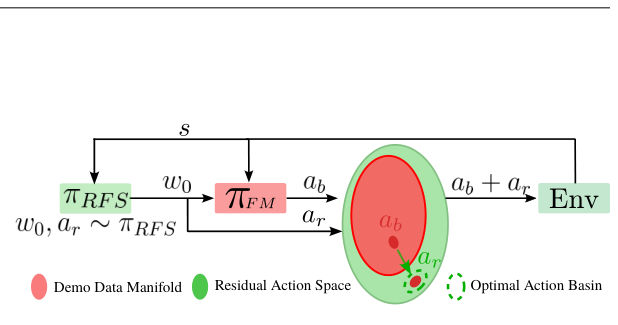
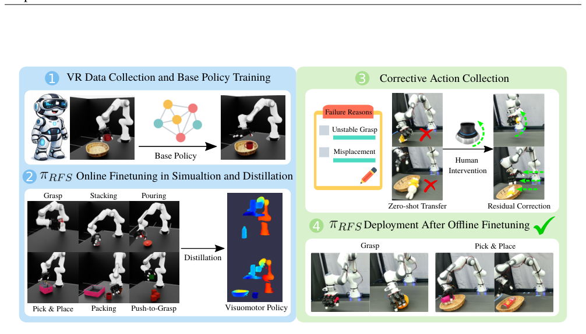
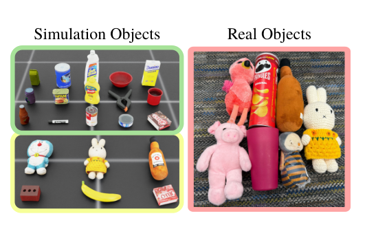
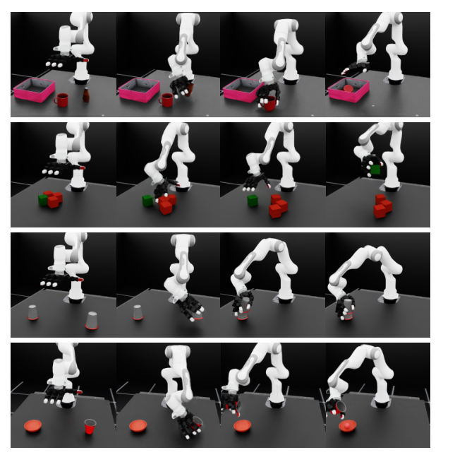
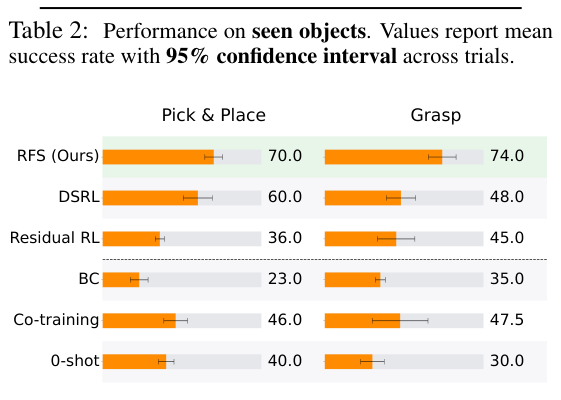
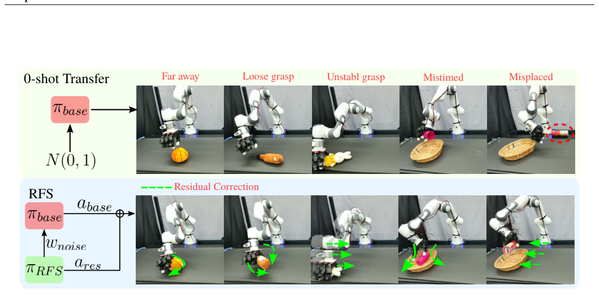
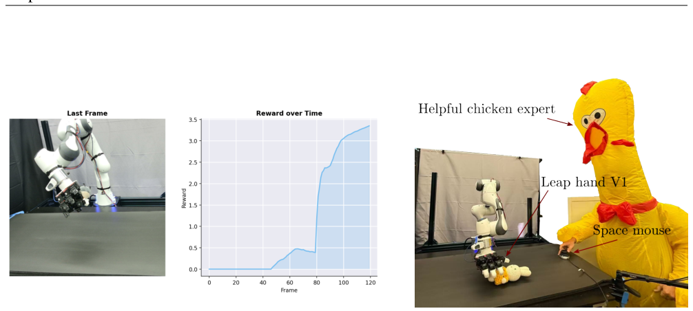

## 基础摘要

灵巧操作中的模仿学习常以扩散模型或流匹配策略表达多模态动作，但这类预训练策略在部署时泛化不足，直接微调又容易破坏其表达结构，难以同时保留全局探索能力并快速纠正局部执行误差。RFS 将预训练流匹配策略作为可引导的生成先验，在适配阶段联合优化残差动作与潜在噪声分布：残差项负责在执行附近做细粒度修正，潜在空间调制则提供更大范围的探索。两者共同作用于原策略的生成过程，而不是替换或重新参数化整张策略网络，因此能在数据有限时完成强化学习适配，并保留预训练学到的多模态行为结构。

## 论文结构图

<!--RAW-->

  

<!--/RAW-->

**图 1：残差流引导（RFS）。** 给定状态 $s$，RFS 策略 $\pi_{\mathrm{RFS}}$ 输出潜流变量 $w_0$ 和残差动作 $a_r$；二者共同引导预训练基策略 $\pi_{\mathrm{FM}}$，产生最终动作 $a_b+a_r$。RFS 同时支持全局模式平移与细粒度残差修正，使策略能够扩展到演示数据流形之外。

<!--RAW-->

  

<!--/RAW-->

**图 2：仿真到真实的残差流引导（RFS）流程概览。** （1）使用 VR 遥操作在多个操作任务上采集演示，训练任务专用的流匹配基策略；（2）在仿真中，在每个基策略之上微调 RFS 策略 $\pi_{\mathrm{RFS}}$，并将其蒸馏为任务专用的视觉运动策略，以改善仿真到真实的迁移；（3）在零样本真实世界部署期间，由人类纠正动作修正不稳定抓取、放置错误等执行失败；（4）利用这些被纠正的转移数据，在 Franka–Leap Hand 系统上离线微调 $\pi_{\mathrm{RFS}}$，提升真实世界抓取与拾取-放置性能。

<!--RAW-->

  

<!--/RAW-->

**图 3：用于灵巧抓取与拾取-放置的仿真物体和真实物体。**

<!--RAW-->

  

<!--/RAW-->

**图 4：灵巧操作任务的代表性 rollout。** 从上到下分别为：Packing、Push-to-Grasp、Packing 与 Stacking。

<!--RAW-->

  

<!--/RAW-->

**图 5：未见物体上的真实世界评测结果。** 柱形表示拾取-放置（左）与抓取（右）的平均成功率，水平误差棒表示 95% 置信区间；数值标注给出平均成功率（±95% CI）。

<!--RAW-->

  

<!--/RAW-->

**图 6：真实世界操作中的常见失败模式与 RFS 修正。** 图中展示零样本仿真到真实迁移的五种代表性失败情形，包括过早合手、松散或不稳定抓取姿态，以及拾取-放置过程中的时机错误或位置错误。上排为零样本策略产生的失败，下排为应用残差流引导（RFS）后的纠正结果。通过联合修正动作时机、抓取姿态和目标位置，RFS 能实现更稳定、更成功的任务执行。

<!--RAW-->

  

<!--/RAW-->

**图 7：真实世界实验中奖励随时间的进展。** **图 8：使用 Leap Hand V1 与 SpaceMouse 接口的离线真实世界数据采集装置。**

## 中文完整翻译

**RFS：用于灵巧操作的残差流引导强化学习**

*RFS: Reinforcement Learning with Residual Flow Steering for Dexterous Manipulation*

**作者：** Entong Su$^1$，Tyler Westenbroek$^1$，Anusha Nagabandi$^2$，Abhishek Gupta$^1$

$^1$ 华盛顿大学 Paul G. Allen 计算机科学与工程学院；$^2$ Amazon Frontier AI & Robotics

**摘要**

模仿学习已成为在机器人领域引导序贯决策的有效方法，即使在高维灵巧操作任务中也能取得很强的性能。近期的行为克隆方法进一步利用扩散模型、流匹配等表达能力强的生成模型来表示多模态动作分布。然而，以这种方式预训练的策略往往泛化能力有限，需要在部署时进行额外微调才能获得稳健性能。此类适应必须保留预训练带来的全局探索优势，同时能够快速纠正局部执行误差。我们提出残差流引导（Residual Flow Steering，RFS），一种用于适配预训练生成策略的数据高效强化学习框架。RFS 通过联合优化残差动作和潜噪声分布来引导预训练的流匹配策略，从而提供互补的探索形式：通过残差修正进行局部细化，以及通过潜空间调制进行全局探索。该设计能够在保留预训练策略表达能力结构的同时实现高效适应。我们在灵巧操作任务上展示了 RFS 的有效性，证明在适配预训练基策略时，无论仿真还是真实世界环境都能实现高效微调。项目网站：https://weirdlabuw.github.io/rfs/

## 1 引言

从人类演示中学习模仿已被证明能够在机器人和序贯决策中学习高性能策略（Zhao et al., 2023; 2025; Chi et al., 2023; Hussein et al., 2017; Ho and Ermon, 2016）。近期进展由生成式模仿学习推动，它利用扩散模型（Ho et al., 2020）和流模型（Lipman et al., 2022）等表达能力强的生成模型来捕获人类演示的分布。这些方法尤其适合人类行为固有的多模态性（Chi et al., 2023; Black et al., 2024），并能够稳健地经验性扩展到复杂操作任务（Team et al., 2025）。然而，仅靠模仿学习往往无法泛化到所有测试时场景（Team et al., 2025），因此通过测试时微调将策略提升到生产级性能仍有很大空间。

虽然监督微调（Ouyang et al., 2022; Black et al., 2024）已被证明对决策系统有效，但它依赖高质量、经过筛选的专家数据。相反，我们希望寻找不依赖这种数据的方法，利用更廉价、次优或自采的数据。强化学习（RL）和离线强化学习（offline RL）（Levine et al., 2020）提供了原则性的行为改进框架，因为智能体优化奖励目标，而不是依赖专家演示。尽管已有许多方法将模仿学习预训练与强化学习微调结合（Rajeswaran et al., 2018a; Hu et al., 2024; Nair et al., 2018; Nakamoto et al., 2024），但这些方法通常依赖闭式似然（Lillicrap et al., 2015）和重参数化（Wang et al., 2019），因而与扩散模型、流模型等表达能力强的生成架构不兼容。此外，该设置中的一个关键挑战是平衡对新任务的适应与保留预训练期间获得的知识。

我们首先将残差强化学习和扩散引导视为更广泛的策略调制方法类的两个实例。这类方法通过调制预训练生成式模仿学习策略的输入或输出，而不是更新模型参数，来适配该策略。残差策略学习（Ankile et al., 2024b）能够进行局部动作细化，但难以引发全局行为变化；而扩散引导（Wagenmaker et al., 2025）允许全局调制，却在离分布状态下提供有限的细粒度控制。这些互补的局限性促使我们提出统一视角。受此视角启发，我们引入残差流引导（RFS），一种利用强化学习适配预训练生成策略的策略调制框架。RFS 联合调制初始潜噪声，并对策略输出施加仿射残差修正，从而同时实现全局语义适应和局部灵巧细化。

我们将 RFS 实例化用于多指操作，开发出能够在仿真中实现稳健多物体抓取并有效迁移到真实世界的控制器。这些控制器还可以利用有限的人类演示进一步改进，在保持精度和灵巧性的同时，实现对真实世界动力学的高数据效率适应。本文贡献如下：（1）提出残差流引导（RFS），一种用于适配预训练流匹配策略的高效框架；（2）RFS 能够从人类演示中进行有效的仿真预训练，捕获复杂的多指协调行为；（3）RFS 支持通过离线强化学习进行真实世界微调，优于自举式模仿学习基线；（4）我们在仿真和真实世界环境中进行了大量消融实验，以识别 RFS 的关键组件。

## 2 相关工作

**带演示的强化学习。** 模仿学习（IL）通常用于为复杂机器人任务引导强化学习（RL），其方式是约束早期探索并提供较强的初始行为。已有工作通过模仿损失、回放缓冲区或重置策略将演示纳入学习（Nair et al., 2018; Qin et al., 2022; Xiao et al., 2025a; Hu et al., 2024），另一些方法则将演示数据与在线 rollout 结合以提高探索效率（Ball et al., 2023; Hester et al., 2017; Ankile et al., 2025; Song et al., 2023）。演示引导的 RL 也被应用于高自由度灵巧操作（Rajeswaran et al., 2018b; Haldar et al., 2023; Wang et al., 2024），这些工作表明，尽管演示能够加速学习，但仍不足以达到高难度灵巧任务所需的细粒度精度。

**离线到在线微调。** 离线到在线微调被广泛用于提高机器人 RL 的样本效率：策略首先在演示上预训练，然后通过有限交互进行细化。轻量级离线到在线方法（Kostrikov et al., 2021; Nair et al., 2021; Nakamoto et al., 2024）很受欢迎；然而，由于它们直接作用于动作空间，常常难以应对分布偏移以及灵巧控制所需的细粒度修正。近期工作将 RL 应用于扩散策略（Ren et al., 2024b; Fang et al., 2025; Davey and Zheng, 2025）和流匹配策略（Zhang et al., 2025b; McAllister et al., 2025; Park et al., 2025）；但是，生成模型的迭代细化结构以及动作分块策略的高维性，使稳定的 RL 微调尤其困难，且容易不稳定。

**策略调制。** 策略调制方法通过修改预训练策略的输出或输入来适配该策略。输出调制利用残差策略调整基策略的动作（Ankile et al., 2024a; Zeng et al., 2020; Silver et al., 2019; Alakuijala et al., 2021; Davchev et al., 2022; Carvalho et al., 2022; Yuan et al., 2024; Xiao et al., 2025b），能够进行有效的局部修正，但当基策略能力有限时无法引发全局行为变化。输入调制方法，例如 DSRL（Wagenmaker et al., 2025），则调整扩散策略的潜噪声以修改高层行为；然而，它们仍受限于演示流形，从而限制了离流形探索和细粒度细化。

## 3 背景

### 3.1 流匹配

流匹配（Lipman et al., 2023; Liu, 2022）是一种生成建模框架，它学习一个时间相关的速度场，将基分布 $p_0$ 输运到目标分布 $p_1$。样本按照 ODE $\frac{dx_t}{dt}=v_\theta(x_t,t)$ 演化；其目标是对齐 $p_0$ 的前推分布与 $p_1$，并通过监督条件路径而不是完整边缘分布，避免 ODE 反向传播和似然计算（Lipman et al., 2023）。训练时抽取 $(x_0,x_1)\sim p_0\times p_1$，采样 $t\sim\mathcal{U}[0,1]$，构造插值 $x_t=(1-t)x_0+tx_1$，并将预测速度回归到直线路径目标 $v^\star(x_t,t)=x_1-x_0$：

$$
\mathcal{L}(\theta)=\mathbb{E}_{x_0\sim p_0,\ x_1\sim p_1,\ t\sim\mathcal{U}[0,1]}\left\|v_\theta(x_t,t)-v^\star(x_t,t)\right\|^2.
\tag{1}
$$

给定训练好的速度场 $v_\theta$，可通过欧拉积分从 $p_1$ 采样（Lipman et al., 2023），得到直接的采样路径：

$$
x^{k+1}=x^k+\Delta t_k\,v_\theta(x^k,t_k),\qquad x^0\sim p_0,\qquad x^K\approx x_1.
\tag{2}
$$

通过使用外部变量 $c$ 学习 $v_\theta(x_t,t,c)$，该框架可变为条件生成。在我们的设置中，使用专家数据集 $\mathcal{D}=\{s_i,a_i\}$ 训练条件策略速度场。相应的训练目标（式 3）学习条件速度场 $v_\theta(a_t,t,s)$：

$$
\mathcal{L}(\theta)=\mathbb{E}_{a_0\sim p_0,\ (s,a)\sim\mathcal{D},\ t\sim\mathcal{U}[0,1]}\left\|v_\theta(a_t,t,s)-(a-a_0)\right\|^2,\qquad a_t=(1-t)a_0+ta.
\tag{3}
$$

对学习到的场 $v_\theta(a_t,t,s)$ 进行积分（式 2）即可产生策略动作；这既能实现表达能力强的多模态行为，又为下游适应提供了自然的控制点。为书写方便，下文对基于流的策略交替使用 $\pi_\theta$ 和 $v_\theta$。

### 3.2 强化学习

对于使用强化学习（RL）进行适应的问题，我们考虑马尔可夫决策过程（MDP）$\mathcal{M}=(\mathcal{S},\mathcal{A},\mathcal{T},r,\gamma)$，其中 $\mathcal{S}$ 和 $\mathcal{A}$ 分别表示状态空间和动作空间，$\mathcal{T}(s'\mid s,a)$ 是转移核，$r$ 是奖励函数，$\gamma\in[0,1)$ 是折扣因子。目标是学习随机策略 $\pi_\theta(a\mid s)$，最大化期望折扣回报 $J(\theta)=\mathbb{E}_{\tau\sim p_\pi}\left[\sum_{t=0}^{\infty}\gamma^t r(s_t,a_t)\right]$。RL 算法的选择并非本文方法的核心；我们关注的是构成该方法基础的两类策略调制范式。

**输出调制。** 一个核心例子是残差强化学习：通过 RL 训练一个小的残差策略 $\pi_r(a\mid s)$，以纠正预训练基策略 $\pi_\theta(a\mid s)$ 的错误（Ankile et al., 2024b; Silver et al., 2019）。动作执行通过加性修正改变，如式 4 所示。

**输入调制。** 另一条互补的研究路线调制生成策略的输入。扩散引导（Wagenmaker et al., 2025）通过在一个初始潜噪声上的策略进行学习，而不是从固定高斯分布采样，从而适配预训练扩散模型。动作生成通过对式 2 中的流匹配动力学积分来完成，该过程将初始潜噪声 $a_0$ 经去噪过程映射为动作。扩散引导通过调整 $a_0$ 来优化式 5，从而在去噪过程中引导生成模型的行为。

$$
\max_{\pi_r}\ \mathbb{E}_{\substack{s_0\sim p_0(s),\ s'\sim p(s'\mid s,a)\\ a=a_r+a_b,\ a_r\sim\pi_r(a\mid s)\\ a_b\sim\pi_\theta(a\mid s)}}\left[\sum_{t=0}^{\infty}\gamma^t r(s_t,a_t)\right]
\tag{4}
$$

$$
\max_{\pi_{\mathrm{DS}}}\ \mathbb{E}_{\substack{s_0\sim p_0(s),\ s'\sim p(s'\mid s,a)\\ a_0\sim\pi_{\mathrm{DS}}(a_0\mid s),\ a\sim p_\theta(a\mid s,a_0)}}\left[\sum_{t=0}^{\infty}\gamma^t r(s_t,a_t)\right]
\tag{5}
$$

## 4 残差流引导：方法与应用

我们提出残差流引导（RFS），一个统一框架：它在预训练基策略之上，将用于全局适应的潜噪声引导与用于精确局部修正的残差动作结合起来。该形式化方法能够在高灵巧任务中实现高效学习，并支持稳健的仿真到真实迁移。

### 4.1 统一的策略调制框架

#### 4.1.1 用于适配预训练生成模型的策略调制算法

由于残差 RL 和 DSRL 分别代表输出调制和输入调制，很自然地可以把它们放在统一的策略调制视角下考察。为明确这一联系，我们考察残差 RL（Ankile et al., 2024b; Silver et al., 2019）和潜噪声引导（Wagenmaker et al., 2025; Du and Song, 2025）在给定预训练生成策略 $v_\theta(a_t,t,s)$ 以及基于去噪的采样函数 $a\sim\mathrm{Des}(s,a_0,v_\theta)$、$a_0\sim\mathcal{N}(0,I)$ 时的结构。我们将两个目标并排放置：

$$
\max_{\pi_{\mathrm{DS}}}\ \mathbb{E}_{\substack{s_0\sim p_0(s)\\ s'\sim p(s'\mid s,a)\\ a=\mathrm{Des}(s,a_0,v_\theta),\\ a_0\sim\pi_{\mathrm{DS}}(a_0\mid s)}}\left[\sum_{t=0}^{\infty}\gamma^t r(s_t,a_t)\right]
\tag{6}
$$

$$
\max_{\pi_r}\ \mathbb{E}_{\substack{s_0\sim p_0(s)\\ s'\sim p(s'\mid s,a)\\ a=a_r+a_b,\ a_r\sim\pi_r(a\mid s)\\ a_b=\mathrm{Des}(s,a_0,v_\theta),\\ a_0\sim\mathcal{N}(0,I)}}\left[\sum_{t=0}^{\infty}\gamma^t r(s_t,a_t)\right]
\tag{7}
$$

两个目标都调制基策略 $v_\theta$ 的行为：要么调整潜噪声，要么施加仿射动作修正。更一般地，对生成策略 $v_\theta(a_t,t,s)$ 的策略调制，在不修改底层参数 $\theta$ 的情况下优化参数化输入变换（$g$）或输出变换（$f$），如式 8 形式化所示。

#### 4.1.2 面向局部与全局联合适应的残差流引导

我们将调制函数 $f$ 和 $g$ 实例化为残差流引导（RFS），它统一了用于输出调制的残差 RL（Silver et al., 2019; Zhang et al., 2020）与用于输入调制的扩散引导 RL（Wagenmaker et al., 2025）。输入调制通过 $a_0=\pi_H(a_0\mid s)$ 调整流匹配策略的潜噪声，以实现全局行为变化；输出调制则通过仿射修正 $a=\mathrm{Des}(s,a_0,v_\theta)+a_r$、$a_r\sim\pi_r(a\mid s)$ 施加局部细化。RFS 通过统一的调制策略 $\pi_{\mathrm{RFS}}(a_0,a_r\mid s)$ 结合这两种机制，联合产生用于全局引导的 $a_0$ 和用于精确局部调整的 $a_r$。这里，$a_0$ 塑造生成模型的整体行为，而 $a_r$ 补偿离流形需求或基策略 $v_\theta$ 的缺陷。式 9 得到的目标与标准 RL 算法兼容；下一小节将把 RFS 实例化用于仿真和真实世界中的灵巧操作。

$$
\max_{\phi}\ \mathbb{E}_{\substack{s_0\sim p_0(s),\ s'\sim p(s'\mid s,a)\\ a=f_\phi(a_b,s),\ a_0=g_\phi(s)\\ a_b\sim\mathrm{Des}(s,a_0,v_\theta)}}\left[\sum_{t=0}^{\infty}\gamma^t r(s_t,a_t)\right]
\tag{8}
$$

$$
\max_{\pi_{\mathrm{RFS}}}\ \mathbb{E}_{\substack{s_0\sim p_0(s),\ s'\sim p(s'\mid s,a)\\ a_0,a_r\sim\pi_{\mathrm{RFS}}(a_0,a_r\mid s)\\ a_b\sim\mathrm{Des}(s,a_0,v_\theta)\\ a=a_r+a_b}}\left[\sum_{t=0}^{\infty}\gamma^t r(s_t,a_t)\right]
\tag{9}
$$

### 4.2 将 RFS 实例化用于灵巧操作

我们通过一条仿真到真实的流程将 RFS 实例化用于灵巧操作：该流程支持在仿真中进行在线微调，并利用有限的真实世界数据进行离线微调；两者分别应用于基于状态和基于视觉的流匹配策略，从而实现广泛探索与数据高效适应（图 2）。我们在多个灵巧操作任务上展示了该方法。

#### 4.2.1 仿真训练：数据生成与在线 RL

灵巧操作的一个关键挑战是如何在高维动作空间中进行有效探索。我们完全在仿真中采集一小组 VR 遥操作演示，用流匹配目标（Lipman et al., 2022）训练基生成策略 $v_\theta$。尽管该策略单独使用时并不完美，但它捕获了协调的手–臂行为，并为强化学习提供了强初始化。随后，我们使用在线 PPO 训练 RFS 策略 $\pi_{\mathrm{RFS}}$，以优化抓取成功率和稳定性。

训练后的 RFS 策略被用于生成额外的仿真演示，这些演示可以访问特权低层状态信息 $s$（例如物体位姿和速度）；随后通过标准的学生–教师框架（Chen et al., 2021）将这些演示蒸馏为以点云为条件的视觉运动策略。

#### 4.2.2 真实世界微调：离线 RFS

将蒸馏得到的视觉运动策略 $v_\phi(a_t,o_{pc},s_{pro},t)$ 直接迁移到真实世界时，常常在新物体或不同初始条件下失败。为弥合这一差距，我们使用一个小规模的人类纠错数据集进行离线 RFS 微调。在数据采集期间，基策略执行 rollout，人类在访问到的状态上提供纠正动作，从而得到 $\mathcal{D}=\{((o,s),(a_{\mathrm{human}},a_b,a_0),(o',s'),r)\}$。残差动作定义为 $a_r=a_{\mathrm{human}}-a_b$，由此产生可供 RFS 使用的数据集 $\mathcal{D}_{\mathrm{RFS}}=\{((o,s),(a_0,a_r),(o',s'),r)\}$。然后我们使用离线强化学习（Levine et al., 2020）训练 $\pi_{\mathrm{RFS}}(a_0,a_r\mid o_{pc},s_{pro})$，采用 TD3+BC（Fujimoto and Gu, 2021）进行带模仿正则化的 actor–critic 更新。

**Critic 更新。** 给定 $\mathcal{D}_{\mathrm{RFS}}$，我们按式 10 应用标准 TD 学习的 critic 更新。critic 以组合动作 $a$ 和 $a'$ 为条件，而不是以分解后的分量 $(a_0,a_r)$ 为条件；第 5.2 节给出了这一设计选择的经验依据。

$$
\min_{\phi}\ \mathbb{E}_{\substack{((o,s),(a_0,a_r),(o',s'),r)\sim\mathcal{D}_{\mathrm{RFS}}\\ a'_0,a'_r\sim\pi_{\mathrm{RFS}}(\cdot\mid o',s'),\ a_b\sim\mathrm{Push}(o,s,a_0,v_\phi),\ a=a_b+a_r\\ a'_b\sim\mathrm{Push}(o',s',a'_0,v_\phi),\ a'=a'_b+a'_r}}\left[\left\|Q_\phi(o,s,a)-r-\gamma Q_{\bar{\phi}}(o',s',a')\right\|^2\right].
\tag{10}
$$

**Actor 更新。** 遵循 TD3+BC（Fujimoto and Gu, 2021），actor 在最大化 critic 的同时，对残差动作施加 BC 正则项：

$$
\arg\max_{\pi_{\mathrm{RFS}}}\ \mathbb{E}_{\substack{((o,s),(a_0,a_r),(o',s'),r)\sim\mathcal{D}_{\mathrm{RFS}}\\ \hat{a}_0,\hat{a}_r\sim\pi_{\mathrm{RFS}}(\cdot\mid o,s),\ \hat{a}_b\sim\mathrm{Push}(o,s,\hat{a}_0,v_\phi),\ \hat{a}=\hat{a}_b+\hat{a}_r}}\left[Q(o,s,\hat{a})-\lambda_{\mathrm{BC}}\left\|\hat{a}_r-a_r\right\|^2\right].
\tag{11}
$$

## 5 实验

我们围绕以下研究问题组织实验：**Q1：** 残差细化能否提升仿真中灵巧操作任务的成功率？**Q2：** 哪些设计选择在仿真和真实世界中都最有效？**Q3：** 潜噪声调制如何影响真实世界适应性能？如第 4.2 节所述，我们首先评估 RFS 用于仿真数据生成的效果，然后评估其用于真实世界微调的效果。实验主要关注使用多指手进行灵巧抓取，但该方法可推广到更广泛的操作任务。

### 5.1 用于仿真数据生成和在线 RL 训练的 RFS

#### 5.1.1 实验设置

我们在六个仿真任务上评估 RFS：抓取、拾取-放置、非抓握式推-抓（push-to-grasp）、长时程装箱（packing），以及高精度堆叠和倾倒（图 4）。使用 Apple Vision Pro AR，我们为每个任务采集约 400 条演示，并使用流匹配（Lipman et al., 2022）预训练生成基策略 $v_\theta(a_t,t,s)$。基策略成功率报告在表 1 中。尽管预训练策略仅达到中等成功率，但它提供了强运动先验，RFS 通过 PPO（Schulman et al., 2017b）进一步细化（第 4.2.1 节）。

#### 5.1.2 基线与消融

**基线。** 我们将 RFS 与一系列常用于仿真驱动灵巧操作的强化学习基线进行比较。所有基于演示的基线都使用与 RFS 相同的离线数据。根据其底层适应策略，我们将这些方法分为四类：（1）**扩散/流 RL 微调**：DPPO（Ren et al., 2024a）和 ReinFlow（Zhang et al., 2025a），通过与环境交互的强化学习微调由演示预训练的扩散或流匹配策略。（2）**离线到在线 RL**：IQL（Kostrikov et al., 2021）、AWAC（Nair et al., 2021）和 Flow Q-Learning（Park et al., 2025），从离线演示初始化，随后通过在线交互改进。（3）**带演示的 RL**：RLPD（Ball et al., 2023）和 IBRL（Hu et al., 2024），将演示数据直接纳入策略更新。

**消融。** 为分离残差细化和潜噪声引导二者的贡献，我们进行了有针对性的消融：（1）DSRL（Wagenmaker et al., 2025）：在不使用残差动作的情况下引导基策略的潜噪声；（2）**最先进的残差 RL**：强残差学习基线，包括 Policy Decorator（Yuan et al., 2024）和 ResiP（Ankile et al., 2024a）。

#### 5.1.3 仿真中的经验结果

**与基线的比较：** 我们在表 1 中总结所有基线的性能，并分析其行为如下：

（1）**基于扩散/流的 RL 微调。** DPPO（Ren et al., 2024a）在所有任务上表现不佳，所有成功率均低于 0.50。ReinFlow（Zhang et al., 2025a）表现出适度改进（抓取 0.58、拾取-放置 0.46、装箱 0.39），但在推-抓、堆叠和倾倒任务上失败。相比之下，将 RL 更新限制在初始噪声和残差项（RFS）上可以得到更稳定的学习，在所有任务上比在整个去噪轨迹上应用 RL 的成功率至少高 0.35。

（2）**离线到在线 RL。** IQL（Kostrikov et al., 2021）是最强的离线到在线基线（抓取 0.69、拾取-放置 0.56、堆叠 0.63、倾倒 0.59），但在装箱（0.20）和推-抓（0.26）上表现不佳。AWAC（Nair et al., 2021）和 FlowQ（Park et al., 2025）在多个任务上崩溃。总体而言，离线到在线 RL 方法缺乏有方向的探索，而 RFS 利用基策略预训练在所有任务上取得了一致更高的成功率。

（3）**带演示的 RL。** RLPD（Ball et al., 2023）在抓取（0.54）和拾取-放置（0.76）上表现良好，但在需要长时程推理（如装箱）或高精度操作（如堆叠和倾倒）的任务上崩溃。IBRL（Hu et al., 2024）仅在抓取、装箱和倾倒任务上成功。相比之下，RFS 在所有任务上都持续优于基策略。

**与消融的比较。** 我们还评估了强消融方法和相关适应策略（表 1）。

（1）**残差 RL 方法。** Policy Decorator（Yuan et al., 2024）和 ResiP（Ankile et al., 2024a）优于早期基线，但其增益仍主要是局部的，在抓取（约 0.60）和拾取-放置（约 0.50）上仅达到中等成功率。在序贯和高精度任务上性能下降，包括装箱（0.40）、推-抓（0.15）、堆叠（0.30）和倾倒（0.20）。相比之下，RFS 在装箱和推-抓上达到约 0.80，在其余任务上达到约 0.90。

（2）**DSRL（Wagenmaker et al., 2025）。** DSRL 是最强基线，达到 0.74（抓取）、0.70（拾取-放置）、0.64（装箱）和 0.43（推-抓），但在堆叠上仅为 0.15，在倾倒上仅为 0.26。由于其修正被约束在演示分布内，DSRL 难以适应具有挑战性或分布外的状态。

**总体而言**，通过联合调制基策略的输入和输出，RFS 在保留基策略性能的同时持续改进它，在所有任务上取得最高成功率：0.89（抓取）、0.94（拾取-放置）、0.78（装箱）、0.72（推-抓）、0.95（堆叠）和 0.87（倾倒），平均成功率为 0.87。

| 类别 | 方法 | 抓取 | 拾取-放置 | 装箱 | 推-抓 | 堆叠 | 倾倒 | 平均 |
|---|---|---:|---:|---:|---:|---:|---:|---:|
| 基策略 | Flow Matching (Lipman et al., 2022) | 0.495 | 0.367 | 0.30 | 0.131 | 0.06 | 0.15 | 0.250 |
| 扩散/流 RL 微调 | DPPO (Ren et al., 2024a) | 0.41 ± 0.05 | 0.433 ± 0.102 | 0.186 ± 0.023 | 0.04 ± 0.036 | 0.00 ± 0.00 | 0.00 ± 0.00 | 0.178 ± 0.035 |
|  | ReinFlow (Zhang et al., 2025a) | 0.584 ± 0.043 | 0.462 ± 0.081 | 0.100 ± 0.089 | 0.398 ± 0.236 | 0.59 ± 0.021 | 0.32 ± 0.15 | 0.409 ± 0.103 |
| 离线到在线 RL | IQL (Kostrikov et al., 2021) | 0.690 ± 0.034 | 0.560 ± 0.075 | 0.203 ± 0.063 | 0.267 ± 0.108 | 0.625 ± 0.073 | 0.583 ± 0.203 | 0.488 ± 0.093 |
|  | AWAC (Nair et al., 2021) | 0.485 ± 0.163 | 0.240 ± 0.120 | 0.00 ± 0.00 | 0.00 ± 0.00 | 0.780 ± 0.03 | 0.625 ± 0.08 | 0.355 ± 0.066 |
|  | Flow Q-Learning (Park et al., 2025) | 0.050 ± 0.012 | 0.486 ± 0.110 | 0.00 ± 0.00 | 0.381 ± 0.040 | 0.00 ± 0.00 | 0.00 ± 0.00 | 0.153 ± 0.027 |
| 带演示的 RL | RLPD (Ball et al., 2023) | 0.547 ± 0.056 | 0.763 ± 0.059 | 0.00 ± 0.00 | 0.012 ± 0.024 | 0.053 ± 0.13 | 0.68 ± 0.13 | 0.343 ± 0.067 |
|  | IBRL (Hu et al., 2024) | 0.404 ± 0.216 | 0.00 ± 0.00 | 0.432 ± 0.150 | 0.00 ± 0.00 | 0.00 ± 0.00 | 0.36 ± 0.10 | 0.199 ± 0.078 |
| 残差 RL（最先进） | Policy Decorator (Yuan et al., 2024) | 0.52 ± 0.09 | 0.314 ± 0.160 | 0.535 ± 0.021 | 0.176 ± 0.016 | 0.00 ± 0.00 | 0.17 ± 0.23 | 0.286 ± 0.086 |
|  | ResiP (Ankile et al., 2024a) | 0.65 ± 0.096 | 0.57 ± 0.014 | 0.302 ± 0.028 | 0.165 ± 0.18 | 0.67 ± 0.05 | 0.24 ± 0.12 | 0.433 ± 0.081 |
| 消融 | DSRL (Wagenmaker et al., 2025) | 0.732 ± 0.04 | 0.692 ± 0.012 | 0.639 ± 0.024 | 0.430 ± 0.085 | 0.135 ± 0.015 | 0.268 ± 0.010 | 0.483 ± 0.031 |
| **我们的方法** | **RFS (Ours)** | **0.899 ± 0.026** | **0.939 ± 0.012** | **0.781 ± 0.019** | **0.721 ± 0.022** | **0.951 ± 0.006** | **0.873 ± 0.010** | **0.861 ± 0.016** |

**表 1：各任务和 RL 方法上的成功率。**

### 5.2 真实世界离线微调

利用 RFS 在仿真中生成、且可访问特权状态信息的数据，我们通过标准学生–教师框架（Chen et al., 2021）蒸馏出一个基于点云的策略，用于真实世界部署。

随后，我们评估离线 RFS 在真实世界抓取和拾取-放置任务中对蒸馏策略的适应能力，测试对象包括已见和未见物体（图 1、图 3）。实验在配备 LEAP 手的 Franka 机械臂上进行，采用笛卡尔阻抗控制，频率为 10 Hz。我们评估七个物体，其中两个与仿真共享，五个为新颖的可变形物体。与刚性仿真资产相比，真实物体具有不同的柔顺性、接触动力学和外观，造成仿真到真实差距，常常导致预训练策略失败。

对于离线 RL 微调，我们使用 SpaceMouse 采集 50 条人类纠错演示（附录 A.4.1）。奖励通过程序化方式定义：使用 SAM2（Ravi et al., 2024）对物体进行分割和跟踪，并提取其质心（附录 A.4.2）。

#### 5.2.1 基线与消融

**基线。** 我们将采用离线 RL 的 RFS（第 4.2.2 节）视为一种数据高效的仿真训练策略微调方法，并与三种适应策略比较：（1）**零样本迁移**：不进行微调，直接部署蒸馏后的仿真策略；（2）**BC 微调**：使用 50 条真实世界演示，通过流匹配进一步训练蒸馏策略；（3）**协同训练（Co-Training）**：在流匹配目标下，将 50 条真实世界演示与额外仿真 rollout 混合，微调蒸馏策略。这些比较表明，离线 RL 微调比标准的流匹配更新带来显著更强的适应能力。

**Critic 设计选择：** 我们还在离线 RL 设置中研究替代 critic 架构，比较：（1）$Q(a_r,o)$，仅以残差动作和观测为条件；（2）$Q([a_r,a_b],o)$，同时以残差动作和基策略动作为条件；（3）$Q(a_b+a_r,o)$（我们的方法），仅以最终执行动作为条件。这分离了 critic 输入结构对离线 RL 稳定性和性能的影响。

**消融：** 我们进一步分析仅使用残差动作的离线 RL（Residual RL）和仅使用潜噪声引导的离线 RL（DSRL），以量化二者各自的贡献。

### 5.3 真实世界中的经验结果

**与监督微调的比较。** 如图 5 和图 6 所示，零样本策略表现较差，出现平移和旋转偏移、抓取时手指闭合不足，以及拾取-放置中的时机错误或位置错误，凸显了显著的仿真到真实差距。虽然协同训练在已知物体上大幅提升性能（抓取 83.3%、拾取-放置 60% 成功率），但对未见物体的泛化仍然有限。人类采集数据的噪声和不一致性引入了不稳定和 rollout 失败，凸显了泛化到新物体的困难。

| 方法 | 拾取-放置 | 抓取 |
|---|---:|---:|
| 0-shot | 50.0 ± 0.0 | 43.3 ± 6.2 |
| Co-training | 60.0 ± 0.0 | 83.3 ± 0.0 |
| BC | 40.0 ± 0.0 | 73.3 ± 0.0 |
| Residual RL | 50.0 ± 0.0 | 80.0 ± 0.0 |
| DSRL | 80.0 ± 0.0 | 70.0 ± 0.3 |
| **RFS (Ours)** | **90.0 ± 0.0** | **80.0 ± 2.9** |

**表 2：已见物体上的性能。** 数值报告多次试验的平均成功率和 95% 置信区间。

**与离线 RL 变体的比较。** 如第 4.2.2 节所述，TD3+BC 以 actor 输出为条件来训练 critic，因此允许不同的 Q 函数参数化。以 $Q(a_r,o)$ 或 $Q([a_r,a_b],o)$ 为条件的 critic 无法产生一致的抓取姿态或精确放置，在抓取和拾取-放置上成功率均为零。相比之下，以执行动作 $Q(a_b+a_r,o)$ 为条件（Residual RL 和 RFS 都采用此设计，图 5）相比所有基线取得显著更高的性能。这些结果表明，将残差动作与执行的基础动作直接耦合，对于稳定有效的离线 RL 适应至关重要。

**与 RFS 消融的比较。** 我们评估仅使用残差动作（$\pi(a_r\mid o)$）或仅通过 DSRL 进行潜噪声引导（$\pi(a_0\mid o)$）的 RFS 变体。如图 5 和图 6 所示，完整模型 $\pi(a_0,a_r\mid o)$ 取得最强性能，尤其是在抓取与拾取-放置任务的未见物体上。定性而言，潜噪声引导促进全局探索，而残差动作实现精确的局部细化，因此二者结合比单独使用任一组件更有效。

**与直接使用真实数据微调的比较。** 在仅用真实演示训练的策略上微调 RFS，只能带来有限增益（已见物体抓取 70% → 73%，未见物体抓取 35% → 50%，拾取-放置几乎没有改善），这反映了真实数据分布覆盖范围有限。相比之下，仿真预训练提供了对抓取、姿态和扰动的广泛覆盖，使策略能够获得仅靠真实数据无法学到的适应行为。因此，用少量真实演示微调仿真预训练策略，能够带来更大的改进和更强的泛化。

## 6 结论

我们提出了残差流引导（RFS），一个将用于全局探索的潜噪声引导与用于局部细化的残差修正统一起来的强化学习框架。在仿真和真实世界的灵巧操作任务中，RFS 通过实现有效的仿真预训练和真实世界中的数据高效微调，持续优于传统基线，包括仅残差方法和基于扩散的引导方法。尽管取得了这些结果，仍存在若干局限，并指向未来工作方向。首先，我们当前的实现主要依赖点云观测，其语义和上下文理解能力有限。因此，在需要更高层推理的杂乱或语义丰富的环境中，性能可能下降。其次，我们框架中的真实世界适应目前仅限于离线微调。这使策略无法根据动态变化的条件进行在线更新，限制了其在真实世界部署期间的响应能力和鲁棒性。

## 致谢

本工作由 Amazon FAR（Frontier AI & Robotics）资助。

## 附录

### A.1 仿真设置与训练

#### A.1.1 强化学习设计选择

为增强鲁棒性并减轻控制器失配以支持仿真到真实迁移，我们引入以下设计选择：

**仿真器：** 所有仿真任务均构建在 IsaacLab（NVIDIA et al., 2025）之上。

**遥操作：** 我们进一步开发了 IsaacLab（NVIDIA et al., 2025）中的遥操作系统，使其更适合灵巧手操作。

**外部扰动：** 每隔 2–5 步对每个关节施加随机外部扰动，促使策略从扰动中恢复。

**观测空间：** 在仿真 RL 训练中，我们使用基于状态的信息，包括机器人本体感知、当前物体位姿、目标物体位姿，以及每个指尖与物体之间的二值接触信号。

**数据采集：** 我们使用 Vision Pro 进行数据采集，所用应用基于 IsaacLab（Mittal et al., 2023）构建。

### A.2 PPO 超参数

我们在仿真中的在线微调阶段使用近端策略优化（PPO）（Schulman et al., 2017a）训练残差流引导（RFS）策略。所有任务使用同一组超参数。

**策略网络与价值网络。** RFS 策略 $\pi_{\mathrm{RFS}}(a_0,a_r\mid s)$ 和价值函数 $V(s)$ 均由多层感知机参数化，包含三个隐藏层，宽度分别为 256、128、64，使用 ReLU 激活。策略同时输出用于流匹配基策略的潜噪声引导变量 $w_0$ 和残差动作 $a_r$。

**表 3：仿真中在线 RFS 训练使用的 PPO 超参数。**

| 超参数 | 取值 |
|---|---|
| 折扣因子 $\gamma$ | 0.99 |
| GAE 参数 $\lambda$ | 0.95 |
| 策略学习率 | $3\times 10^{-4}$ |
| 价值学习率 | $1\times 10^{-3}$ |
| 优化器 | Adam |
| 裁剪范围 $\epsilon$ | 0.2 |
| 价值损失系数 | 0.5 |
| 最大梯度范数 | 1.0 |
| 小批量大小 | 1024 |

#### A.2.1 策略蒸馏

为改善仿真到真实迁移，我们使用点云作为视觉观测。为减轻相机标定误差和硬件差异，我们从多个相机视角采集仿真数据，并将所有点云标定到机器人基座坐标系。我们还在数据采集期间向相机外参注入随机噪声，并在训练期间向点云注入噪声，以提高鲁棒性。在仿真中，我们为抓取和拾取-放置任务各采集 1000 条演示来训练策略。

### A.3 真实世界实验细节

#### A.3.1 真实机器人评测

对于真实机器人评测，我们在距机器人基座 0.35–0.65 m、水平跨度 $-0.25$ 至 $0.25$ m 的 $30\times 50$ cm 区域内测试策略。对已知物体，每个物体评测 20 次；对七个未知物体，每个物体评测 10 次。

### A.4 遥操作数据采集

对于协同训练设置中的真实世界遥操作数据采集，我们开发了一个基于 Park and Agrawal（2024）的 Vision Pro 应用，支持以 10 Hz 的受控频率进行遥操作。

#### A.4.1 离线数据采集

当手距离桌面约 10 cm 以内时——大多数失败发生在此处（图 6）——我们启用通过 SpaceMouse 进行的人工干预（图 8）。我们并不给予完全手动控制，因为那会改变策略分布；相反，我们计算以当前观测为条件、相对基策略输出的有界残差修正。具体而言，CFM 模块预测下一动作，我们取该 rollout 与操作者输入之间的差值。残差被约束为笛卡尔平移不超过 1.5 cm、手指运动不超过 0.05 rad，并在所有关节上统一施加。实践中，修正主要限于笛卡尔平移和轻微手指调整，SpaceMouse 的 z 轴映射到手指运动。

#### A.4.2 奖励函数设计

在真实世界中，奖励使用 SAM2（Ravi et al., 2024）在图像空间跟踪物体并提取其点云，再据此计算物体中心。奖励由两项组成：（1）物体中心与手掌之间的距离，通过正运动学获得；（2）物体的抬升高度，用于鼓励稳定抓取执行。图 7 展示了奖励变化趋势。

### A.5 TD3+BC 超参数

我们在真实世界中使用 TD3+BC 算法（Fujimoto and Gu, 2021）微调残差流引导（RFS）策略，采用固定的人类纠错转移数据集进行离线设置。观测表示为点云，感知骨干网络改编自 PointNet（Qi et al., 2017）。所有真实世界实验使用的 TD3+BC 超参数汇总于表 4。

**表 4：真实世界实验中离线 RFS 微调使用的 TD3+BC 超参数。**

| 超参数 | 取值 |
|---|---|
| Actor 学习率 | $3\times 10^{-4}$ |
| Critic 学习率 | $3\times 10^{-4}$ |
| 策略更新延迟 | 10 |
| 目标策略噪声标准差 | 0.2 |
| 目标噪声裁剪 | 0.5 |
| 行为克隆权重 $\lambda_{\mathrm{BC}}$ | 0.2 |
| 批量大小 | 512 |
| 回放缓冲区 | 固定离线数据集 |

### B 仿真基线与代码库

我们将 RFS 与多种仿真基线进行比较，涵盖扩散/流 RL 微调、离线到在线 RL、带演示的 RL 以及最先进的残差 RL 方法。对于每个基线，我们使用其开源实现，并遵循其推荐的训练协议。

- DPPO（Ren et al., 2024a）：https://github.com/irom-princeton/dppo
- ReinFlow（Zhang et al., 2025a）：https://github.com/ReinFlow
- Flow Q-Learning（FQL）与 IQL（Park et al., 2025）：https://github.com/seohongpark/fql/tree/master/agents
- AWAC（Nair et al., 2021）：https://github.com/ikostrikov/jaxrl
- RLPD 与 IBRL（Hu et al., 2024）：https://github.com/hengyuan-hu/ibrl
- Policy Decorator（Yuan et al., 2024）：https://github.com/tongzhoumu/policy_decorator
- ReSIP（Ankile et al., 2024a）：https://github.com/ankile/robust-rearrangement

所有基线均使用与 RFS 相同的仿真器、观测模态和任务规范进行训练，以确保公平比较。

## 参考文献

Minttu Alakuijala, Gabriel Dulac-Arnold, Julien Mairal, Jean Ponce, and Cordelia Schmid. Residual reinforcement learning from demonstrations, 2021. URL https://arxiv.org/abs/2106.08050.

Lars Ankile, Anthony Simeonov, Idan Shenfeld, Marcel Torne, and Pulkit Agrawal. From imitation to refinement – residual rl for precise assembly, 2024a. URL https://arxiv.org/abs/2407.16677.

Lars Ankile, Anthony Simeonov, Idan Shenfeld, Marcel Torne, and Pulkit Agrawal. From imitation to refinement - residual RL for precise visual assembly. CoRR, abs/2407.16677, 2024b. doi: 10.48550/ARXIV.2407.16677. URL https://doi.org/10.48550/arXiv.2407.16677.

Lars Ankile, Zhenyu Jiang, Rocky Duan, Guanya Shi, Pieter Abbeel, and Anusha Nagabandi. Residual off-policy rl for finetuning behavior cloning policies, 2025. URL https://arxiv.org/abs/2509.19301.

Philip J. Ball, Laura Smith, Ilya Kostrikov, and Sergey Levine. Efficient online reinforcement learning with offline data, 2023. URL https://arxiv.org/abs/2302.02948.

Kevin Black, Noah Brown, Danny Driess, Adnan Esmail, Michael Equi, Chelsea Finn, Niccolo Fusai, Lachy Groom, Karol Hausman, Brian Ichter, Szymon Jakubczak, Tim Jones, Liyiming Ke, Sergey Levine, Adrian Li-Bell, Mohith Mothukuri, Suraj Nair, Karl Pertsch, Lucy Xiaoyang Shi, James Tanner, Quan Vuong, Anna Walling, Haohuan Wang, and Ury Zhilinsky. π0: A vision-language-action flow model for general robot control. arXiv preprint arXiv:2410.24164, 2024. URL https://arxiv.org/abs/2410.24164.

Joao Carvalho, Dorothea Koert, Marek Daniv, and Jan Peters. Residual robot learning for object-centric probabilistic movement primitives, 2022. URL https://arxiv.org/abs/2203.03918.

Tao Chen, Jie Xu, and Pulkit Agrawal. A system for general in-hand object re-orientation. In Aleksandra Faust, David Hsu, and Gerhard Neumann, editors, Conference on Robot Learning, 8-11 November 2021, London, UK, volume 164 of Proceedings of Machine Learning Research, pages 297–307. PMLR, 2021. URL https://proceedings.mlr.press/v164/chen22a.html.

Cheng Chi, Siyuan Feng, Yilun Du, Zhenjia Xu, Eric Cousineau, Benjamin Burchfiel, and Shuran Song. Diffusion policy: Visuomotor policy learning via action diffusion. In Proceedings of Robotics: Science and Systems (RSS), 2023.

Todor Davchev, Kevin Sebastian Luck, Michael Burke, Franziska Meier, Stefan Schaal, and Subramanian Ramamoorthy. Residual learning from demonstration: Adapting dmps for contact-rich manipulation. IEEE Robotics and Automation Letters, 7(2):4488–4495, April 2022. ISSN 2377-3774. doi: 10.1109/lra.2022.3150024. URL http://dx.doi.org/10.1109/LRA.2022.3150024.

Ashley Davey and Harry Zheng. Convergence of proximal policy gradient method for problems with control dependent diffusion coefficients, 2025. URL https://arxiv.org/abs/2505.18379.

Maximilian Du and Shuran Song. Dynaguide: Steering diffusion polices with active dynamic guidance, 2025. URL https://arxiv.org/abs/2506.13922.

Linjiajie Fang, Ruoxue Liu, Jing Zhang, Wenjia Wang, and Bing-Yi Jing. Diffusion actor-critic: Formulating constrained policy iteration as diffusion noise regression for offline reinforcement learning, 2025. URL https://arxiv.org/abs/2405.20555.

Scott Fujimoto and Shixiang Shane Gu. A minimalist approach to offline reinforcement learning. In Thirty-Fifth Conference on Neural Information Processing Systems, 2021.

Siddhant Haldar, Jyothish Pari, Anant Rai, and Lerrel Pinto. Teach a robot to fish: Versatile imitation from one minute of demonstrations, 2023. URL https://arxiv.org/abs/2303.01497.

Todd Hester, Matej Vecerik, Olivier Pietquin, Marc Lanctot, Tom Schaul, Bilal Piot, Dan Horgan, John Quan, Andrew Sendonaris, Gabriel Dulac-Arnold, Ian Osband, John Agapiou, Joel Z. Leibo, and Audrunas Gruslys. Deep q-learning from demonstrations, 2017. URL https://arxiv.org/abs/1704.03732.

Jonathan Ho and Stefano Ermon. Generative adversarial imitation learning. In Advances in Neural Information Processing Systems (NeurIPS), volume 29, pages 4565–4573, 2016. URL https://papers.nips.cc/paper/6391-generative-adversarial-imitation-learning.

Jonathan Ho, Ajay Jain, and Pieter Abbeel. Denoising diffusion probabilistic models. In Advances in Neural Information Processing Systems (NeurIPS), volume 33, pages 6840–6851, 2020. URL https://arxiv.org/abs/2006.11239.

Hengyuan Hu, Suvir Mirchandani, and Dorsa Sadigh. Imitation bootstrapped reinforcement learning, 2024. URL https://arxiv.org/abs/2311.02198.

Ahmed Hussein, Mohamed Medhat Gaber, Eyad Elyan, and Chrisina Jayne. Imitation learning: A survey of learning methods. ACM Comput. Surv., 50(2), April 2017. ISSN 0360-0300. doi: 10.1145/3054912. URL https://doi.org/10.1145/3054912.

Ilya Kostrikov, Ashvin Nair, and Sergey Levine. Offline reinforcement learning with implicit q-learning, 2021. URL https://arxiv.org/abs/2110.06169.

Sergey Levine, Aviral Kumar, George Tucker, and Justin Fu. Offline reinforcement learning: Tutorial, review, and perspectives on open problems, 2020. URL https://arxiv.org/abs/2005.01643.

Timothy P. Lillicrap, Jonathan J. Hunt, Alexander Pritzel, Nicolas Manfred Otto Heess, Tom Erez, Yuval Tassa, David Silver, and Daan Wierstra. Continuous control with deep reinforcement learning. CoRR, abs/1509.02971, 2015. URL https://api.semanticscholar.org/CorpusID:16326763.

Yaron Lipman, Ricky T. Q. Chen, Heli Ben-Hamu, Maximilian Nickel, and Matt Le. Flow matching for generative modeling. arXiv preprint arXiv:2210.02747, 2022. URL https://arxiv.org/abs/2210.02747.

Yaron Lipman, Ricky T. Q. Chen, Heli Ben-Hamu, Maximilian Nickel, and Matt Le. Flow matching for generative modeling, 2023. URL https://arxiv.org/abs/2210.02747.

Qiang Liu. Rectified flow: A marginal preserving approach to optimal transport, 2022. URL https://arxiv.org/abs/2209.14577.

David McAllister, Songwei Ge, Brent Yi, Chung Min Kim, Ethan Weber, Hongsuk Choi, Haiwen Feng, and Angjoo Kanazawa. Flow matching policy gradients, 2025. URL https://arxiv.org/abs/2507.21053.

Mayank Mittal, Calvin Yu, Qinxi Yu, Jingzhou Liu, Nikita Rudin, David Hoeller, Jia Lin Yuan, Ritvik Singh, Yunrong Guo, Hammad Mazhar, Ajay Mandlekar, Buck Babich, Gavriel State, Marco Hutter, and Animesh Garg. Orbit: A unified simulation framework for interactive robot learning environments. IEEE Robotics and Automation Letters, 8(6):3740–3747, 2023. doi: 10.1109/LRA.2023.3270034.

Ashvin Nair, Bob McGrew, Marcin Andrychowicz, Wojciech Zaremba, and Pieter Abbeel. Overcoming exploration in reinforcement learning with demonstrations, 2018. URL https://arxiv.org/abs/1709.10089.

Ashvin Nair, Abhishek Gupta, Murtaza Dalal, and Sergey Levine. Awac: Accelerating online reinforcement learning with offline datasets, 2021. URL https://arxiv.org/abs/2006.09359.

Mitsuhiko Nakamoto, Yuexiang Zhai, Anikait Singh, Max Sobol Mark, Yi Ma, Chelsea Finn, Aviral Kumar, and Sergey Levine. Cal-ql: Calibrated offline rl pre-training for efficient online fine-tuning, 2024. URL https://arxiv.org/abs/2303.05479.

NVIDIA, Mayank Mittal, Pascal Roth, James Tigue, Antoine Richard, Octi Zhang, Peter Du, Antonio Serrano-Muñoz, Xinjie Yao, René Zurbrügg, Nikita Rudin, Lukasz Wawrzyniak, Milad Rakhsha, Alain Denzler, Eric Heiden, Ales Borovicka, Ossama Ahmed, Iretiayo Akinola, Abrar Anwar, Mark T. Carlson, Ji Yuan Feng, Animesh Garg, Renato Gasoto, Lionel Gulich, Yijie Guo, M. Gussert, Alex Hansen, Mihir Kulkarni, Chenran Li, Wei Liu, Viktor Makoviychuk, Grzegorz Malczyk, Hammad Mazhar, Masoud Moghani, Adithyavairavan Murali, Michael Noseworthy, Alexander Poddubny, Nathan Ratliff, Welf Rehberg, Clemens Schwarke, Ritvik Singh, James Latham Smith, Bingjie Tang, Ruchik Thaker, Matthew Trepte, Karl Van Wyk, Fangzhou Yu, Alex Millane, Vikram Ramasamy, Remo Steiner, Sangeeta Subramanian, Clemens Volk, CY Chen, Neel Jawale, Ashwin Varghese Kuruttukulam, Michael A. Lin, Ajay Mandlekar, Karsten Patzwaldt, John Welsh, Huihua Zhao, Fatima Anes, Jean-Francois Lafleche, Nicolas Moënne-Loccoz, Soowan Park, Rob Stepinski, Dirk Van Gelder, Chris Amevor, Jan Carius, Jumyung Chang, Anka He Chen, Pablo de Heras Ciechomski, Gilles Daviet, Mohammad Mohajerani, Julia von Muralt, Viktor Reutskyy, Michael Sauter, Simon Schirm, Eric L. Shi, Pierre Terdiman, Kenny Vilella, Tobias Widmer, Gordon Yeoman, Tiffany Chen, Sergey Grizan, Cathy Li, Lotus Li, Connor Smith, Rafael Wiltz, Kostas Alexis, Yan Chang, David Chu, Linxi "Jim" Fan, Farbod Farshidian, Ankur Handa, Spencer Huang, Marco Hutter, Yashraj Narang, Soha Pouya, Shiwei Sheng, Yuke Zhu, Miles Macklin, Adam Moravanszky, Philipp Reist, Yunrong Guo, David Hoeller, and Gavriel State. Isaac lab: A gpu-accelerated simulation framework for multi-modal robot learning, 2025. URL https://arxiv.org/abs/2511.04831.

Long Ouyang, Jeff Wu, Xu Jiang, Diogo Almeida, Carroll Wainwright, Pamela Mishkin, Chong Zhang, Sandhini Agarwal, Katarina Slama, Alex Ray, John Schulman, Jacob Hilton, Fraser Kelton, Luke Miller, Maddie Simens, Amanda Askell, Peter Welinder, Paul Christiano, Jan Leike, and Ryan Lowe. Training language models to follow instructions with human feedback. arXiv preprint arXiv:2203.02155, 2022. URL https://arxiv.org/abs/2203.02155.

Seohong Park, Qiyang Li, and Sergey Levine. Flow q-learning, 2025. URL https://arxiv.org/abs/2502.02538.

Younghyo Park and Pulkit Agrawal. Using apple vision pro to train and control robots, 2024. URL https://github.com/Improbable-AI/VisionProTeleop.

Charles R. Qi, Hao Su, Kaichun Mo, and Leonidas J. Guibas. Pointnet: Deep learning on point sets for 3d classification and segmentation, 2017. URL https://arxiv.org/abs/1612.00593.

Yuzhe Qin, Yueh-Hua Wu, Shaowei Liu, Hanwen Jiang, Ruihan Yang, Yang Fu, and Xiaolong Wang. Dexmv: Imitation learning for dexterous manipulation from human videos, 2022. URL https://arxiv.org/abs/2108.05877.

Aravind Rajeswaran, Vikash Kumar, Abhishek Gupta, Giulia Vezzani, John Schulman, Emanuel Todorov, and Sergey Levine. Learning complex dexterous manipulation with deep reinforcement learning and demonstrations, 2018a. URL https://arxiv.org/abs/1709.10087.

Aravind Rajeswaran, Vikash Kumar, Abhishek Gupta, Giulia Vezzani, John Schulman, Emanuel Todorov, and Sergey Levine. Learning complex dexterous manipulation with deep reinforcement learning and demonstrations, 2018b. URL https://arxiv.org/abs/1709.10087.

Nikhila Ravi, Valentin Gabeur, Yuan-Ting Hu, Ronghang Hu, Chaitanya Ryali, Tengyu Ma, Haitham Khedr, Roman Rädle, Chloe Rolland, Laura Gustafson, Eric Mintun, Junting Pan, Kalyan Vasudev Alwala, Nicolas Carion, Chao-Yuan Wu, Ross Girshick, Piotr Dollár, and Christoph Feichtenhofer. Sam 2: Segment anything in images and videos. arXiv preprint arXiv:2408.00714, 2024. URL https://arxiv.org/abs/2408.00714.

Allen Z. Ren, Justin Lidard, Lars L. Ankile, Anthony Simeonov, Pulkit Agrawal, Anirudha Majumdar, Benjamin Burchfiel, Hongkai Dai, and Max Simchowitz. Diffusion policy policy optimization, 2024a. URL https://arxiv.org/abs/2409.00588.

Allen Z. Ren, Justin Lidard, Lars L. Ankile, Anthony Simeonov, Pulkit Agrawal, Anirudha Majumdar, Benjamin Burchfiel, Hongkai Dai, and Max Simchowitz. Diffusion policy policy optimization, 2024b. URL https://arxiv.org/abs/2409.00588.

John Schulman, Filip Wolski, Prafulla Dhariwal, Alec Radford, and Oleg Klimov. Proximal policy optimization algorithms, 2017a. URL https://arxiv.org/abs/1707.06347.

John Schulman, Filip Wolski, Prafulla Dhariwal, Alec Radford, and Oleg Klimov. Proximal policy optimization algorithms, 2017b. URL https://arxiv.org/abs/1707.06347.

Tom Silver, Kelsey Allen, Josh Tenenbaum, and Leslie Kaelbling. Residual policy learning, 2019. URL https://arxiv.org/abs/1812.06298.

Yuda Song, Yifei Zhou, Ayush Sekhari, J. Andrew Bagnell, Akshay Krishnamurthy, and Wen Sun. Hybrid rl: Using both offline and online data can make rl efficient, 2023. URL https://arxiv.org/abs/2210.06718.

TRI LBM Team, Jose Barreiros, Andrew Beaulieu, Aditya Bhat, Rick Cory, Eric Cousineau, Hongkai Dai, Ching-Hsin Fang, Kunimatsu Hashimoto, Muhammad Zubair Irshad, Masha Itkina, Naveen Kuppuswamy, Kuan-Hui Lee, Katherine Liu, Dale McConachie, Ian McMahon, Haruki Nishimura, Calder Phillips-Grafflin, Charles Richter, Paarth Shah, Krishnan Srinivasan, Blake Wulfe, Chen Xu, Mengchao Zhang, Alex Alspach, Maya Angeles, Kushal Arora, Vitor Campagnolo Guizilini, Alejandro Castro, Dian Chen, Ting-Sheng Chu, Sam Creasey, Sean Curtis, Richard Denitto, Emma Dixon, Eric Dusel, Matthew Ferreira, Aimee Goncalves, Grant Gould, Damrong Guoy, Swati Gupta, Xuchen Han, Kyle Hatch, Brendan Hathaway, Allison Henry, Hillel Hochsztein, Phoebe Horgan, Shun Iwase, Donovon Jackson, Siddharth Karamcheti, Sedrick Keh, Joseph Masterjohn, Jean Mercat, Patrick Miller, Paul Mitiguy, Tony Nguyen, Jeremy Nimmer, Yuki Noguchi, Reko Ong, Aykut Onol, Owen Pfannenstiehl, Richard Poyner, Leticia Priebe Mendes Rocha, Gordon Richardson, Christopher Rodriguez, Derick Seale, Michael Sherman, Mariah Smith-Jones, David Tago, Pavel Tokmakov, Matthew Tran, Basile Van Hoorick, Igor Vasiljevic, Sergey Zakharov, Mark Zolotas, Rares Ambrus, and Kerri Fetzer-Borelli. A careful examination of large behavior models for multitask dexterous manipulation. arXiv preprint arXiv:2507.05331, 2025. URL https://arxiv.org/abs/2507.05331.

Andrew Wagenmaker, Mitsuhiko Nakamoto, Yunchu Zhang, Seohong Park, Waleed Yagoub, Anusha Nagabandi, Abhishek Gupta, and Sergey Levine. Steering your diffusion policy with latent space reinforcement learning, 2025. URL https://arxiv.org/abs/2506.15799.

Huan Wang, Stephan Zheng, Caiming Xiong, and Richard Socher. On the generalization gap in reparameterizable reinforcement learning, 2019. URL https://arxiv.org/abs/1905.12654.

Jun Wang, Ying Yuan, Haichuan Che, Haozhi Qi, Yi Ma, Jitendra Malik, and Xiaolong Wang. Lessons from learning to spin "pens", 2024. URL https://arxiv.org/abs/2407.18902.

Wenli Xiao, Haotian Lin, Andy Peng, Haoru Xue, Tairan He, Yuqi Xie, Fengyuan Hu, Jimmy Wu, Zhengyi Luo, Linxi "Jim" Fan, Guanya Shi, and Yuke Zhu. Self-improving vision-language-action models with data generation via residual rl, 2025a. URL https://arxiv.org/abs/2511.00091.

Wenli Xiao, Haotian Lin, Andy Peng, Haoru Xue, Tairan He, Yuqi Xie, Fengyuan Hu, Jimmy Wu, Zhengyi Luo, Linxi "Jim" Fan, Guanya Shi, and Yuke Zhu. Self-improving vision-language-action models with data generation via residual rl, 2025b. URL https://arxiv.org/abs/2511.00091.

Xiu Yuan, Tongzhou Mu, Stone Tao, Yunhao Fang, Mengke Zhang, and Hao Su. Policy decorator: Model-agnostic online refinement for large policy model, 2024. URL https://arxiv.org/abs/2412.13630.

Andy Zeng, Shuran Song, Johnny Lee, Alberto Rodriguez, and Thomas Funkhouser. Tossingbot: Learning to throw arbitrary objects with residual physics, 2020. URL https://arxiv.org/abs/1903.11239.

Shangtong Zhang, Wendelin Boehmer, and Shimon Whiteson. Deep residual reinforcement learning, 2020. URL https://arxiv.org/abs/1905.01072.

Tonghe Zhang, Chao Yu, Sichang Su, and Yu Wang. Reinflow: Fine-tuning flow matching policy with online reinforcement learning, 2025a. URL https://arxiv.org/abs/2505.22094.

Tonghe Zhang, Chao Yu, Sichang Su, and Yu Wang. Reinflow: Fine-tuning flow matching policy with online reinforcement learning, 2025b. URL https://arxiv.org/abs/2505.22094.

Tony Z. Zhao, Vikash Kumar, Sergey Levine, and Chelsea Finn. Learning fine-grained bimanual manipulation with low-cost hardware. In Proceedings of Robotics: Science and Systems (RSS), 2023. URL https://arxiv.org/abs/2304.13705. ALOHA: Action Chunking with Transformers (ACT).

Tony Z. Zhao, Jonathan Tompson, Danny Driess, Pete Florence, Seyed Kamyar Seyed Ghasemipour, Chelsea Finn, and Ayzaan Wahid. Aloha unleashed: A simple recipe for robot dexterity. In Proceedings of The 8th Conference on Robot Learning (CoRL), volume 270 of Proceedings of Machine Learning Research, pages 1910–1924. PMLR, 2025. URL https://proceedings.mlr.press/v270/zhao25b.html.
